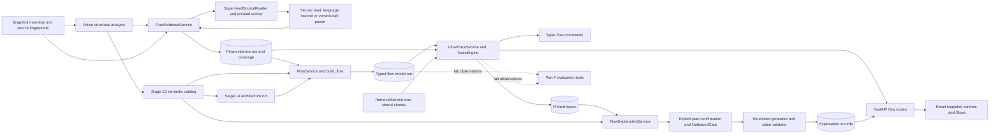
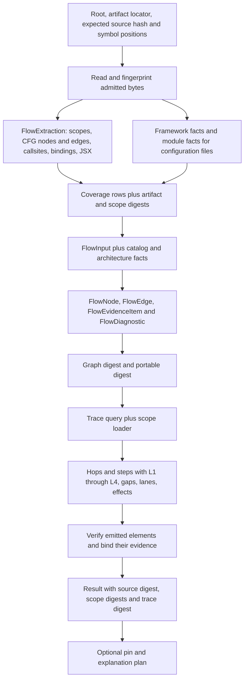
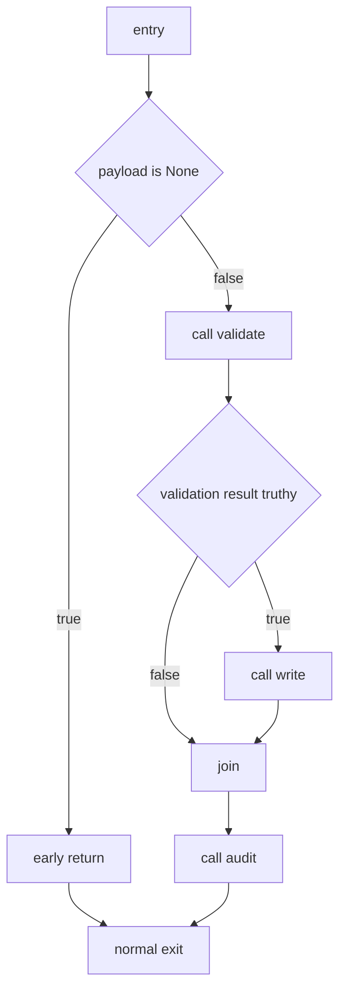
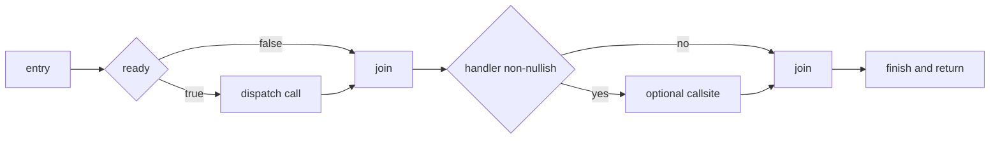
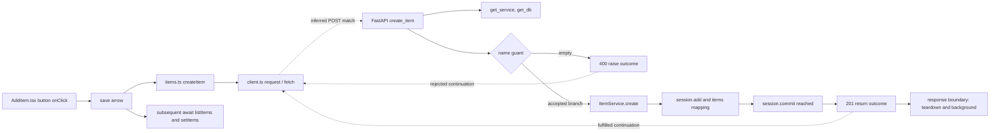
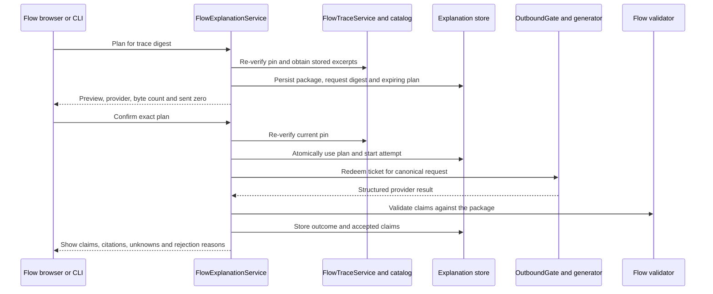
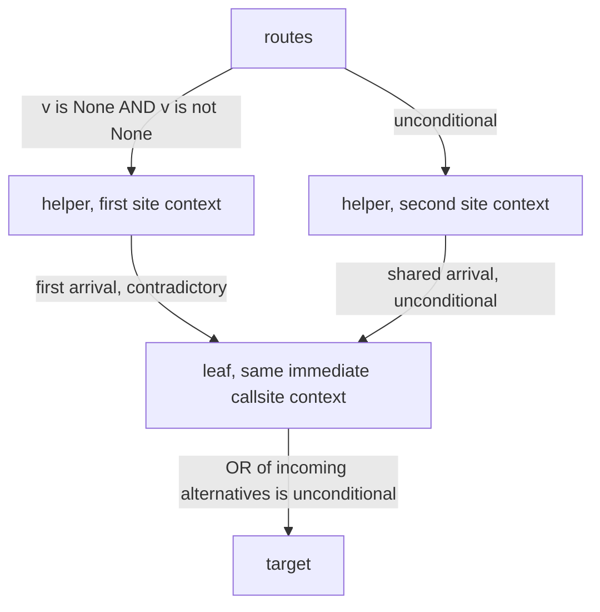

# BuildLens Stage 15 — Final implementation explainer

## 1. What Flow Tracing tells a developer

Imagine opening a repository for the first time and asking, “What happens after I click **Log in**?” A React button identifies a handler. That handler might validate input, call a wrapper around `fetch`, and navigate after the wrapper fulfills. A FastAPI route might inject a session and an authentication service, look up an account in PostgreSQL, and return a response or raise an HTTP exception. Following the imports will find some of those files. It will leave questions about which function a specific call refers to, which branch leads to that call, and what the next layer does. The login example in this section is illustrative. [Section 8](#8-six-source-backed-walkthroughs) follows an actual designed fixture and a separate recorded browser run.

Stage 13 makes symbols, modules, facts, relationships and stored source evidence navigable through a deterministic semantic catalog. Stage 14 adds architecture views such as module dependencies, route and client-request relationships, integrations and database model mappings. Stage 15 takes that inventory and asks about **a site in a body**, the bindings visible there, the ways control can reach it, and the chain of source-backed relationships a developer can follow from it. For example, Stage 14 can link a request pattern to a route and map a model to a table. Stage 15 can associate the request with a particular callsite in a handler, attach conditions to candidate steps, and distinguish a session `add` from reaching a `commit`.

| Concept | Login example | Question it answers |
|---|---|---|
| Structural relationship | `LoginForm.tsx` imports an API wrapper | How are files or declarations related? |
| Callsite and call target | The particular `signIn(values)` expression and the bound declaration of `signIn` | Which implementation does this occurrence refer to? |
| Control flow | A false validation check returns early. The next statement is available on the other branch. | Which point in the same body can execute next? |
| Data flow | A variable called `client` has one binding from an import on one branch and another binding from an assignment on another. | Which definitions and selected value shapes can reach a use? |
| Structural execution path | A walk through a handler, wrapper, request, endpoint and query operation | What sequence is represented in the static model? |
| Path feasibility | One route requires the same admissible local to be both `None` and non-`None` | Can the modeled constraints of this route hold together? |
| Runtime trace | One observed browser click, deployed endpoint, SQL transaction and response | What happened during this particular execution? |

**Static program analysis** reads and interprets program structure without executing the analyzed application. BuildLens checks source identity, parses syntax, lowers bodies into graphs, computes facts about control and bindings, and applies versioned resolution and framework rules. A callsite is a specific source occurrence with an enclosing scope and a location. Resolving it means deriving a target from bindings, imports, receiver evidence or another supported rule. A project-wide search for a function with the same name cannot establish that relationship. Deterministic resolution means the same inputs and rule give the same result. It still depends on the language and framework assumptions the rule encodes.

**Reachability, feasibility and execution are distinct.** A call can be reachable in the graph because the graph retains both sides of a branch. A particular route to it can be refuted by contradictory admissible guards. Another route can survive the fragment and still depend on configuration, scheduler behavior, request validation, network outcomes, session state or code outside the snapshot. A runtime trace requires an observation from an actual run. Source spans, rule IDs, evidence digests and explicit unknowns let the reader tell where each conclusion came from and how far they can use it.

A developer can start from a recognized event or endpoint, or paste a graph node key, and follow the static possibilities downstream. They can start at a service or another modeled node and look for potential upstream callers. They can inspect a branch, response alternative, async lane, table attribution, staging or commit point, and open stored source for a catalog-backed scope. They can also pin and re-verify a bounded result and, where generation is configured and explicitly authorized, request a grounded explanation of the pin. The actual capabilities and evaluation limits are detailed in [Section 12](#12-verification-evaluation-and-operational-limits).

### Source identity and reading guide

This account describes the working tree inspected on **19 November 2026 (India time)**. The branch is `stage15/flow-tracing`, with HEAD `febdf143f53ead040d6f980d5e9bc605fe73b867`, “Stage 15 Milestone E: explanations of pinned traces.” The comparison base is the Stage 14 merge `5c65617`. The Stage 15 commit sequence is `3cb2af8` (A), `674a195` (B), `6c260a2` (C), `61ed1c3` (D), and `febdf14` (E). A0 is a retained spike. Part F's tooling and fixes and the final F1 change are present beyond HEAD. There were no staged changes when this document was started.

- **Nine pre-existing tracked modifications.** `application/{architecture_views,flow_trace,flow_trace_service}.py`, `domain/flow_trace.py` and `infrastructure/persistence/flow.py` under `backend/src/buildlens/`, plus `backend/tests/integration/{test_architecture_views,test_flow_trace}.py` and `backend/tests/unit/{test_architecture_literals,test_flow_feasibility}.py`.
- **Twelve pre-existing untracked files.** `BuildLens-resume-audit.md`, `docs/FLOW_EVALUATION.md`, four lab scripts, one evaluation application module and five evaluation/resource tests listed in [Section 3](#3-file-by-file-source-map). Evaluation receipts are retained under ignored `.buildlens-eval/`.
- **Fingerprint of the inspected Stage 15 source surface.** SHA-256 `b52c5b4deeee164862d11e38f017e0d256c91ba4048c72de917bd06e4f84a174` over a sorted, compact JSON object mapping repository-relative paths to SHA-256 of their current bytes. The scope is the union of backend and frontend files changed against `5c65617` and untracked, non-ignored backend and frontend files, 69 files in all, including tests, scripts and migrations. This is an inspection fingerprint with a scope defined here. The product's graph, evidence and trace digests use their own canonical payloads.
- **Historical identity comparison.** Of the 304 named files in Part F's `implementation-identity.20261113.json`, 299 still match byte for byte. The five differing paths are `application/flow_trace.py`, `application/flow_trace_service.py`, `domain/flow_trace.py`, `test_flow_trace.py` and `test_flow_feasibility.py` in the locations above. These are the final F1 patch and its tests. BuildLens itself was an **analyzed corpus** exported at `febdf14` for Part F. That corpus revision, the analyzer's November 13 byte manifest and today's working-tree fingerprint identify three different things. [Historical manifest](../.buildlens-eval/runs/stage15-f-20261112/implementation-identity.20261113.json)

The source map and behavior below were cross-checked against the blueprint, state file, application architecture, Stage 13 and 14 documentation, the A0 spike, A–E milestone reports, Part F records, and the owner's retained technical-review summary and final F1 report in the BuildLens “Explain Flow Tracing” conversation. The standalone original technical review document and the full external Revision 3/3.1 planning notes were unavailable in the accessible materials. The report therefore attributes plan decisions through `FLOW_TRACING.md` and the A0 report, and review findings through the retained review summary, F1 report and matching code. `FLOW_TRACING.md` identifies **Revision 3.1** as the approved plan incorporating the A0 amendments. The repository's proportional-verification skill explicitly exempts read-only explanation from implementation test campaigns. The verification statements here describe retained evidence. [Blueprint](../PROJECT_BLUEPRINT.md), [Current state](../CURRENT_STATE.md), [Architecture](ARCHITECTURE.md), [Stage 13](SEMANTIC_MODEL.md), [Stage 14](ARCHITECTURE_INTELLIGENCE.md), [Milestones A–E](FLOW_TRACING.md), [Part F method](FLOW_EVALUATION.md), [A0 report](../.buildlens-eval/runs/stage15-a0-20261101/REPORT.md), [Verification skill](../Agents/Skills/verify/skills.md)

| Documented checkpoint | Actual working-tree behavior |
|---|---|
| `CURRENT_STATE.md` and `FLOW_TRACING.md` still treat F as pending and `ARCHITECTURE.md` has an in-progress Stage 15 heading. | A–E are committed. Part F tooling, engineering evaluation and fixes are retained locally. The owner records implementation completion with the qualifications in Sections 11–12. |
| A's schema and contracts describe `flow-evidence.v1` and v1 language passes. | B adds module facts and bumps evidence and both language passes to v2. Migration 0018 creates `flow_module_facts`. Bindings stay in scope summary JSON. |
| C documents `flow-trace.v1` and implies cache comparisons for all path reads. | Current full traces use `flow-trace.v2`. The path witness service verifies stored selected elements and evidence but omits the expected cached-digest comparison (F3). |
| The historical evaluation note describes BuildLens and Polar as interrupted. | Later receipts show BuildLens finished all 472 uncensored samples. Polar stopped at 30 of 472. The separate deadline diagnostic completed. |
| Revision 3 design as summarized in milestones | Current code duplicates cleanup CFG subgraphs by completion kind, stores graph evidence digests directly on graph elements, organizes model rules by language and orchestration, uses a dedicated explanation validator, and records query fan-out while enforcing candidate fan-out when constructing the graph. See Sections 4, 6, 9 and 10 for consequences. |

## 2. Architecture and authority

Stage 15 has three deterministic transformations and an optional explanation stage. First the evidence run certifies what the supported extractors could read and lower. Then the model run interprets that evidence and upstream identities into typed edges. A trace selects and annotates part of one run. Explanation consumes a pinned trace under a separate outbound authorization and storage contract. This separation lets the same source facts feed new versions of resolution and trace rules and lets the product point to the layer where uncertainty or staleness originates.



### What actually travels through the layers

1. **Source authority.** Snapshot records identify the artifact and its bytes. Stage 13 structural analysis identifies which parse is authoritative and supplies declaration IDs and positions. The Stage 15 pass reads admitted files through a supervised reader or reuses a verified artifact extraction. A scope record identifies its owner where possible, and carries its CFG, summaries and referenced callsites. Coverage is a first-class output, including missing and partial files.
2. **Resolution authority.** A fresh model binds exactly one evidence run, catalog run and architecture run over one structural analysis. `SqlAlchemyFlowStore.load_input` projects scopes, imports/exports, symbols, selected literals, version and module facts and the needed Stage 14 elements from PostgreSQL. `build_flow` interprets these using `PythonFlow` and `TypeScriptFlow`, then stitches request and response relationships. No analyzer-side source re-read occurs in this stage. The published run is the authority for targets, tiers, edge rules and model diagnostics.
3. **Trace authority.** `FlowTraceService` selects a run, indexes its graph and gives `TraceEngine` a loader for persisted scope evidence. A trace produces contextual hops, anchored steps, path conditions, lanes, alternatives, data effects and gaps. A post-walk database check authenticates the elements it returns against their stored digests and source rows. The frontend renders those results and fetches stored catalog source where it has an identity. The separate structural-witness endpoint has the narrower verification behavior described in F3.
4. **Candidate discovery.** The existing retrieval subsystem proposes relevant source chunks. Their stable symbol identities map to scopes in the selected graph, and a bounded reverse walk finds candidate entry points. The user's explicit selection starts a trace. A text match supplies a reason for offering an entry.
5. **Explanation and evaluation.** The planner packages selected verified trace facts and source excerpts. The provider can return prose claims, which undergo lexical and evidence checks and are written to explanation tables. Explanations have no path back into extraction or resolution. The Part F tools use frozen corpora, source labels, real analyzer observations and score/latency receipts to measure the deterministic product externally.



## 3. File-by-file source map

Paths below are exact repository-relative paths. **New** and **modified** compare against `5c65617`. **Local modification** also differs from HEAD, and **untracked** refers to the existing implementation files outside HEAD. The algorithm sections show the internal execution behavior of these modules.

### Contracts, admission, extraction and evidence persistence

| Path and status | Responsibility, callers and behavior |
|---|---|
| `backend/src/buildlens/domain/flow_evidence.py` — new | Evidence contracts, language and resource limits, safe literal and display representations, `FlowScope`, `FlowCallsite`, `FlowJsxBinding`, `FlowExtraction`, `ArtifactFlowCoverage`, `FrameworkFact`, `ModuleFact` and `FlowEvidenceRun`. Workers and stores share their shapes and digest functions. Separating this contract from parsing lets a store verify rows without importing a language parser. |
| `backend/src/buildlens/domain/flow_cfg.py` — new | `CfgBuilder` handles directed edges and completion frames. `Graph.of` and the analysis functions compute graph reachability, post-dominance, dependence, local guards, exceptional sources and reaching definitions. Both lowerers and both model/trace layers share the representation. This module owns algorithms over CFGs without knowing filesystems or frameworks. |
| `backend/src/buildlens/application/flow_evidence.py` — new | `FlowEvidenceService.extract` validates snapshot and active structure, takes a local lock, binds authority and delegates `_collect`, `_reuse` and `_versions`. Input records carry artifact and snapshot fingerprints, owner positions and run identity. `rebind` maps valid reused scopes to current symbol IDs. The service returns publication status and diagnostics via explicit store and reader ports. |
| `backend/src/buildlens/infrastructure/structural/supervisor.py` — modified | Extends the Stage 13 supervised worker with `flow` and `flow_versions`. `_flow` hashes bytes and invokes the language lowerer, including the TS grammar canary. `_versions` parses configuration as data. The parent `SupervisedSourceReader` applies operation timeouts and tears down failed workers. |
| `backend/src/buildlens/infrastructure/structural/python_flow.py` — new | `extract_python_flow` plans named and synthetic scopes from Python AST and lowers each through `_lower` and `_Lowerer`. It associates declaration positions with structural owners, captures parameter and argument shapes, emits branch and completion structure, and deduplicates evaluations of a copied callsite against one source occurrence. Parse errors, truncation and unsupported features become evidence or diagnostics. |
| `backend/src/buildlens/infrastructure/structural/typescript_flow.py` — new | `extract_ts_flow` selects TS, TSX or JS grammar through the existing structural adapter. `_Context` plans scopes and resolves exact owner regions. `_Lowerer` is responsible for block-level bindings, call/new/optional shape, JSX bindings, control flow and cleanup. Recovery and truncation are represented explicitly. It returns the same `FlowExtraction` contract as Python. |
| `backend/src/buildlens/infrastructure/structural/framework_versions.py` — new | `is_version_file`, `is_tsconfig`, `parse_version_file` and `parse_module_file` interpret data files into a fixed fact vocabulary for framework version choices, TS aliases and workspace package resolution. Malformed or unsupported inputs yield limited facts or diagnostic errors. This I/O boundary keeps lockfile parsing out of graph construction. |
| `backend/src/buildlens/infrastructure/persistence/flow_evidence.py` — new | `SqlAlchemyFlowEvidenceStore` loads current structure, owner IDs and input rows, verifies reusable evidence on hydration, persists coverage/scopes/callsites/JSX/display/configuration, and publishes under snapshot-row authority. `publish` / `save_failure` preserve separate latest-attempt and active-good-run semantics. This adapter owns SQL transaction and row projection details. |
| `backend/alembic/versions/0017_flow_evidence.py` — new | Defines base evidence tables and the snapshot evidence pointer, including composite same-run provenance constraints. Downgrade checks data presence. [Storage names and behavior](#9-persistence-freshness-integrity-and-security). |

### Graph construction and persistence

| Path and status | Responsibility, callers and behavior |
|---|---|
| `backend/src/buildlens/domain/flow.py` — new | Defines `FlowRun`, `FlowBuild`, `FlowNode`, `FlowEdge`, `FlowEvidenceItem`, `FlowDiagnostic`, relation families and tiers. Owns model contract, stable hashing of semantic fields and portable projection. Used by builders, persistence, tracing and HTTP projections. |
| `backend/src/buildlens/application/flow.py` — new | `FlowService` aligns active authority, builds with `build_flow`, invokes store publication and distinguishes missing/stale/failed/conflicting runs. `node` and `edges` request verification over returned elements. Keeps lifecycle and errors separate from individual resolution rules. |
| `backend/src/buildlens/application/flow_inputs.py` — new | `FlowInput` and typed records form the SQL-free builder input. Key helpers namespace scopes, callsites and JSX. `ScopeView.of` turns persisted CFG/bindings into local reaching definitions. `Emitter` creates evidence items and typed graph elements, deduplicates repeated stable edges, merges evidence and assigns deterministic entry keys. Shared by both resolvers and the stitcher. |
| `backend/src/buildlens/application/flow_builder.py` — new | `build_flow` is the composition root of the pure model. `Facts` indexes model/table mappings and selects version alternatives. `_stitch` joins Stage 14 request sites to exact callsites. `_respond` maps endpoint outcomes back to client continuations. Produces deterministic graph, coverage and diagnostics with size caps and placeholder targets. |
| `backend/src/buildlens/application/flow_python.py` — new | `PythonFlow` interprets reaching bindings/imports/receivers, runs construction and invocation rules, then FastAPI and SQLAlchemy rules. `Target` preserves qualification and caveats across lookup and dereference. `handlers`, `injects`, `responses` and `boundary` produce framework model edges. Unknowns and candidates survive publication. [Resolution](#5-call-resolution-and-selective-data-flow), [Framework behavior](#7-framework-semantics-the-graph-actually-encodes). |
| `backend/src/buildlens/application/flow_typescript.py` — new | `TypeScriptFlow` interprets lexical bindings, imports/exports, component prop candidates, known client/callback shapes and HTTP descriptors. `_Modules` implements bounded alias/workspace matching, `TsTarget` carries tier and conditions, and `jsx`, `external`, `schedule`, `mutation` and `descriptor` emit specialized edges. Ambiguity yields labeled candidates or a gap. |
| `backend/src/buildlens/infrastructure/persistence/flow.py` — new, locally modified | `SqlAlchemyFlowStore.load_input` materializes relational evidence for the pure builder. `publish` checks authority and writes graph and diagnostic rows. `verify`, `_verify_evidence` and `integrity` check content and source row hashes. `graph`, `scopes` and `fingerprints` feed trace computations. `pin` and `pinned` manage by-run records. Part F batches evidence-item reads. |
| `backend/src/buildlens/infrastructure/persistence/models.py` — modified | Registers SQLAlchemy mapped records for run, graph, evidence, pin and explanation tables, adds snapshot pointers and same-snapshot/run constraints, and exposes the schema to migration parity checks. |
| `backend/alembic/versions/0018_flow_model.py` — new | Adds module facts, active flow model pointer, graph rows, diagnostics and pin storage. Composite constraints enforce run ownership where defined. Uniqueness protects stable edge keys within a run. Evidence-array validation belongs to the store. |
| `backend/src/buildlens/application/architecture_views.py` — locally modified | Stage 14 `ViewsProjection` remains the supplier of table views. The Part F change in its database projection emits one `references_table` edge per model and referenced table even if multiple columns carry the same `ForeignKey`. This repaired the upstream publication Polar needs. |

### Trace, transport, browser and explanations

| Path and status | Responsibility, callers and behavior |
|---|---|
| `backend/src/buildlens/domain/flow_trace.py` — new, locally modified | `TraceQuery`, bounds, contracts and digest. `Atom`, `decide`, `decide_dnf` and serialization supply the limited feasibility domain. This layer knows no database or HTTP. The working tree bumps the trace contract to v2 and leaves the feasibility contract at v1. |
| `backend/src/buildlens/application/flow_trace.py` — new, locally modified | `TraceGraph.of` builds adjacency and indexes. `TraceEngine.facts` loads per-scope CFG evidence and computes derived facts lazily. `_Walk` executes bounded traversal and accumulates steps, lanes, guards and effects. `settle` and `_disjoin` correct shared-route guards, and `exit_anchor` carries local raise guards. Separate `path` emits an L3 witness. |
| `backend/src/buildlens/application/flow_trace_service.py` — new, locally modified | `TraceGraphCache` holds two run/digest graphs. `FlowTraceService` selects authority, invokes the engine, verifies results, binds digests, persists/re-verifies pins and maps search hits into entry candidates. F1 adds early staleness for an older trace contract. |
| `backend/src/buildlens/domain/flow_explanation.py` — new | Defines plan, run and claim records, package limits and explanation versions. Makes accepted prose a separate domain value from graph evidence. |
| `backend/src/buildlens/application/flow_package.py` — new | `package_of`, `package_digest` and `package_data` select bounded trace facts and serialize them with source excerpts, generated IDs, instructions and schema. `excerpt_text` selects and bounds the quoted line window from an already verified stored chunk. Used only by the explanation service. |
| `backend/src/buildlens/application/flow_explanation.py` — new | `FlowExplanationService.plan` checks the pin, constructs excerpts and canonical provider request, and persists authorization material. `execute` validates confirmation and freshness, admits one attempt via the store, calls `OutboundGate` and validates response claims. `FlowCanonicalOutbound` binds the flow-specific package to the exact provider request. |
| `backend/src/buildlens/application/flow_validation.py` — new | `validate` and helpers parse provider JSON, reject malformed or unsupported claims and validate quoted excerpts, associations and wording levels. Returns kept claims and outcome/reason codes. The flow-specific boundary keeps this logic independent of graph construction and provider adapters. |
| `backend/src/buildlens/infrastructure/persistence/flow_explanation.py` — new | `SqlAlchemyFlowExplanationStore` holds the plan/package, one-time admission state and lease, attempt, outcome and approved claims. It owns transaction boundaries and resolves scoped history. A failed attempt leaves a classified record. |
| `backend/alembic/versions/0019_flow_explanations.py` — new | Creates explanatory plan, item, run, attempt, outcome and claim tables and pin/run relationships. Supported migration head for the inspected source. |
| `backend/src/buildlens/infrastructure/runtime.py` — modified | Wires PostgreSQL adapters, reader factory, shared locks, cache, catalog, architecture, retrieval and existing structured generator behind `flow_evidence_service`, `flow_service`, `flow_trace_service` and `flow_explanation_service`. API and CLI use the same application behavior. |
| `backend/src/buildlens/api/dependencies.py` — modified | Exposes the runtime service factories as FastAPI dependencies. Keeps endpoint functions thin and shareable with local wiring. |
| `backend/src/buildlens/api/main.py` — modified | Installs the router and runtime locks/cache and extends JSON content-type checks to mutating flow endpoints. |
| `backend/src/buildlens/api/errors.py` — modified | Binds flow domain errors to stable safe HTTP responses, including custom plan invalidation reasons, stale/required states, integrity and size failures. |
| `backend/src/buildlens/api/flow_routes.py` — new | Pydantic projections and bounds plus explicit snapshot-scoped endpoints for evidence, graph, trace/witness/pin and explanation. Uses dependencies and service calls, checks body/query inputs, returns result/status and failure envelopes. [Surface table](#8-six-source-backed-walkthroughs). |
| `backend/src/buildlens/cli/main.py` — modified | Registers the `flow` Typer command group. |
| `backend/src/buildlens/cli/flow.py` — new | Groups `evidence` and `explain` and provides graph and trace commands. Runtime context and JSON emitter call the same services as HTTP. Commands take project/snapshot and optionally run, node or trace identity, with explicit confirmation for generation. |
| `frontend/src/App.tsx` — modified | Adds client routing and navigation to `/flows`. |
| `frontend/src/components/ProjectSnapshotPanel.tsx` — modified | Mounts the flow controls in the selected snapshot view beside the prerequisite stages. |
| `frontend/src/api/flow.ts` — new | Snapshot-keyed HTTP functions and TypeScript types for flow evidence, model status, entries, traces, pin and explanations. Calls the shared HTTP client and forwards cancellation signals. The interface carries L1–L4, gaps and evidence through to the browser. |
| `frontend/src/components/flows/FlowPanel.tsx` — new | Reads evidence and model status, drives explicit extract/build actions and links to exploration when current. Scope keys and request hooks avoid stale responses from prior snapshots. |
| `frontend/src/components/flows/FlowsPage.tsx` — new | `EntryPanel` lists kinds and retrieves candidates. `TraceArea` manages direction, bounds, filters and tabs. `PinControl` pins and re-verifies. `PinnedExplanation` checks for a current pin. URL parameters bind the view state to the selected project, snapshot and entry. |
| `frontend/src/components/flows/TraceViews.tsx` — new | `TraceOutline` renders ordered steps and the display-only refuted filter. `LaneDiagram` uses existing layered layout. `ResponsePanel` and `BranchPanel` expose response continuations, database effects, guards and ambiguity. No evaluation takes place here. |
| `frontend/src/components/flows/StepInspector.tsx` — new | Shows L1–L4, attributes and evidence count for a selected step. Uses the **from** hop's catalog identity to ask the semantic API for stored source and highlight a callsite line where available. Framework or synthetic scopes may lack source. |
| `frontend/src/components/flows/ExplanationPanel.tsx` — new | Loads generation configuration/history, presents a planned request preview, requires confirmation, and displays accepted claims, step links, unknowns and rejected-claim count. |
| `frontend/src/components/flows/format.ts` — new | Translates relation and verdict values, formats guard atoms, surfaces safe error text and escapes unsafe display characters through the existing visibility helper. |
| `frontend/src/styles.css` — modified | Flow layout, lane view, step inspector, responsive trace and explanation presentation. |

### Evaluation tools and verification source

| Path and status | Responsibility and evidence boundaries |
|---|---|
| `backend/src/buildlens/application/flow_evaluation.py` — untracked | `bound` / `verified`, pre-registration, label validation, ordered LCS, score and `latency_summary`. Inputs bind to frozen packet and labels by digest and require complete honest attribution. Produces metrics, denominators, gate status, uncertainties and diagnostics. It is a lab consumer of flow output. |
| `backend/scripts/flow_evaluate.py` — untracked | `prepare` inventories frozen corpora, independently indexes Python calls using AST, invokes TS indexing and optional Jedi proposals, builds source-only sample packets and validates or scores them. `save` refuses overwrites. |
| `backend/scripts/flow_source_index.mjs` — untracked | Uses a pinned TypeScript compiler API in no-emit mode with a confined filesystem host. Enumerates declaration/call locations and separate type-checker target proposals. The live model uses tree-sitter. |
| `backend/scripts/flow_evaluation_run.py` — untracked | Builds isolated scratch databases with the real stack, observes call identities and path projections, runs interleaved cold/warm workloads and resumes from journaled attempts only when bindings match. Also implements the separately recorded client-deadline diagnostic. |
| `backend/scripts/flow_z3_experiment.py` — untracked | Creates a seeded narrow integer-equality comparison and opaque-guard controls against Z3. Z3 is a lab dependency. |
| `backend/tests/flow_support.py` — new | `FlowStack` and designed source dictionaries build a controlled snapshot → catalog → architecture → graph pipeline using real PostgreSQL and workers. The item-creation fixture is used in Section 8. |
| `backend/tests/integration/test_flow_evidence.py` — new | Verifies coverage, source drift, reuse/rebinding, same-authority invariants, route contracts and guarded downgrade. |
| `backend/tests/integration/test_flow_model.py` — new | Designed resolution, effect and framework oracles, DB graph tamper/freshness and non-interference checks. Its `Graph` helper selects modeled nodes by test identities. |
| `backend/tests/integration/test_flow_trace.py` — new, locally modified | Whole designed cross-layer and branch traces, backward absence, structural witness, pins, no disk-read behavior, HTTP and stale handling. F1 adds shared-route and old-contract tests. |
| `backend/tests/integration/test_flow_explanation.py` — new | Real outbound admission with loopback stub, exact plan and call count, adversarial responses, no non-explanation table writes, HTTP and migration behavior. |
| `backend/tests/unit/test_flow_cfg.py` — new | Designed lowering, cleanup, branch, syntax-recovery and safety/cap cases for Python and TS. |
| `backend/tests/unit/test_flow_model_rules.py` — new | Focused model rules with controlled input and emitters. |
| `backend/tests/unit/test_flow_versions.py` — new | Lockfile/manifests, version facts and module fact handling. |
| `backend/tests/unit/test_flow_feasibility.py` — new, locally modified | Constraint operations and conservative behavior, augmented with F1 merge and term-cap checks. |
| `backend/tests/unit/test_flow_validation.py` — new | Claim format, evidence and adversarial language cases for the flow validator. |
| `backend/tests/unit/test_flow_evaluation.py` — untracked | Frozen membership and mechanical scoring/statistics checks. |
| `backend/tests/unit/test_flow_evaluation_sources.py` — untracked | Source-index shape, span and observation identity regressions. |
| `backend/tests/unit/test_flow_integrity_batches.py` — untracked | Regression for the Part F bound-parameter fix, including verifying the full evidence set across batches. |
| `backend/tests/unit/test_flow_performance_resume.py` — untracked | Journal binding, resume and elapsed deadline accounting for the lab. |
| `backend/tests/unit/test_flow_resources.py` — untracked | Adversarial extraction size, nesting and bounded trace/guard workloads. |
| `backend/tests/integration/test_architecture_views.py` — locally modified | Repeated foreign keys to one table should publish one stable relationship per model/table. |
| `backend/tests/unit/test_architecture_literals.py` — locally modified | Narrows the type of the fixture's `callee_scope` literal attribute for mypy while preserving the TS scope expectation. |
| `backend/tests/integration/test_persistent_embeddings.py` — modified | Existing migration assertion now expects `0019_flow_explanations`. |
| `frontend/src/components/flows/Flows.test.tsx` — new | Mocked HTTP/UI cases for verdicts, selection, scope changes, cancellation, pins and the plan/confirmation UI. The Part F browser receipt supplies a distinct real-stack observation. |

### Important unchanged dependencies

- **Snapshot, structural and parser authority.** `backend/src/buildlens/application/snapshots.py` and `backend/src/buildlens/application/structural.py` establish inventory and active structure. `backend/src/buildlens/infrastructure/persistence/structural.py` stores the authoritative artifact analyses and stable symbol identities. `backend/src/buildlens/infrastructure/structural/reader.py` provides the POSIX secure file reader used by the supervisor. `backend/src/buildlens/infrastructure/structural/typescript.py` provides the parser/grammar selection, positions and canary used by the flow pass.
- **Semantic and architecture inputs.** `backend/src/buildlens/application/semantic_catalog.py` and `backend/src/buildlens/infrastructure/persistence/semantic.py` publish the Stage 13 catalog and expose verified entity and chunk evidence. `backend/src/buildlens/application/architecture.py`, `architecture_api.py` and `architecture_builder.py` and `backend/src/buildlens/infrastructure/persistence/architecture.py` supply and validate the upstream Stage 14 model. The flow import resolver reuses `ImportResolver` from `semantic_catalog.py`.
- **Discovery and explanations.** `backend/src/buildlens/application/retrieval.py` and `backend/src/buildlens/infrastructure/persistence/retrieval.py` supply the search hits used by entry discovery. `backend/src/buildlens/application/outbound_gate.py` checks a bound single-use outbound ticket. Existing adapters in `backend/src/buildlens/infrastructure/generation/semantic_{common,local,openai,gemini}.py` supply canonical structured request rendering and provider calls. `backend/src/buildlens/domain/source.py` provides screening and canonical content hashing.
- **Read-only browser primitives.** `frontend/src/components/architecture/useRequest.ts` supplies stale-safe request hooks. `frontend/src/components/architecture/layout.ts` supplies `layered`. `frontend/src/api/semantic.ts` and `frontend/src/components/explore/{SourceView.tsx,visible.ts}` supply the stored source panel and safe display. Those components carry no flow-specific resolution logic.

## 4. From syntax to control-flow evidence

### Admission and parsing

The source pass relies on two stored agreements and one live check on a fresh read. `FlowEvidenceService._collect` requires an eligible snapshot and a parsed artifact analysis with a fingerprint. Its snapshot digest must equal that analysis's input fingerprint. Then the secure worker reads the file and computes a fresh SHA-256. The parent keeps the extracted evidence only if the returned hash agrees. A reusable extraction takes the verified stored path described in Section 9. Module-resolution and version files are admitted separately as snapshot-bound data.

Python's `extract_python_flow` uses `decode_source` with Python encoding handling, screens the decoded content, calls `ast.parse`, annotates parent links, and plans scopes before lowering their bodies. A syntax tree has nodes such as `If`, `Call` and `Try`. The planner gives each module, function/method, class body, lambda, comprehension and generator expression a scope key and an enclosing relationship. It matches declaration owners by supplied structural coordinates and name. Some scopes are synthetic and need no named symbol. Definition-time work and body-time work are separate. Lowering a function definition can visit expressions used at definition time, while a function body's calls belong to its own CFG. Immediate comprehensions and class bodies can be represented as executed nested scopes.

TypeScript and JavaScript use tree-sitter with the existing grammar for the artifact. `extract_ts_flow` parses screened UTF-8 bytes, and `_Context` uses byte positions and decoded offsets to associate declaration regions. It plans modules, declarations, methods, arrows, function expressions and class/static initialization scopes. Top-level statements containing tree-sitter error regions can be skipped with `SYNTAX_RECOVERED` while other statements contribute evidence. The production pass identifies syntax directly. The TypeScript compiler/type checker appears in the separate evaluator.

Both lowerers record these facts:

- **Scope** carries a key, parent, owner symbol if matched, kind, callable kind, span, CFG and summary. Parameters, return and raise shapes, suspension points, selected nested-scope execution, parameter invocations, dynamic features and truncation help the model reason beyond raw syntax.
- **Callsite** carries an ordinal, evaluating CFG node, `copies` for duplicate cleanup lowering, exact span, structured callee and argument shapes, awaited state, and decoded offsets for TS/JS where available. A nested argument call is recorded where it is evaluated, so an outer `save(buildPayload())` and inner `buildPayload()` are distinguishable.
- **Binding** carries a name, CFG node, kind, definition ordinal and value shape. Assignments, parameters, imports, loop targets, destructuring, selected attribute stores, handler captures and context-manager aliases contribute facts. These are JSON in the scope summary. TSX additionally records JSX tag, whether it is intrinsic, attribute, handler/value shape, location and CFG anchor.
- **Analysis shape** preserves exact names and structured objects such as member paths, calls, bounded object/array arguments and literals. General strings carry type, digest and length. Small integers, booleans and `None` retain a value representation. Selected path-shaped strings and configuration facts can carry screened structured values for matching. Display text is separately bounded to 256 UTF-8 bytes, screened, and flagged for bidi/control characters. Withholding display text leaves the underlying binding and branch facts available.

### Worker isolation and limits

The POSIX reader opens relative to a verified root using file descriptors, rejects excluded or unsafe locators, refuses symlink traversal and unsuitable file types, checks device/identity and size, and checks for changes during consumption. The supervised worker keeps parsing and data-file handling out of the API process. It is spawned as a separate process, uses a narrow protocol, reports byte progress, and can be terminated or replaced on timeout and abnormal results. The structural supervisor checks peak RSS after a flow extraction operation and rejects an over-limit result. The runtime supplies its default threshold. There are independent limits for input bytes and graph construction. The parsers receive data and do not import target repository modules.

`FlowEvidenceService` defaults to 1 MiB per source artifact, 256 MiB total, three seconds per artifact and 300 seconds overall. The runtime passes configured structural per-artifact limits. The configuration pass can read selected version files up to 8 MiB, which matters for BuildLens's `uv.lock`. Evidence uses a fixed package allowlist and supported declarative TOML, JSON, YAML or requirements text. `package.json` and `tsconfig` facts serve module resolution. Coverage distinguishes missing structure, unsupported language, changed bytes, failed parsing and partial output. Scope caps include 1,024 calls, 2,048 CFG nodes, 2,048 bindings and 1,024 JSX records. Artifact caps include 8,192 calls and 4,096 scopes. Shape depth and item count are also bounded. A scope or artifact may yield partial output. Exceeding 500,000 accumulated callsites fails the run.

### Control-flow graph construction

A **basic block** conventionally groups straight-line operations with one entry and no internal transfers. BuildLens implements a **statement and evaluation-point CFG**. A node can be a whole statement, a call, a branch, an operand, a join, a suspension/resumption point or an artificial entry/exit. This granularity makes a call inside an expression independently inspectable. An edge is a directed possible transfer annotated with kind and, where relevant, a label. Some operations can raise and therefore have an exceptional successor in addition to the normal successor.

`CfgBuilder.node` assigns dense local integer IDs. `follow` adds a normal edge from a previous point when one exists. Language lowerers split and join the current frontier with `cond` / `attach`, expression lowering, and statement routines. Where supported, `and` / `or` and `&&` / `||` / `??` create a branch before the right-hand expression. A loop adds a back edge, an exit and break/continue targets. Python loop `else` is attached to exhaustion or a false condition with a separate break destination. TS adds switch fall-through, labeled jumps, conditional expressions and optional access or calls. Return sends control to the function's completion path. Subsequent source can be lowered as disconnected nodes, distinguishing a recorded occurrence from a reachable one.

**Illustrative Python.** The diagram elides expression evaluation and most exceptional exits.

```python
def save_if_present(payload):
    if payload is None:
        return
    validate(payload) and write(payload)
    audit()
```



The `write` call depends on the false outcome of the null check and the true outcome of the short circuit. `audit` depends on surviving the early return and can be reached from either normal short-circuit alternative. The predicate for `validate(payload)` is opaque. There is a separate exceptional model for calls which raise.

**Illustrative TypeScript.** The nullish and truthiness forks govern whether a callsite is evaluated. Resolution still requires evidence for the target.

```typescript
function afterClick(handler?: () => void, ready = false) {
  ready && dispatch()
  handler?.()
  return finish()
}
```



An extracted `handler?.()` site can have a structural guard and an unknown callback target simultaneously. These answers occupy different verdict fields.

### Abrupt completion and exceptions

`CfgBuilder` maintains frames for loops, switch breaks, handler dispatch and cleanup. `jump` sends `return`, `raise`, `break` or `continue` outward from the innermost frame. A matching loop/switch captures a jump. A handler frame captures the exceptional branch into a dispatch node. A cleanup frame inserts a `finally_entry` and a body copy keyed by completion kind and jump label. The copy is lowered with only outer frames active, so a new return or raise in the cleanup can override the pending completion. If the cleanup completes normally, the original completion resumes outward. `normal_completion_through_finally` builds the corresponding normal copy. Language lowerers reuse one source callsite ID with multiple evaluating CFG node IDs.

For example, in `try: return work()` followed by `finally: close()`, a normal result from `work` enters the return copy of `close` and can leave through the return exit. An exception enters the raise copy and can leave through the exceptional exit. Distinct CFG copies keep those completions from accidentally crossing at a shared cleanup join. At trace time `_representative` prefers a copy reachable on an unblocked normal path when one exists. This is an anchoring choice for a single recorded occurrence.

Python `_Lowerer.try_` adds possible handler choices, catch-all logic and an unmatched exception that propagates, and lowers `else` from normal completion of the try body. It treats `except*` approximately. Python `with_` models entry/exit and possible suppression or propagation for exceptional completion. TS `try_` uses a catch-all catch edge and the same cleanup mechanism. Calls, operations such as `await`, and explicit raises introduce modeled exceptional reachability. Arbitrary dynamic exception types and filtering through every intervening callee are beyond these rules.

### From post-dominance to guards

A node `d` **dominates** `n` if every entry-to-`n` path passes through `d`. A node `p` **post-dominates** `n` if every path from `n` to the modeled exit passes through `p`. The first relation describes necessary prior control. The second describes what must follow at a join. The implemented guard pass needs the immediate post-dominator tree.

1. `Graph.successors(normal_only=True)` excludes exceptional edge kinds. `postdominators` builds reverse adjacency, attaches normal sinks to a conceptual virtual exit, and computes reverse postorder by iterative DFS on this reversed graph. Nodes unable to reach a sink can have no immediate post-dominator.
2. It solves the Cooper–Harvey–Kennedy equations on that order. Initialize sinks' parent to the virtual exit, repeatedly intersect the already-known parent chains of a node's successors, and stop when parent assignments stabilize. The immediate parent gives the nearest guaranteed reconvergence in this model.
3. `control_dependence` uses the Ferrante–Ottenstein–Warren rule. For an edge from branch `a` to successor `b`, walk from `b` up its immediate post-dominator chain until the immediate post-dominator of `a`. Record the original branch edge against the intervening nodes. With a simple `if` whose arms rejoin, the branch controls each arm's work and the reconverged tail is outside both arms' direct dependence.
4. `guards` follows dependencies transitively to explain nested guards, taking distinct direct-dependence chains as alternatives. It avoids following branch dependence cycles indefinitely and caps the disjunction at 16 terms. `TraceEngine.local_guards` converts each dependence to a normalized atom at the callsite's CFG node.
5. `exceptional_sources` walks reverse CFG adjacency to collect sources of exceptional edges that can lead to a point. The trace reports this separately from normal guards. A catch block can have a `reachable_if_raises` explanation even when it has no ordinary branch condition in the normal graph.

The benefit of deriving dependence from the CFG is visible in the example's early return. A text scan might see `audit()` at outer indentation and report it as unconditional. The CFG knows that the early return prevents reaching it. A guard derived from a hypothetical CFG can still depend on opaque behavior or repeated loop evaluation.

## 5. Call resolution and selective data flow

### Reaching definitions

Consider this illustrative local choice.

```python
def run(mode):
    fn = read_from_cache
    if mode:
        fn = query_database
    return fn()
```

A textual last-assignment search always finds `query_database`. The CFG has two incoming definitions at `fn()`. `flow_cfg.reaching_definitions` computes a forward, intraprocedural **may** analysis over ordinary and exceptional edges.

1. `IN[n, name]` is the union of `OUT[p, name]` for predecessors `p`.
2. If `n` defines the name, `OUT[n, name]` contains just the last definition of that name at `n`. Otherwise `OUT[n, name] = IN[n, name]`. An assignment kills the old definition along that predecessor. At a join the possibilities accumulate.
3. Start with empty sets and iterate until no entry or exit set changes. Use the **entry** state for expressions at a node so a definition at that node does not become its own input.

The finite domain consists of extracted binding ordinals. Fixed-point iteration accounts for loop-carried definitions. `ScopeView.of` builds the name index and runs the algorithm. `reaching_at` maps ordinals back to binding records. The resolver interprets those records into target shapes. This data flow follows selected values and declarations. Arbitrary mutable heap state is outside its representation.

### Python name, import, method and callback resolution

`PythonFlow` builds scope views, class and method indexes and symbol-owner identity maps. Each `callsite` records the observed occurrence, runs `callee_targets`, emits graph relations and then applies recognized framework rules.

- **Name binding.** `lookup` consults the current scope's reaching definitions. A name with a local binding somewhere and none reaching this use may be `UNBOUND_LOCAL`. Lookup honors recorded `global` routing, walks enclosing scopes while skipping class bodies for nested functions, and eventually recognizes builtin names or emits an unresolved reason. Multiple bindings can produce inferred target alternatives. Captured or multiply rebound closure names lose confidence. `interpret` dispatches on declaration, import, parameter, assignment, annotation, context result and other binding kinds.
- **Imports.** `import_target` calls Stage 13's `ImportResolver.python` with artifact, relative level and module/name facts. `module_member` resolves exact module bindings and known package submodules. `import a.b` without an alias binds `a` and member lookup follows the module path. Following imported bindings can resolve explicit re-exports. The milestone describes a two-re-export-hop bound. The live flow resolvers use depth checks on recursive lookup/dereference functions. There is no independent two-hop counter on each re-export path. Missing modules, wildcard imports and conditional reaching imports are surfaced explicitly.
- **Receiver evidence.** `value_targets` and `call_result` turn supported literal construction into class or instance targets. `param_target` and `type_of` can derive an instance candidate from a resolvable annotation, including selected `Optional` and `Annotated` shapes. `depends_provider` and `provider_type` infer selected FastAPI receiver types from a provider's annotation or return shape. `field_type` looks at captured `self.attr` assignments, with `__init__` preferred. These inferences rely on assumptions about values at use sites.
- **Methods and inheritance.** `mro` applies C3 to resolved repository bases. Merge ordered base lists by choosing a head that occurs in no remaining tail, respecting both local base precedence and inherited order. `method` chooses the first known method along that order. External or unresolved bases can weaken a result with `MRO_INCOMPLETE`. `_super` and `_member` implement supported lookup shapes. `dispatch` can retain overriding subclass candidates. `protocol_candidates` uses repository classes with all required public method names as a heuristic, without checking complete signatures. There is a candidate cap.
- **Result and callback semantics.** `emit_target` decides what evaluation of a target can mean. It can emit a resolution fact alongside invocation, creation of a coroutine or another typed relation. A non-transparent decorator can yield `DECORATOR_MAY_WRAP`. `callbacks` follows one level of callback passing where the callee summary identifies an invoked parameter and the bound argument resolves. Constructors and context managers have specialized rules. For a known `__new__` returning a different type the analyzed class's `__init__` is skipped. A metaclass `__call__` override introduces uncertainty.

An import to an external package may establish a package boundary and support a known contract such as `sqlalchemy.orm.Session.commit`. A computed `getattr` chain, `callbacks[key]()`, arbitrary callable parameter or unresolved receiver is insufficient evidence for a specific local target. A project-defined `Depends` or `Session` resolves in its own binding context. The package and receiver checks prevent these lookalikes from activating the corresponding framework rules.

### TypeScript and JavaScript lexical bindings

`TypeScriptFlow.lookup` starts with local reaching bindings, then considers local binding summaries when reaching entries are empty, enclosing views, import facts and recognized globals. The fallback serves cases such as hoisted function declarations and closures. Bindings are grouped in extracted scope views. Temporal dead zones and the complete JavaScript/TypeScript lexical environment and type system are outside the supported analysis. Multiple distinct values give inferred alternatives. Weak closure rebinding can yield unknown. Imports and class/declaration evidence supply target identity.

- **Modules.** `_Modules.resolve` probes repository relatives, bounded `tsconfig` path aliases and literal workspace package data. The `extends` chain is bounded to depth three. Workspace entries use allowed export fact shapes. A `dist` to source bridge requires literal `rootDir` and `outDir` correspondence and carries `WORKSPACE_DIST_TO_SOURCE_MAPPED`. `exported` examines structural symbol owners and Stage 13 export rows, including selected named/default, CommonJS and re-export shapes. Dynamic modules, arbitrary export conditions and build plugins can take it outside the modeled closure.
- **Values and methods.** `interpret` / `value` / `call_value` resolve bounded expressions and selected return summaries. A repository function or custom hook that returns a callback or supported object can preserve that relationship. `_member` handles selected instance/module/object/class members and `this`. `construct` applies supported constructor/base patterns. A constructor overriding the returned object can yield `CONSTRUCTOR_RETURN_OVERRIDE`. Unlowered instance field initializers carry `FIELD_INITIALISERS_NOT_LOWERED`. Arbitrary prototype mutation, proxies, computed access or dynamic spread can leave a gap.
- **React wiring.** `jsx` consumes intrinsic-element and component attribute records. It resolves supported named and inline callbacks and creates a DOM entry for supported intrinsic event attributes. For component props it associates actual callback candidates with component scope/prop keys, records `binds_prop_callback` evidence, and resolves relevant subsequent calls as inferred `PROP_CALLBACK_BINDING` where the shape is supported. Dynamic props or spreads can remain unbound. `useCallback` preserves the argument's callback identity where it resolves. Selected custom hook returns go through ordinary bounded return analysis.

### HTTP request linkage

1. **Stage 14 span stitch.** `_stitch` indexes scope callsites by artifact locator and exact start/end coordinates. A Stage 14 `client_call` has a literal ordinal from which the corresponding literal span is recovered. A matching callsite gets a `derived issues_request` edge to the request node. A span failure yields `STITCH_SPAN_NOT_FOUND`. Stage 14 `calls_endpoint` candidates and conditions are copied with tier `inferred` and `HTTP_LINK_INDEPENDENT_EVALUATION_PENDING`.
2. **Bound descriptor client.** `TypeScriptFlow.descriptor` recognizes supported method/path shapes on an identified API client, such as an upper-case method with a root-relative path or a lower-case method with a `url` in an options object. Recognition includes supported package bindings and a weaker vendored factory shape. The latter requires a returned object with at least three HTTP verb keys plus `request`, in a module with Axios or fetch evidence. The matcher compares method and path segments, retains bounded candidates and reports base uncertainty or opaque paths. `NO_CANDIDATE` and `OPAQUE_PATH` explain unresolved sites. Descriptor request relations are inferred.

Endpoint-to-handler relations use the Stage 14 endpoint's source identity. `_respond` later maps response outcomes back to their corresponding requests with inferred edges. “Every HTTP hop is inferred” in product caveat wording concerns crossing the request/endpoint and response/request boundary. An exact span stitch within the client and a handler identity match use stronger local evidence. See Section 7 for response semantics.

| Tier | Meaning in the graph | Illustrative reading |
|---|---|---|
| `observed` | Directly extracted structural occurrence or relation | The source contains this callsite in this scope. |
| `derived` | A supported deterministic binding or model rule supplies the relation | The call binds to a named repository declaration through its resolved import. |
| `inferred` | Evidence supports a candidate under stated assumptions | A receiver follows from its annotation, or a request pattern matches an endpoint. |
| `unknown` | Target or behavioral evidence is insufficient | A dynamic callee remains unresolved. |

“Resolved call” describes the result of a binding rule. It can coexist with possible overrides, a structural guard, a known external boundary or an unresolved alternative. The output retains the rule, tier and conditions.

## 6. From a flow model to a FlowTrace

### Graph representation and entry discovery

The project graph is a typed directed multigraph. `scope:<locator>#<scope-key>` identifies one persisted scope, and a separate call key adds a source call ordinal. Some scope-prefixed nodes have kind `function`. Other nodes represent entries, requests, endpoints, outcomes, DB operations/tables, transaction boundaries, schedulers and effects. Each edge has a stable key, a relation, source and optional target, a rule, tier, conditions, attributes and evidence digests. Different relations can connect the same nodes. `FlowEvidenceItem` can bind a scope, callsite, JSX row, Stage 14 element, import/module/framework fact or explicit derivation. An unknown edge may have no target.

The **resolution family** includes `resolves_to`, `dispatch_candidate`, `handled_by`, `issues_request`, `calls_endpoint` and `unresolved`. The **invocation family** includes `invokes`, `awaits`, `iterates`, `registers`, `injects` and `enters`. **Effects** include `performs`, `on_table`, `in_transaction`, `schedules_render` and external boundaries. **Responses** include `exits_with`, `raises_to`, `response_boundary` and `responds`. These families express different claims about the same source operation.

`TraceGraph.of` builds both adjacency directions and indexes handlers, dependencies, nested scope keys and unresolved calls. `Emitter.entry` creates entries for HTTP endpoints, intrinsic DOM events, recognized effects, module bodies, Click/Typer commands and `asyncio.run`. An `enters` edge points at the modeled target. Direct TanStack Router and Next.js App Router route-component entries remain a coverage gap.

Listing entries without text filters by kind and sorts by kind, label and key. With text, `FlowTraceService.entries` uses `RetrievalService.search` with top 10. The API accepts exact, lexical, semantic and hybrid. The browser offers lexical and hybrid. Hit chunk symbol identities select candidate scopes. `_entries_reaching` traverses a subset of incoming relations with depth parameter eight. Its reported distance comes from the layer at which the entry edge is found, so a directly attached entry can have distance zero. Rank uses retrieval rank, distance, then stable entry key. Each suggestion reports the matching chunk, scope and distance. The user selects the entry.

### Forward, backward and witness traversal

| Algorithm | Implementation | What it supports |
|---|---|---|
| Forward | `TraceEngine.forward` → `_Walk.forward` → recursive `expand` / `expand_scope` / `follow`. Depth-first expansion from an entry. Scope expansion handles dependency setup, callsites in recorded ordinal order, scope-level relations, then exit outcomes. | Annotated first expansions, shared links, conditions, async lanes, outcomes and effects. Visitation order describes the static walk. |
| Backward | `_Walk.backward` dequeues a FIFO frontier, follows sorted incoming relations from `_BACK`, deduplicates source nodes and stops expanding entry nodes. Includes callsite containment. | Structural potential callers and entry points. Uses `scope_reached` and unguarded step placeholders, without a reverse predicate solution. |
| Structural witness | `TraceEngine.path` uses layered breadth-first search over a specified set of traversal, leaf and containment relations. Skips `unresolved` and `responds`. A predecessor-edge map reconstructs a chain by reversing the target-to-source backtrack. | One shortest witness by modeled edge count within the explored graph, with `L3_structural_witness`, weakest tier and caveats. A missing witness yields `NO_STRUCTURAL_PATH_WITHIN_BOUNDS`. |

Depth-first order exposes nested evidence beside the source that leads to it. Breadth-first search produces upstream distance and an unweighted shortest path because each successive frontier adds one graph edge, and a predecessor is recorded at first discovery. The selected witness can include inferred alternatives. The separate witness query checks its visited-size limit between frontiers, so the declared `max_hops` can be crossed during frontier expansion.

A forward **hop** is a contextual visit with a local `H#` ID. A **step** is a traversed edge with an `S#` ID and optional target. Deduplication uses `(target node, context, phase)`. Context for scope visits is generally the **immediate callsite**, a one-site or `k=1` context. A response-boundary transition uses its source context so distinct outcomes have distinct conditions. Phase distinguishes setup and teardown. A revisit creates a `shared` link without a second expansion. A target on the active stack produces a `cycle_ref`, which stops recursive descent.

Iterative Tarjan in `_cyclic_nodes` identifies strongly connected components in a **per-scope CFG**. The index records discovery order. A low link records the oldest still-stacked node reachable from a DFS subtree. A component root pops its members. Multi-node components and self-loops identify possible repetition, which affects branch atom admission. Interprocedural recursion is handled by the separate active-stack and seen-key logic.

`follow` emits `creates_*` as a leaf with `body_runs=false`. `responds` links to the original request with a continuation label. Scheduler lanes communicate how callbacks may run. The main lane records CFG order within a scope. FastAPI teardown uses version-table order and TanStack mutation uses its contract. Most other lanes carry `ORDER_NOT_DETERMINED`. Hop layers such as Frontend, HTTP, Route, Dependencies, Data and Scheduler organize presentation. Branch segments group such alternatives as competing dispatch targets or framework semantics. Layers, segments and lane order do not establish a global schedule.

### L1–L4 on each step

1. **L1 resolution.** Copy the model edge's tier, rule and conditions.
2. **L2 reachability.** `TraceEngine.facts` builds normal, full including exceptions, and normal-with-non-returning-call-blocked reachability sets from the persisted scope CFG. Results are `reachable_in_model`, `unreachable_static`, `unreachable_after_non_returning_call` or `reachable_if_raises` with possible raising sites. A step without a CFG anchor gets `scope_reached`.
3. **L3 path condition.** A list of alternative terms, with each term a conjunction. With parent condition A ∨ B and local condition C ∨ D, a step can have (A ∧ C) ∨ (A ∧ D) ∨ (B ∧ C) ∨ (B ∧ D). `_conjoin` constructs this product with a 16-term cap. After F1, `settle` also disjoins valid incoming routes at shared hops.
4. **L4 feasibility.** `decide_dnf` interprets terms in a limited predicate domain. This measures the modeled constraints separately from the edge tier and existence of a graph route.

### Predicate normalization and the small solver

A variable is identified by `(scope key, exact local name, reaching-definition ordinals)`. Reassigning a name can change its identity, so a fact about its prior value is not automatically reused. `TraceEngine.variable` excludes inadmissible locals, including certain dynamic scopes, `with`, globals/nonlocals and detected child rebindings. `known_values` contributes a supported literal fact when a single reaching literal definition supplies the value. Python equality and truthiness require evidence of built-in value semantics. A type annotation alone cannot establish this.

- **Python** normalizes `is None` and its complement, supported boolean identity, admissible built-in equality/truthiness and supported constant conditions. `isinstance` remains opaque.
- **JS/TS** normalizes strict equality on retained primitive representations, nullish checks, `typeof` and truthiness under a host-object assumption. Arbitrary getters, calls and general loose equality remain opaque.
- **Branch identity** is independent of displayed text. An acyclic CFG branch can take one outcome in one modeled activation. The solver checks opposite outcomes of the same anchored opaque or constant branch. The SCC guard excludes repeated loop branches from this rule. Two separate opaque evaluations with identical text are separate unknowns.
- **Term decision.** `decide` accumulates domain constraints by variable. Opposing nullishness, incompatible required literal values, or positive and negative requirements for one known type can contradict. Cross-type numeric relationships can stay undecided. A contradiction refutes even a term containing an opaque atom elsewhere. Compatible supported atoms can yield `consistent_in_fragment`. Undecided or opaque atoms with no contradiction yield `undetermined`.
- **Disjunction decision.** A complete OR of refuted terms is refuted. One consistent term yields `consistent_in_fragment`. An approximate OR with only refuted retained terms yields `undetermined` because a discarded term could still work. `_condition` serializes an exact unconditional empty conjunction as no displayed terms. `ASSERTIONS_ENABLED_ASSUMED` and `HOST_OBJECT_FALSY_EXCLUDED` disclose language assumptions.

Full symbolic execution would need to track program states, substitutions, heap changes and side effects across invocations and control transfers. The guard fragment is deliberately smaller and has no production solver dependency. A positive fragment verdict says the modeled constraints leave a possibility. It gives neither concrete inputs nor evidence that a runtime realized the path.

### Bounds, uncertainty and digests

`TraceQuery` defaults to depth 24 and 2,000 hops. The contract records fan-out eight, the 16-term DNF cap and a five-second walk deadline. HTTP trace/pin accept depth 1–64 and up to 10,000 requested hops. The graph enforces candidate fan-out during construction. The walk deadline is checked during expansion and is distinct from total API latency. Full trace verification has a 25,000-node-plus-edge budget. Limit/deadline states take precedence over gaps. Builtin, global and external-library stops can be recorded as boundaries. Unresolved dynamic sites, opaque scopes and truncation can make the result `incomplete_evidence`. A `complete` result reached the modeled termination without a reported interruption.

With no incoming caller edge, backward absence is still gated. Non-extracted coverage, dynamic callsites in the language, an unresolved same-name site or module import/runtime execution all cause `ABSENCE_NOT_DETERMINABLE`. `no_callers_in_model` is an absence claim about coverage and graph relations.

Stable ordering and canonical hashing bind trace contract, graph digest, normalized query and result, including fingerprints of touched sources and loaded scope digests. Deadline-truncated traces cannot be pinned. Deterministic bounded completion and unchanged inputs make pins reproducible. [Trace engine](../backend/src/buildlens/application/flow_trace.py), [Feasibility contract](../backend/src/buildlens/domain/flow_trace.py), [Trace service](../backend/src/buildlens/application/flow_trace_service.py)

## 7. Framework semantics the graph actually encodes

The framework passes classify selected, source-bound patterns. A deterministic rule can still emit an inferred relation when it depends on a receiver assumption, client default, runtime lifecycle or incomplete matching evidence.

### Python execution and asyncio

| Source behavior | Graph treatment | Limits |
|---|---|---|
| Synchronous repository call | Supported target gets `invokes`. A possible exception is represented in the caller's CFG where applicable. `_never_returns` can supply `normal_continuation:false` from unreachable normal exit or trusted `NoReturn`/`Never`, with reason codes. Known process exits receive a separate reason. | The analyzer does not run the callee or compute arbitrary returned values. |
| Call to `async def` | `_invocation` gives `creates_coroutine` when unawaited and `awaits` at a recognized awaited call. The creation edge is a leaf with `body_runs:false`. | Await outcomes, cancellation and scheduling depend on runtime. An indirect await can lose identity if the data flow loses the coroutine. |
| Generator or async generator | `creates_generator` / `creates_async_generator` separates creation from body entry. `iteration` emits `iterates` for a supported iterator use. Recognized `next`, `send` and related forms use `resumes`. Throw or close forms use `throws_into`, with `GeneratorExit` on close where modeled. | Generator state/protocol progress and garbage-collection finalization remain unknown. |
| Generator context manager | `managers` creates enter/exit resume relationships. Setup runs structurally to yield and exit may resume or inject an exception. `_Walk.in_phase` selects the appropriate persisted CFG portion, including finally copies. | The yielded `as` value and arbitrary suppression behavior remain unknown. |
| asyncio | `frameworks` / `_scheduled` recognize creation/registration with `create_task`, `ensure_future` and supported TaskGroup names when the argument target is evidenced. `gather` emits inferred `awaits` for recognized inputs and `asyncio.run` can give an entry point. | There is no event-loop simulation or ordering across tasks. The edges carry `ORDER_NOT_DETERMINED` where applicable. |

### FastAPI dependencies and response lifecycle

`PythonFlow.handlers` links a known endpoint to its actual scope. `injects` follows imported `Depends`/related dependency forms, including supported annotated metadata and nested providers, with a seen set and depth cap. A generator provider has a setup phase at entry and teardown at the response boundary. The setup relation can record declared cache behavior and conditions when a cache flag is dynamic. Request-level overrides, runtime dependency return values and side effects are outside exact resolution. A 422 outcome can be accompanied by `DEPENDENCY_SIDE_EFFECTS_ON_422_POSSIBLE`.

`Facts.fastapi_alternatives` selects a matching version fact by location and pin versus declared constraint. A declared range can span rows. Missing/unverified versions get caveats. The encoded teardown bands follow the A0 source investigation.

| FastAPI version band in the code | Modeled teardown relative to response |
|---|---|
| Before 0.106 | After response send |
| 0.106 to before 0.118 | Before response send |
| 0.118 to before 0.121 | After response send |
| 0.121 onward | Function-scoped teardown before send and request-scoped teardown after send |

The retained source investigation covered checked tags from 0.105.0 to 0.157.0. The rule can assign an unverified band with a caveat outside that range. An applicable `response_boundary` relation describes which side of the send teardown belongs to and how background work relates to it. The background rule attaches a task callback registered through an evidenced `BackgroundTasks.add_task`. It can flag use of a yield-backed resource or cases where returning a `Response` with its own background work drops injected registration. The callback lane follows the send boundary in the model. Whether a particular task is executed depends on registration, response and framework state.

`responses` builds exit-specific `response_outcome` nodes. These include declared route status (including the normal default of 200 for the modeled plain POST), returned response objects such as `JSONResponse` or redirects, selected dynamic `response.status_code` shapes, known `HTTPException`, a framework 422 alternative and an unhandled outcome whose status can stay unknown with 500 as a possibility. `_http_raises` / `_nested_http_raises` add outcomes from dependencies and callees within the supported bound, including up to three resolved callee hops for the search. They explicitly caveat that propagation through intervening callers is unverified. `exception_handlers` and `_link_exception_handlers` link resolvable registrations by supported type patterns. Repository-wide caveats about middleware or dynamically registered exception handlers are broader than a per-app analysis. Actual validation and serialization, handler overrides, middleware, server state and network delivery can all change the outcome.

### React, TypeScript and JavaScript clients

| Pattern | What `TypeScriptFlow` records | What remains conditional |
|---|---|---|
| Intrinsic JSX event, e.g. `onClick={save}` | `jsx` derives a registration and scheduler relationship and can emit a `dom_event` entry. Props use separate binding evidence for component consumers. | The element must mount, an event must occur, and the handler and prop value at that render may differ. Conditional JSX has CFG evidence but the graph does not build a live component tree. |
| `useCallback(fn, deps)` | `call_value` can resolve the returned callback back to `fn`. | Creating/memoizing the callback does not activate its body. Stale closure contents and cache behavior are outside value tracking. |
| `useMemo(fn, deps)` | An inferred render-phase invocation candidate with `RECOMPUTE_WHEN_DEPS_CHANGE_OR_CACHE_DISCARDED`. | The cache, dependency change and number of computations are not simulated. |
| `useEffect` and `useLayoutEffect` | `external` registers supported callbacks in `react_commit`/`react_commit:layout`. `cleanup` can model a returned cleanup, and a separate effect entry represents possible invocation. | Commit/mount/dependency behavior, paint timing and development Strict Mode are conditional. |
| `useState` setter | `special` emits `schedules_render` and can attach owner and state identity. `reruns` matches effects on the same component whose known dependency list includes that state or is absent. | The render can bail out or batch, and dependency changes or mount status are unknown. |
| Async JavaScript calls and reactions | Awaited known async calls get `awaits`. An unawaited known async function gets `invokes_until_first_await` to label its synchronous-prefix semantics. `schedule` records supported `then`/`catch`/`finally`, `queueMicrotask`, timers and animation-frame callbacks in named lanes. | Unlike dependency-yield setup/teardown, the current trace does not slice a JS async function's CFG at the first await based on that relation. Downstream steps can remain visible as structural possibilities. Thenable assumptions, cancellation, unhandled rejections and microtask/timer interleavings are not decided. |
| TanStack Query and react-hook-form | Selected `mutate`/`mutateAsync`, mutation functions and lifecycle continuations use contract lanes. `useQuery` and invalidation have query/refetch possibilities and supported `enabled` behavior. `handleSubmit` can register valid/invalid callbacks with validation caveats. | Query key equivalence, cache and app-specific validation or replacement callbacks are outside exact inference. |
| Navigation and storage | Supported hook results can emit `navigates` with a literal path or unknown destination. Storage calls produce boundary/effect evidence. | A navigation relation is not a router transition into a traced component, and storage contents are not modeled. |

`_continuation` translates known status into a request-side outcome. Bare `fetch` models fulfillment for HTTP statuses. A recognized wrapper with a raise controlled by a false `.ok` test makes a non-2xx rejected continuation. An unrecognized wrapper can leave non-2xx handling ambiguous. Axios assumes default `validateStatus`, openapi-fetch can fulfill with an error payload, and an unknown status can produce `fulfilled_or_rejected`. The `.ok` decision is a CFG shape check in `_wrapper_throws_on_not_ok`, with no proof about every response object, interceptor, parse error or failed network request. `responds` records that continuation at the request. Ordinary frontend CFG and invocation edges independently expose subsequent source such as `await load()` or a navigation. The model does not replay a returned HTTP value into arbitrary frontend branch variables.

### SQLAlchemy, staging and commit evidence

`PythonFlow.sqlalchemy` first needs a recognized external SQLAlchemy session receiver and a supported method. `add`, `add_all`, `delete` and `merge` are coded as `stage`. A `get`/`query` or supported `select` shape contributes a query. Selected `execute(insert/update/delete(...))` shapes are `dml_executed`. `flush`, `commit`, `rollback` and `close` are separate operations. These names encode the model's classification and do not assert that the DB executed a statement. A session method can have runtime side effects such as autoflush outside this local classification.

- **Table attribution.** `_tables` resolves a model in an operation argument and joins it with Stage 14 `maps_table`, which supplies table evidence. It can use inline `session.add(Item(...))` or the construction reaching a named argument. Opaque arguments can give `TABLE_UNKNOWN_FOR_INSTANCE`. SQL text identified at supported DB callsites gets `RAW_SQL_NOT_PARSED` and no table claim.
- **Transaction boundaries.** `transactions` models supported `with session.begin()`, `begin_nested()` and `sessionmaker.begin()` shapes. It associates body operations through `in_transaction` when it can tie the receiver to the same scoped binding or the recorded `as` identity. The modeled boundary commits on normal completion and rolls back on exceptional completion. Transaction execution, rollback success and deployed database guarantees require runtime evidence.
- **Trace-level effect summary.** `_effects` collects traversed DB operation steps. For a stage, DML or flush, it looks for a reachable subsequent same-session commit using local CFG/binding identity, inferred session identity via an injected parameter, or an attached transaction scope. Results include `staged`, `sent_uncommitted`, `commit_reached`, or `commit_reached_session_unknown` when a commit is encountered without a supported session link. A same-session rollback can add `ROLLED_BACK_ON_PATH`. The summary uses modeled traversed relationships and local reachability checks. It does not execute a transaction or prove all the operations co-occur in one concrete run.
- **Timing and durability.** `_position` can distinguish handler/callee commit, dependency teardown before or after send, and background work after send. Multiple plausible lifecycle sides yield `SEMANTICS_ALTERNATIVE`. A commit can raise or be preceded by an exception, and the analyzer has no database outcome. The trace's claim is at most that a commit is reachable with conditions. [Python model rules](../backend/src/buildlens/application/flow_python.py), [TS/React model rules](../backend/src/buildlens/application/flow_typescript.py), [Response stitching](../backend/src/buildlens/application/flow_builder.py), [Trace effect analysis](../backend/src/buildlens/application/flow_trace.py)

## 8. Six source-backed walkthroughs

The HTTP routes in this section live under BuildLens's `/api/v1/projects/{p}/snapshots/{s}/flow`. A target repository's own endpoint, such as `POST /api/items`, is a node in the analyzed graph. Calling BuildLens's trace endpoint does not send that target request.

| Operation | HTTP suffix | Typer under `buildlens flow` |
|---|---|---|
| Evidence publication and status | `POST /evidence`, `GET /evidence` | `evidence run`, `evidence status` |
| Evidence inspection | `GET /evidence/runs[/{run_id}]`, `/evidence/coverage`, `/evidence/artifacts/{artifact_analysis_id}`, `/evidence/framework-facts` | `evidence coverage`, `evidence facts` |
| Model publication and status | `POST` or `GET` on the flow prefix | `build`, `status` |
| Model inspection | `GET /runs[/{run_id}]`, `/node`, `/edges`, `/diagnostics`, `/integrity` | `node`, `integrity` |
| Candidate discovery and tracing | `GET /entries`, `/trace`, `/path` | `entries`, `trace`, `path` |
| Pin and re-verify | `POST /traces`, `GET /traces/{trace_digest}` | `pin`, `verify` |
| Explanation | `GET /explanations/config`, `POST /explanations/plan`, `POST /explanations`, `GET /explanations[/{run_id}]` | `explain plan`, `explain run`, `explain show` |

### A. Snapshot to published evidence

1. A developer invokes **Extract flow evidence** in `frontend/src/components/flows/FlowPanel.tsx` or `buildlens flow evidence run`. `api/flow_routes.py::extract` receives the snapshot-scoped JSON request and calls the runtime's `FlowEvidenceService.extract`. The prerequisite is an eligible snapshot with active structural analysis. Evidence extraction can precede the catalog and architecture.
2. `SqlAlchemyFlowEvidenceStore.snapshot_source` and `structural_input` deliver canonical root information, snapshot digests and source symbol coordinates. `extract` captures structural run ID/revision, the evidence contract and current publication revision. `_collect` records unsupported or unparsed artifacts in coverage. For a supported parsed artifact it checks the stored fingerprints and looks for a verified reusable extraction.
3. A fresh parse goes through `SupervisedSourceReader.extract_flow` → worker `_flow` → `PosixSecureSourceReader.read` → `extract_python_flow` or `extract_ts_flow`. An artifact whose bytes changed during or since the snapshot is refused for this evidence. A successful artifact gives scopes, CFGs, callsites/bindings, JSX and display entries. Version/module facts are collected by `_versions` via the worker's data-file operation.
4. The parent builds `FlowEvidencePayload` and its run digest. `SqlAlchemyFlowEvidenceStore.publish` obtains a snapshot-row lock, checks active structural authority, stores coverage and evidence with a new revision, and moves the pointer if publication won. A file failure can yield a publishable partial run. A run-wide limit or authority conflict has separate handling.
5. The implementation returns active/latest status. The UI shows revision, outcome and freshness. Evidence coverage and artifact endpoints expose flags, CFG/scopes and source references for inspection without re-parsing. The CLI returns JSON. `test_flow_evidence.py` exercises these interfaces, exact-snapshot behavior, same-run owners, reuse and non-interference. [Service](../backend/src/buildlens/application/flow_evidence.py), [Worker](../backend/src/buildlens/infrastructure/structural/supervisor.py), [Evidence store](../backend/src/buildlens/infrastructure/persistence/flow_evidence.py), [Integration test](../backend/tests/integration/test_flow_evidence.py)

### B. Evidence and upstream runs to a published model

1. **Build flow model**, `POST /flow`, or `buildlens flow build` reaches `FlowService.build`. It selects current evidence, semantic catalog and architecture runs, checks that they share structural analysis and that architecture used the chosen catalog, and constructs a hash over their identities/digests and current model contract. With matching fresh authority it can return the existing run.
2. `SqlAlchemyFlowStore.load_input` assembles `FlowInput` from persisted evidence. A declaration owner supplies scope identity. Stage 13 imports/exports, symbols and catalog facts make bindings navigable. Stage 14 endpoint, request, matching and `maps_table` evidence provides cross-file and cross-layer anchors. The input contains facts at the specific captured revisions.
3. `build_flow` makes an `Emitter`, initializes `Facts`, runs `PythonFlow.run` and `handlers`, then `TypeScriptFlow.run`. `ScopeView` supplies reaching definitions in each language pass. The builder runs `_stitch` and `_respond`, sorts outputs, computes coverage and diagnostics and seals graph/portable digests. A missing target node is made an explicit placeholder with diagnostic. Going over the model caps fails closed.
4. `SqlAlchemyFlowStore.publish` checks all captured active pointers under the snapshot-row lock, inserts graph nodes, edges, evidence items and diagnostics, and publishes an immutable numbered model. The transaction isolates row insertion from visibility of the active pointer. The builder computes integrity digests at construction and the store persists them. Full persisted-graph re-verification is a separate explicit `integrity` operation. Normal model reads verify returned elements and their cited rows.
5. Status and model summaries are visible on the snapshot. `node`, `edges` and `integrity` provide machine-readable inspection. A partial model remains usable with its coverage and graph gaps visible. [Model service](../backend/src/buildlens/application/flow.py), [Pure builder](../backend/src/buildlens/application/flow_builder.py), [SQL store](../backend/src/buildlens/infrastructure/persistence/flow.py)

### C. The actual item-creation fixture across browser-shaped and backend-shaped source

The source here comes from `FLOW_REPOSITORY` in `backend/tests/flow_support.py`. These paths are files in the synthetic repository written by `FlowStack`. The associated verification uses the real analyzer and PostgreSQL to analyze them. The fixture's web application itself is not launched by that test.



1. In fixture `frontend/src/AddItem.tsx`, `save` awaits `createItem('x')`, then awaits `listItems()` as an argument to `setItems`. `TypeScriptFlow.jsx` derives the DOM entry for `<button onClick>` from `save`. Lexical lookup and imports resolve the calls into `frontend/src/items.ts` and the request wrapper in `frontend/src/client.ts`.
2. The client wrapper awaits fetch and throws when `!response.ok`. Stage 14 request and endpoint evidence is stitched at the source span, so one POST request candidate reaches `POST /api/items`. `PythonFlow.handlers` links that endpoint to `create_item` in fixture `backend/app/api.py`. `calls_endpoint` stays inferred and carries the independent-evaluation caveat.
3. `injects` expands `get_service` with nested `get_db` setup. The former returns `ItemService(session)`. An evidenced provider and annotation allow `svc.create(name)` to reach `ItemService.create` in `backend/app/service.py`. `get_db` in `backend/app/db.py` yields a session and closes it in `finally`. Fixture `backend/uv.lock` pins FastAPI 0.141.1. The model can therefore place request-scoped teardown on the after-send side.
4. `sqlalchemy` recognizes `self.session.add(item)` and `self.session.commit()`. It links the staged operation to `db_table:items` using the Stage 14 mapping from fixture `backend/app/models.py`. The trace effect says `commit_reached`, `COMMIT_BEFORE_RESPONSE` and `COMMIT_MAY_RAISE`. A separate `POST /api/tx` case in `TRACE_REPOSITORY` shows the inferred injected-parameter session identity and `COMMIT_AFTER_RESPONSE_SENT` for a commit in dependency teardown.
5. `responses` records 400 for the explicit raise on the missing-name branch, 201 for the declared normal return and other alternatives, including validation 422 and unknown unhandled status. The success path can include `notify` registration. The framework response boundary carries background and teardown. The 400 path refutes the background registration in the designed check because the relevant branch must have opposite outcomes. `_respond` maps 201 to fulfilled, 400 and 422 to rejected, and unknown status to fulfilled-or-rejected. The frontend CFG gives the structural continuation after the await, including `listItems`, `setState` and a possible effect rerun. The output has no proof that request validation accepts the fixture's concrete body or that PostgreSQL persisted an item.
6. `test_whole_path_from_a_dom_event_to_the_database_and_back` asserts the expected ordered first-visit labels, relationship/phase caveats, response alternatives, commit wording, background contradiction and byte-identical recomputation. This is S2 designed engineering evidence. The browser fixture receipt in Scenario D is a distinct observation. [Fixture source](../backend/tests/flow_support.py), [Whole-path integration test](../backend/tests/integration/test_flow_trace.py)

### D. Entry selection, forward/backward tracing and the browser

1. `FlowsPage.EntryPanel` can show recognized entries by kind or search via `listEntries`. For a query such as “what happens after login” in a project with that code, the service maps retrieval hits to indexed scopes, then performs reverse entry discovery. Selection updates the entry URL parameter. A manual graph key is also supported. `TraceArea` passes direction and depth to `getTrace`.
2. `flow_routes.flow_trace` constructs `TraceQuery`. `FlowTraceService.trace` selects a model, loads `TraceGraphCache`, binds its persisted evidence loader and computes the requested walk. In the designed fixture, forward from the DOM event reaches the POST/request chain. Backward from the `create_item` scope reaches endpoint, request, callsite and entry via incoming edges. A separate `path` can find an L3 witness from the DOM entry to `db_table:items`.
3. Forward uses scope facts, guard normalization, route settling and effective lane/branch conditions. Backward propagates supported structural incoming relations with caveated absence. `_compute` verifies visited graph elements, binds the source/scope hashes and returns result counts, status, gaps, evidence and digest. It ordinarily writes no trace row. Pin explicitly recomputes and stores it.
4. `TraceOutline` presents stable steps and the display-only hide-refuted option. `LaneDiagram` lays out hop layers and lanes. `ResponsePanel` and `BranchPanel` show statuses, effects, guards or alternatives. Selecting a step opens `StepInspector`, with four verdicts, conditions, evidence count, and stored source where the source hop carries a catalog identity. The same trace and pin operations can be used through CLI JSON.
5. The retained real browser receipt records BuildLens's own **GET /api/v1/health** entry, 11 hops and 18 steps, `incomplete_evidence` with `verification:verified`, four-verdict inspector, stored `backend/src/buildlens/api/main.py:122–124`, four visited tabs and a pin re-verified as `current`. No console errors were recorded. It demonstrates a browser and scratch service working through the graph pipeline on that case. [Trace UI](../frontend/src/components/flows/FlowsPage.tsx), [Source inspector](../frontend/src/components/flows/StepInspector.tsx), [Browser receipt](../.buildlens-eval/runs/stage15-f-20261112/browser.json)

### E. From a selected pin to grounded explanation claims



1. The developer pins a computed trace. `ExplanationPanel` finds a current pin and reads `/explanations/config`. Planning via `FlowExplanationService.plan` re-verifies the pin, calls `_excerpts` for up to eight verified Stage 13 symbol-chunk excerpts, and runs `package_of`. The package contains the first 160 steps, participating hops, included effects/gaps, relevant lane data and caveats. Excerpt text is bounded to 1,200 characters per excerpt, using a local line window when appropriate. It comes from existing verified stored chunk content.
2. `FlowCanonicalOutbound` derives the package/request hashes and projected request bytes through the selected structured generator. The store persists a plan binding trace, package, request, configuration and expiry with a plan digest. The returned browser preview contains provider, model, counts, exact request byte length, a digest preview and expiry. The plan TTL is capped at 1,800 seconds. The request byte ceiling comes from the semantic generation settings and defaults to 64,000 bytes. Generation defaults to disabled. `sent:0` denotes a planning operation.
3. Request confirmation submits `plan_id`, `plan_digest` and `confirm:true`. `execute` checks generation enablement, plan lookup, package hash, pin freshness, matching config and canonical request digest. `SqlAlchemyFlowExplanationStore.admit` locks the plan, checks its digest, expiry and planned state, and marks it used with a unique run. It records an attempt and obtains one ticket. `OutboundGate` and the adapter bind redemption to the request and the run/lease. Consumption is single-use, so repeated confirmation does not make another call.
4. A completed provider output is parsed by `flow_validation.validate`. Up to 12 claims cite one to six known `S#` steps and up to three exact `E#` quotes each. Up to six stated unknowns have a separate structure. The validator checks shape, duplicate keys, IDs, quote exactness/uniqueness, identifier grounding, known endpoints and lexical constraints on certainty, lane order, commit frequency/durability, rendering and status. Whole-response errors, rejected claims and provider refusal or incompleteness have explicit outcomes. Valid sibling claims can survive invalid ones. Kept claims are stored with citation IDs, quote digests and offsets in the stored package. Rejected claims produce reason codes.
The implementation exposes `FLOW_EXPLANATION_PLAN_INVALID` with a reason for a noncurrent trace, a changed package, a changed provider config or request, an expired or consumed plan, a mismatched plan digest, or an oversized request. `FLOW_EXPLANATION_DISABLED` handles disabled execution. Validator outcomes include `accepted`, `accepted_with_rejections`, `rejected` and `insufficient_evidence`. Typical individual reason codes include `EDGE_NOT_IN_TRACE`, `LEVEL_OVERSTATED`, `TIER_OVERSTATED`, `ORDER_NOT_IN_TRACE`, `BEHAVIOR_IN_GAP`, `COMMIT_OVERSTATED`, `RENDER_OVERSTATED` and `STATUS_OVERSTATED`. Word patterns and trace-context checks implement these decisions.

5. The UI labels accepted claims as AI, links them to steps and shows unknowns and rejection count/codes. In the retained `test_plan_confirm_run_with_an_honest_and_an_attacker_model`, a loopback HTTP stub behind the real adapter produces three retained honest claims and eight rejections in one confirmed request. Invalid, expired, disabled or stale requests are fenced as described in Sections 9 and 12. This exercises authorization and designed validation cases. F2 qualifies the lexical validator's coverage of paraphrases. [Explanation service](../backend/src/buildlens/application/flow_explanation.py), [Package](../backend/src/buildlens/application/flow_package.py), [Validator](../backend/src/buildlens/application/flow_validation.py), [Integration test](../backend/tests/integration/test_flow_explanation.py)

### F. Two source routes, one shared downstream hop

The regression adds fixture `backend/app/shared.py` to `TRACE_REPOSITORY` and uses `Graph.scope` to select `routes`. `FlowStack` publishes the necessary evidence and model. The entry can equivalently be a scope key passed to `/trace` or the CLI. The two `helper` callsites produce different contextual helper hops. Both have the same source callsite for `helper → leaf`, so the second reaches a shared `leaf` hop. The trace must retain the separate incoming route conditions, then use their **OR** for `leaf → target`. In v2, the unconditional route makes the descendant condition exact and unguarded. The historical F1 report states that v1's first-route condition falsely refuted this descendant. Current test and contract behavior, including the old-pin result, are explained in [Section 11](#11-technical-review-findings-and-the-final-f1-correction). [Regression](../backend/tests/integration/test_flow_trace.py), [Current engine](../backend/src/buildlens/application/flow_trace.py)

## 9. Persistence, freshness, integrity and security

### PostgreSQL schema and ownership

The two publication pointers are on `project_versions`. Their runs bind the owning project, snapshot and upstream revisions. Complete or partial runs have content and an outcome. A recorded failed attempt has a reason and no active content digest. A pointer is the current authorized selection, and revisions remain available as history.

| Alembic revision | Tables and ownership |
|---|---|
| `0017_flow_evidence` | `flow_evidence_runs` and `project_versions.active_flow_evidence_run_id`. Per-run tables `flow_artifact_coverage`, `flow_scopes`, `flow_callsites`, `flow_jsx_bindings`, `flow_display_texts` and `flow_framework_facts`. Composite keys bind evidence to its structural authority and owners to the same artifact analysis. Scope summaries include bindings. |
| `0018_flow_model` | `flow_module_facts` belongs to an evidence run. `flow_runs` and `project_versions.active_flow_run_id` add model history/current selection. `flow_evidence_items`, `flow_nodes`, `flow_edges` and `flow_diagnostics` store the graph and its provenance. Edge lookups have source/target indexes. `flow_trace_records` stores explicit pins by flow run and digest. |
| `0019_flow_explanations` | `flow_explanation_plans`, `flow_explanation_items`, `flow_explanation_runs`, `flow_explanation_attempts`, `flow_explanation_outcomes` and `flow_explanation_claims`. A plan binds to a scoped pin and owns its package and request authorization. Run, attempt, outcome and claims form a separate audit chain. |

SQLAlchemy records in `models.py` mirror the migrations. Published model/evidence runs are immutable by the application workflow. PostgreSQL constraints enforce ownership, run/record identities, unique keys, allowed states and digest shape. The evidence set on an element is a JSON array of evidence digests, so the store verifies referential integrity at that layer. Application immutability still permits privileged database edits, which integrity checks can detect within their scope. Migrations guard downgrade when their run data exists. The retained empty-stage downgrade/upgrade uses a disposable database.

### Publication, source change and freshness

`FlowEvidenceService.extract` and `FlowService.build` hold process-local locks to avoid overlapping work in one runtime. The stores take a snapshot row `FOR UPDATE` when publishing, compare captured prerequisite IDs, calculate the next revision and insert the new rows in the publication transaction. A changed upstream authority refuses publication. The service records `FLOW_AUTHORITY_CHANGED` on these handled conflict paths. If another attempt changed the corresponding active pointer or latest revision, a late result can be retained as `superseded` without taking the pointer. Run-wide limits and build errors are recorded where the service has reached the corresponding failure handling. A source/parser failure for an individual artifact can instead be represented in a partial run.

**Freshness and checkout mutation have different clocks.** Evidence is current while structural authority and contract match. A current model also requires its evidence/catalog/architecture selections to remain active and fresh under their contracts. An unchanged fresh operation can short-circuit to the existing run. An edit in the checkout does not immediately invalidate an existing snapshot-bound trace, since reads use stored authority. On a fresh read for extraction, different bytes against the expected snapshot become `not_current`. A new snapshot gives edited source a new identity. Advancing the structural run stales evidence bound to the old one. Advancing catalog, architecture or flow evidence stales a model using the old run. Unqualified current reads fail with required/stale responses such as `FLOW_EVIDENCE_REQUIRED`, `FLOW_EVIDENCE_STALE`, `FLOW_REQUIRED` and `FLOW_STALE`. Explicit historical run selection can label old results with freshness reasons.

`SqlAlchemyFlowEvidenceStore.reusable` searches the same project by input fingerprint and flow-pass contract and hydrates the stored artifact. Recomputed evidence must agree with its published digest. `rebind` needs a unique match for structural owners using stable identity and declaration position. Failure falls back to a fresh read if eligible. Valid reuse first requires compatible stored snapshot and structural fingerprints, and makes no new claim about the live checkout.

### Integrity from bytes to pin

- **Source and scope.** Raw bytes are bound to expected artifact fingerprints. Extraction has a contract and digest. Scopes, calls and JSX records have deterministic digests over the represented source facts. Structural owner identity and artifact coordinates bind citations to authority.
- **Element and evidence.** `FlowNode.element_digest` and `FlowEdge.element_digest` hash semantic fields plus the sorted evidence set. A digest refers to `FlowEvidenceItem`, whose refs carry table, row IDs, locator and expected row digest. `SqlAlchemyFlowStore.verify` checks presence and rehashes requested elements. `_verify_evidence` rehashes evidence items and verifies each distinct cited row. Full integrity preloads recomputed scope/callsite/JSX digests where applicable. Part F queries 1,000 evidence digests per select and keeps every requested digest in the final check.
- **Graph.** `graph_digest_of` binds sorted node/edge keys and element digests plus diagnostic digests, with the model contract version. `integrity` recomputes stored elements, evidence and graph digest for a run. `portable_digest` uses portable refs without database row IDs and excludes database-assigned scope identity attributes where applicable. It supports like-for-like cross-database comparison. The ordinary graph digest authenticates a particular persisted graph projection.
- **Trace.** `trace_digest` hashes the trace contract, graph digest, normalized query and result. `FlowTraceService._compute` includes the digest of touched source fingerprints and loaded scope digests in the result and adds envelope identifiers, freshness and verification separately. A pin stores the query and result keyed by run and digest. Across matching pins in one snapshot the lookup selects the newest revision.

The in-process `TraceGraphCache` is a two-entry LRU keyed by run ID and graph digest. A forward/backward trace can reuse adjacency and still rechecks selected stored nodes and edges, evidence and cited rows. `_compute` supplies expected cached element digests, so divergence can produce `CACHE_DIFFERS`. The service evicts on integrity failure and returns a safe error such as `FLOW_INTEGRITY_FAILED`. The path endpoint checks endpoints and witness edges and their evidence against persisted rows. It has the narrower verification scope described in F3. Entry discovery uses graph identities to propose candidates and skips a full trace verification pass over each suggestion.

A pin is re-verified only after checking run freshness and stored trace contract. An older contract gives `stale` with `TRACE_CONTRACT_CHANGED`. A same-contract fresh run is recomputed. A different digest or element/evidence failure yields `integrity_failed`. Deadline results are refused for pinning. Integrity verifies the selected modeled data and its authority. It has no visibility into the analyzed application's runtime behavior.

### Trust boundaries

1. **Source admission.** The POSIX reader checks repository-relative eligibility, identity, file type, link traversal and device, with worker timeout, input and extraction bounds. Fingerprints detect drift on fresh reads. Runtime wires a 1 GiB worker RSS threshold from `infrastructure/structural/worker.py`. Stored source for inspection and explanation comes from catalog evidence.
2. **Facts and presentation.** Analysis uses exact identifiers and bounded structured values. Display text can be withheld or flagged after screening. Browser `visible` exposes visual controls. Existing stored chunk integrity is checked before excerpts are used. An excerpt whose evidence cannot be verified is omitted.
3. **Outbound authorization.** The trace/excerpt package is untrusted project data. The provider instructions explicitly disallow following instructions in it. One plan binds one canonical request, selected provider/config, expiry and digest. Generation requires the enabled switch and confirmation of that plan. Re-verification and single-use admission protect against stale plans, altered packages and duplicate use. Planning sends zero requests. The lease-bound ticket authorizes the provider request.
4. **Conservative output.** Validation precedes claim storage. Rejected claim reason codes exclude the rejected sentences. Refusals, incomplete responses and provider failures have separate outcomes. Accepted prose is AI output and is never used to create graph edges, alter a model or supply Ask evidence. The lexical paraphrase limitation remains F2. [Evidence store](../backend/src/buildlens/infrastructure/persistence/flow_evidence.py), [Graph store](../backend/src/buildlens/infrastructure/persistence/flow.py), [Outbound gate](../backend/src/buildlens/application/outbound_gate.py), [Explanation store](../backend/src/buildlens/infrastructure/persistence/flow_explanation.py)

## 10. Engineering decisions and their trade-offs

The **documented basis** comes from the milestones, A0 report and repository skill. The **engineering reading** explains the design consequences.

| Decision | Documented basis | Engineering reading |
|---|---|---|
| Separate evidence and model runs | D11 and Stage 15 source-read/authority invariants put extraction in its own run. | A model change can reuse bound evidence. Separate outcomes distinguish a missing parse from a missing resolution rule. The split adds rows, storage and freshness checks. |
| Deterministic rules own graph edges | Rule contracts, tiers and citations are part of the model. Explanations are stored separately. | A rule output can be reproduced and audited. Generated prose has no comparable binding derivation and cannot extend the graph. |
| Real CFGs in addition to architecture views | A lowers CFGs and C exposes reachability and feasibility separately. | Imports and service boundaries alone cannot represent early return, conditional arguments or finally completion. CFG granularity supplies those facts with more parser work and storage. |
| Typed relations and selective data flow | B documents relation families, CFG-based bindings and language/framework rules. | Invocation, registration and effects have different meanings. Selected reaching/receiver facts make useful cases tractable without a whole-program heap representation. |
| Bounds and uncertainty as output | D7/A0 limits, partial coverage, explicit unknowns and C's traversal bounds. | Caps contain resource use. Disclosing refusal, unresolved gaps, truncation and alternatives explains why the result has limited scope. |
| Predicate normalization and fragment feasibility | C's guard contract and Part F's lab-only Z3 comparison. | A small fragment can explain common contradictions using variable and branch identity. An unrestricted symbolic executor would need state transfer, a heap model and external behavior across calls. |
| PostgreSQL persistence | Migrations 0017–0019 and existing application architecture. | Snapshot pointers and transactional publication fit the existing consistency model. In-memory adjacency supports graph queries without another storage system, with measurable cold-load and verification costs. |
| Pin-grounded explanations and a dedicated validator | D4 pins, D5 flow validator, D12 quality judging and E request protocol. | A pin binds explanation meaning across changes. Flow-specific rules understand tier, lane, commit, render and status. Authorization and citation validity are mechanizable. Prose semantics are more open-ended. |
| Reuse Stage 13/14 | Milestone dependencies and D1 independent API caveat. | Canonical identities, imports/exports, table facts, API matching, retrieval and stored source were already available. Their authority, coverage and evaluation qualifications carry into Stage 15. |
| Proportional verification | `Agents/Skills/verify/skills.md` and F1 closure decision. | Designed fixtures, focused regressions, full suites, benchmarks and independent studies answer different questions. Each receipt remains tied to its source and environment. |

A0 changed the plan based on observations from the selected corpora. Alias usage was material and the template's request pass produced zero Stage 14 request sites in the spike, motivating D9 aliases and D10 descriptor requests. D13 covered workspace packages, D14 TanStack Query, D15 callback contracts, D16 the router-entry gap and D17 version files as data. The approved milestone record identifies Revision 3.1. B records the vendored-client factory recognizer as a later amendment for owner review. Its implementation emits inferred relations. Other differences from the described initial design include copying finally by completion, summary JSON for bindings, evidence digest arrays instead of a link table, and language-organized resolvers with a shared builder. [A0 report](../.buildlens-eval/runs/stage15-a0-20261101/REPORT.md), [Milestone decisions](FLOW_TRACING.md), [Verification skill](../Agents/Skills/verify/skills.md)

## 11. Technical review findings and the final F1 correction

### Reproduction and the actual shared hop

The final correction report records a failing focused integration reproducer on the prior code. The fixture source is effectively this.

```python
def target():
    pass

def leaf():
    target()

def helper():
    leaf()

def routes(v):
    if v is None:
        if v is not None:
            helper()
    helper()
```

The two `routes → helper` callsites each have an ordinal and produce different contextual helper hops. Both visits use the **same** immediate callsite for `helper → leaf`. They therefore share the contextual `leaf` hop. First discovery follows the contradictory route and expands `leaf → target`. Before F1, the later unconditional invocation added a `shared` reference without updating the already-computed descendant condition. It was `refuted_in_fragment` even though an unconditional route shares this suffix. The optional outline filter could hide the descendant.



The first arrival retains its contradiction. For a shared hop, combine its incoming route conditions with OR. For an outgoing step, combine its parent-hop condition with the local guard using AND. If C(h) is the condition of the parent hop and g(e) is the local guard, the step gets C(h) ∧ g(e). The target hop aggregates that quantity over all valid incoming routes. In the fixture, (nullish(v) ∧ ¬nullish(v)) ∨ true reduces to true. Conjoining the two ways in would require both routes at once.

### What changed in the engine

1. **Record local guard factors.** `_Walk.follow` takes the local DNF from `TraceEngine.local_guards` and incorporates supported known-value facts as applicable. `step` stores `self.factors[S#]` with the parent hop, local guard terms and approximation bit. The first DFS still computes immediate conditions within existing traversal bounds.
2. **Classify genuine incoming routes.** The step that creates a hop or a `shared` revisit goes into `self.routes`. A `cycle_ref` is excluded. A `responds` leaf link jumping back to its existing request is excluded as a continuation. Including it would create cyclic dependencies. A leaf that creates a hop can supply its initial route.
3. **Recompute in dependency order.** `_Walk.result` calls `settle` before serializing and computing forward effect summaries. `settle` indexes incoming routes and outgoing factors. If no hop has multiple routes, it returns early. Otherwise it counts pending incoming routes and uses a min-heap of ready hop numbers for deterministic topological processing. A one-input hop inherits its route. A merge disjoins all computed input terms. Each outgoing step conjoins the revised hop condition with its own factor and updates L3/L4. Only valid route steps decrement the target's counter. The expected route relation is a DAG. Leftover hops explicitly degrade to approximation, precluding exact refutation.
4. **Cap the merge.** `_disjoin` deduplicates identical DNF terms in stable order. An exact unconditional empty term absorbs the other alternatives. An apparent unconditional term supplied by approximation yields an approximate result. Above 16 distinct terms it retains the first 16 and sets `approximate:true`. If all retained terms refute, approximation forces `undetermined` for the whole OR. `_conjoin` also has a 16-term product bound.
5. **Anchor local raises.** A response outcome can also be reached via a generic `exits_with` link. An unguarded handler-to-outcome edge would make a guarded local raise look unconditional after merging. `exit_anchor` finds an incoming `raises_to` link from a callsite in that handler scope and uses its representative CFG node. The background-task step independently uses the task registration's guard. In the designed 400 case those guards require opposite outcomes of the same branch. The pre-existing expectation that the 400 path refutes that background step is preserved. Returns, unhandled outcomes and raises whose only source is a callee remain unanchored over-approximations.

### Contract and recorded focused verification

`domain/flow_trace.py` now sets `FLOW_TRACE_VERSION` to `flow-trace.v2`. A conditioned trace can change over identical graph evidence, so the version belongs to the trace layer. Feasibility remains `flow-feasibility.v1`. When `FlowTraceService.pinned` sees an older stored contract, it adds `TRACE_CONTRACT_CHANGED` to freshness reasons before any recomputed-digest comparison. The result is `stale`. The rule change explains the difference. A current same-contract recomputation or row verification failure can instead produce `integrity_failed`.

`test_a_shared_hop_keeps_every_route_condition` asserts one refuted and one consistent route into `helper`, two steps into `leaf` of which one is shared, and an exact unguarded consistent step below `leaf`. It also checks recomputed digest equality and a current pin. It then changes the test record's contract marker to v1 and checks for older-contract staleness. The unit regression in `test_flow_feasibility.py` exercises the cap and unconditional absorption. The final correction report records **41 passing targeted Python 3.14 tests** covering trace, explanation, feasibility and validator, plus clean Ruff, formatting and mypy on source and changed tests. The final patch has no Python 3.11 run in that report. [Trace regression](../backend/tests/integration/test_flow_trace.py), [Feasibility regression](../backend/tests/unit/test_flow_feasibility.py), [Engine](../backend/src/buildlens/application/flow_trace.py), [Pin logic](../backend/src/buildlens/application/flow_trace_service.py)

### F2–F5

| Finding | Status in the inspected tree | Significance |
|---|---|---|
| **F2 — explanation paraphrases** | Open. `flow_validation._claim` uses structure, evidence grounding and lexical overclaim patterns. The final report records paraphrased overclaims can pass. | Exact quote and edge checks and the outbound plan still exercise the designed cases. A sentence can preserve the identifiers while overstating behavior in wording the lexical patterns miss. This remains a safeguard limitation for real-model use. |
| **F3 — witness-path cache parity** | Open. `FlowTraceService.path` calls `verify(run, node_keys, edge_keys)` without the `expected` digest map used by `_compute` and passes only the source and target nodes. | It re-verifies selected stored elements, evidence and cited rows. Its witness lacks the direct cached-versus-stored checks and intermediate-node selection of full trace verification. |
| **F4 — Stage 14 change inside Part F** | Upstream bug repaired locally. `ViewsProjection._database` collects and sorts unique tables from repeated `ForeignKey` occurrences before emission. Independent Stage 14 re-review remains pending. | Several columns could previously generate identical model/table edge keys and block Polar publication. This Stage 14 repair has its own integration regression and needs disclosure in that re-review record. It is separate from F1. |
| **F5 — lexical timeout classification** | Open. `RetrievalService._check_deadline` raises `EmbeddingUnavailableError("Search timed out.")` even in lexical mode. The shared API maps this exception to `503 OPERATION_UNAVAILABLE`. | The timeout falls under embedding/infrastructure unavailability even when no embeddings are needed. The safe public response can be more generic. This affects diagnosis of entry discovery. |

Part F's evidence-query batching is another implemented repair. Batching lets full integrity verify a large evidence set below PostgreSQL's parameter ceiling. F3 concerns the cached content used by a shortest-witness computation. The F4 regression repair leaves the prior Stage 14 API quality and remediation re-review statuses outstanding. The owner kept Stage 15 implementation-complete with these disclosures following the focused F1 correction.

## 12. Verification, evaluation and operational limits

### Engineering receipts and their scope

| Checkpoint | Retained result | What it establishes |
|---|---|---|
| A0 coverage and semantics spike | Source-based FastAPI/Starlette review, two owner-approved example corpora, parse/cost measurements and proposed amendments. | Framework-version and scope decisions have source evidence and resource estimates. The spike was not a product acceptance test. |
| A evidence gate | 387 selected backend tests on Python 3.14.6. Empty 0017 → 0016 → 0017 schema round trip. Real read/partial/reuse and non-interference cases. | The Stage 15 pass is additive and snapshot-bound on the checked integration cases. A's mypy run documented an existing architecture-test type error. |
| B model completion gate | 71 selected tests after the B completion pass, plus reviewed rule fixtures and DB integrity/freshness checks. | Model builds, cross-stage contracts and designed cases work under the selection. Historical BuildLens run had 37,444 nodes, 80,923 edges, 60/60 Stage 14 requests stitched and zero unstitched span sites. |
| C trace gate | 83 selected tests, including the whole-path/response/feasibility fixtures, witnesses, stale scenarios and pin checks. | L1–L4 and designed cross-layer behavior exercised in PostgreSQL. The historical single-run sample on BuildLens `5c65617` recomputed forward traces byte-identically. It reported 154 of 160 forward traces as incomplete because of evidence gaps. |
| D browser/UI | 53 frontend tests, lint and build. Earlier real browser check over `5c65617` traces the “New snapshot” event with 283 hops and 1,423 steps, including the POST continuation, stored source and current pin. | The earlier UI integrates with real graph services for that case. It also exposed a non-literal URL builder boundary in “Build architecture.” |
| E explanations | 165 selected backend tests, frontend 56/56 plus lint/build, clean static checks and an empty 0019 → 0016 → 0019 schema round trip. Loopback stub checks include zero sends for refused plans, one send for an authorized plan, and designed adversarial claims. | The authorization and persistence path, designed lexical cases and non-interference are exercised. No provider-quality gate ran. |
| Part F Python 3.11 | Full-run receipt **568 passed, 2 skipped, 5 deselected**. Subsequent focused reruns include **26 passed** on both runtimes at the November 13 checkpoint. | Pass on that defined 3.11 suite selection and targeted Part F additions. These receipts predate final F1. |
| Part F Python 3.14 | Broad-run receipt **568 passed, 1 failed, 2 skipped, 5 deselected**. The unchanged supervisor case failed to raise under suite load and passed isolated. An earlier concurrent DB provisioning failure also passed isolated. | The complete 3.14 suite retains its failure. Isolated success supports the load-sensitive interpretation without replacing the broad result. The owner accepted this verification qualification. |
| Part F static checks, frontend, migration, browser and CLI | November 13 focused receipt records clean Ruff, formatting and mypy on both runtimes. Frontend **56 tests**, lint and TypeScript/Vite build passed. Single head `0019_flow_explanations`, empty-stage round trip reproduced the schema with no flow tables at 0016, ORM parity and downgrade checks covered. Real browser health trace and CLI `status`/`verify` succeeded. | This covers actual surface integration at the retained identity. Browser `GET /api/v1/health` trace was partial in evidence, verified and pin-current. CLI smoke covers the recorded commands. |
| Final F1 | **41 focused passes on Python 3.14**, clean Ruff/format and mypy over source and changed tests. No full suite was rerun and no final corrective tests ran on Python 3.11. | Shared-route and old-pin regression, merge caps, existing response branch fixture and affected explanation/trace behavior at the final correction. Broader Part F results keep their historical source identity, including benchmarks. |

The Part F corpus runs used PostgreSQL 16 with pgvector 0.8.6 and retained zero failed graph checks across BuildLens (**49,277 nodes**, **105,764 edges**), the FastAPI template (**3,990 nodes**, **7,427 edges**) and Polar (**251,595 nodes**, **517,779 edges**). Polar verified **276,535 evidence items** in its persisted model. The integrity repair has a dedicated roughly 66,000-digest batching regression. Designed tamper tests checked graph, element, citation, cache and pin behavior within their scopes. The upgraded Stage 11 baseline compared 42 pre-existing tables, retained **30/30** bound validation cases and **90/90** lab parity pairs. Frozen Stage 13/14 artifacts stayed valid. Resource tests covered large call populations, deep nesting and bounded trace/guard workloads. No hosted CI result is recorded. [Milestone receipts](FLOW_TRACING.md), [Part F record](../.buildlens-eval/runs/stage15-f-20261112/RESUME.md), [Focused checkpoint](../.buildlens-eval/runs/stage15-f-20261112/pause.20261113.json), [Migrations](../.buildlens-eval/runs/stage15-f-20261112/migrations.json), [Polar build](../.buildlens-eval/runs/stage15-f-20261112/build.polar.json), [CLI receipt](../.buildlens-eval/runs/stage15-f-20261112/cli-smoke.json)

### What the call, path, retrieval and solver evaluations measure

The Part F source sample is 50 callsites per language per frozen corpus across BuildLens at `febdf14`, the FastAPI template at `f4bcfaba7c85be3c6332cc74a20819f586dcdbc6` and Polar at `9b679857ca56c8c1fdffe8edb46490a3151ce608`. The 300 sites balance available direct, attribute and dynamic forms, including generated and test code. The source packet was independently enumerated from Python AST and the TypeScript compiler API, and the **AI-assisted** labels were frozen before predictions were opened. The labeller had seen earlier fixtures and corpora. This is a balanced exploratory sample with known inputs. Independent human agreement and prevalence accuracy are unmeasured.

`flow_evaluation.score` validates membership/digests and compares target sets. A local label supplies a recall opportunity. An emitted local set supplies a precision opportunity. Mismatches and relevant overclaims count against the corresponding gate. Missing extractions stay in coverage/recall accounting. Observation revision 2 used full source spans and canonical named-arrow declarations after a start-only exporter collision. The frozen label set and tracer rules were not changed by that exporter correction. [Method](FLOW_EVALUATION.md), [Executable scorer](../backend/src/buildlens/application/flow_evaluation.py), [R2 score](../.buildlens-eval/runs/stage15-f-20261112/score.r2.json)

| S3 language | Analyzed callsite coverage | Emitted-target precision and Wilson 95% | Recall | Gate result |
|---|---:|---:|---:|---|
| Python | 147/150 | 38/38 = 100%, lower bound 0.908190 | 38/46 = 82.61% | Sampled gate passed. |
| TypeScript/JavaScript | 148/150 | 27/28 = 96.43%, lower bound 0.822878 | 27/32 = 84.38% | Failed the 0.90 precision lower-bound gate. |

Recall's point gate was 0.70. The per-language sampling gate requires 150 units, while the precision interval uses the number of emitted target sets, here 38 and 28. The scorer reports zero indeterminable-label overclaims using its definition. The one primary TS precision disagreement was later identified in `label-errata.json` as a frozen label mistake for a local `visible` import. Separate sensitivity gives **28/28**, lower bound **0.879357**, still below threshold. The primary frozen score remains 27/28. Even no observed misses at that small denominator cannot give a 0.90 Wilson lower bound.

- **S0 / S2 paths.** The 12 bounded AI-assisted path diagnostics scored **11/12** whole-path exact. Their scorer preserves duplicate occurrence order through longest common subsequence and checks other facets such as resolved targets, guards, responses and effects separately. Guard results were inconclusive due to insufficient relevant examples. The independent full cross-layer S0 gold strata were not labelled. The designed item fixture is real integration testing under S2 and supports specific expectations.
- **S1 entry search.** Six source-written lexical questions gave **Recall@5 3/6** and **MRR 0.5**. Recall@5 measures a correct candidate among the first five. MRR averages reciprocal rank with zero for a miss. This small diagnostic permits misses and cannot establish general entry-selection quality.
- **S4 differential.** Jedi 0.19.2 and TypeScript 5.7.3 were comparison tools, with no target code execution and no production dependency. Python: 35 same local target sets, 110 both without local target, 2 oracle-only and 3 system-only. TS: 19 same target sets, 118 both without, 4 oracle-only and 9 system-only. Agreement can reflect missing dependencies, aliases or shared resolution choices. The proposals have a separate differential-evidence status.
- **Z3.** `flow_z3_experiment.py` generated **1,000** seeded integer equality/inequality conjunction comparisons against Z3 4.13.4.0 with **zero disagreements**. Separate controls record different opaque evaluations as undetermined and opposite outcomes of one acyclic branch as refuted. This supports the tested fragment. It does not exercise arbitrary Python/JS operators, all path construction, the final F1 route merge or whole-program soundness.
- **S5/S6/S8.** S5 exercises graph integrity and tamper handling, S6 exercises outbound and validation safety with the stub, and S8 tests bounds/resources. Real-model explanation quality remains **deferred and unmeasured**. The retained draft has hard gates for safe outbound and kept-claim re-validation, with owner-level criteria and judging still open. F2 shows why passing a fixed lexical suite and demonstrating general paraphrase safety are different claims. [Differential record](../.buildlens-eval/runs/stage15-f-20261112/differential.json), [TS label erratum](../.buildlens-eval/runs/stage15-f-20261112/label-errata.json), [Z3 record](../.buildlens-eval/runs/stage15-f-20261112/z3.json), [Explanation evaluation draft](../.buildlens-eval/reviews/flow-explanation-preregistration-draft/preregistration.json)

### S7 large-project performance

The registered performance protocol uses 20 frozen inputs per query class, five discarded warmups and 59 timed measurements for each of four classes in cold-application and warm-cache conditions. Each corpus has 472 timed samples when complete. Inputs are sampled with replacement using the recorded seed. Cold-application runs evict the in-process graph cache. PostgreSQL buffers and machine load are uncontrolled. Under independent stationary draws the sample maximum is a one-sided nominal 95% upper bound for mixture p95, since the chance of at least one sample above the population p95 is approximately 1 − 0.95^59. The gate was two seconds. Strong drift or a large split-half median shift makes the group nonstationary and suppresses the bound. Errors and client deadlines must be reported, not filtered out of the result.

| Corpus and group | Recorded uncensored outcome |
|---|---|
| BuildLens warm forward | **Failed.** Median about 1.04 s, accepted-for-gating sample maximum / upper bound about **4.48 s**. Its typical latency can be near one second while the registered tail criterion fails. |
| BuildLens warm backward / path | **Passed these groups.** Upper bounds about **1.85 s** and **1.68 s** respectively. |
| BuildLens warm entry and four cold groups | **Nonstationary.** No formal latency verdict or valid upper bound. Approximate cold medians were 6.08–8.00 s, with the retained cold forward maximum about 25.58 s. |
| FastAPI template | All 472 samples collected. **All eight groups nonstationary** in the authoritative interpretation. The raw observations remain informative without a formal pass. |
| Polar | **Incomplete, cannot pass.** Owner stopped the uncensored collection at **30/472**, all retained samples cold. Measured cold ranges across classes were about **22–52 s**. There were no uncensored warm samples and no registered p95 bound. Its persisted model did build and pass integrity. That is a different result from request latency. |

The post-observation two-second deadline diagnostic stays separate. Polar missed the deadline on **59/59** timed attempts in every class/workload. Cold groups failed and warmup failures invalidate a warm-cache success claim. BuildLens's separate diagnostic also recorded failures and warmup issues. Duration of an attempt that is interrupted or censored cannot supply completion latency. Reported elapsed overruns, including signals swallowed during finalization, were counted as failure. BuildLens and template uncensored reports and Polar's stop decision supersede the earlier interrupted notes. The time spent loading graph rows and adjacency, checking upstream freshness and re-verifying evidence explains why a trace walk's internal five seconds is not the same as an HTTP bound. The receipts remain pre-F1 measurements rather than a new benchmark of v2. [Final interpreted groups](../.buildlens-eval/runs/stage15-f-20261112/performance-interpreted.20261116.json), [Polar stop](../.buildlens-eval/runs/stage15-f-20261112/performance.polar.stopped.20261116.json), [Deadline amendment](../.buildlens-eval/runs/stage15-f-20261112/performance-deadline-amendment.json)

### Status a developer can accurately state

- **Implementation completeness.** Stage 15 exposes a usable snapshot-bound tool for Python and JS/TS flow investigation, including recognized FastAPI, React and SQLAlchemy cases, bounded traversal, stored evidence and explicitly authorized explanation generation.
- **Engineering verification.** An implemented feature has designed fixture, local suite, migration and browser evidence. The retained 3.14 broad-suite exception and the final F1 patch's 3.14-only focused verification qualify the claim.
- **Independent quality and prior stages.** Stage 15 independent human gold and original cross-layer S0 coverage remain outstanding. Stage 13 real-model evaluation is deferred after provider-side failures with no judged output. Stage 14's self-hosted module-edge result passed its recorded gate. Its API score of 58/58 precision and 58/59 recall was exploratory AI-assisted. The preregistered human API evaluation and independent R01–R05 re-review remain open. The HTTP cross-layer caveat therefore stays.
- **Operational envelope.** Syntax recovery, partial coverage, framework recognition, unresolved dynamic calls and size/cost limits constrain answers. Stage 15 can show which modeled steps are candidates, refuse unsupported claims and explain its evidence. Runtime scheduling, live requests, session outcomes, concrete input values, database durability and deployment behavior remain questions for runtime observability. [Current upstream statuses](../CURRENT_STATE.md), [Stage 13](SEMANTIC_MODEL.md), [Stage 14](ARCHITECTURE_INTELLIGENCE.md)

## 13. Glossary and technical understanding questions

### Glossary

| Term | Stage 15 meaning |
|---|---|
| AST | Abstract syntax tree. A tree of language constructs such as Python `Call` and `If`, interpreted by the Python lowerer. |
| tree-sitter | The parsing library supplying syntax trees and spans for TypeScript, TSX and JavaScript. The production resolver works from extracted facts. |
| Source span | Start and end position of an occurrence. An exact match identifies one Stage 14 request annotation even when nested calls begin at the same column. |
| Snapshot fingerprint | Digest of admitted artifact bytes as inventory recorded them. It identifies source content for a given snapshot. |
| Structural authority | The active parsed analysis that supplies declaration IDs, spans and analysis input fingerprints for the snapshot. |
| Scope | An extracted module, body or synthetic callable context with one local CFG and summary. Its portable key is distinct from the optional catalog symbol identity. |
| Callsite | One source occurrence that evaluates a call. A callsite may be anchored at multiple CFG nodes when cleanup is copied. |
| Basic block | A conventional straight-line control-flow unit. BuildLens uses finer-grained statement and expression evaluation nodes where useful. |
| CFG | Directed control-flow graph local to a scope. Edges represent possible transfers, including branch, loop and abrupt completion edges. |
| Dominator | A node every modeled path from entry to a particular node passes through. |
| Post-dominator | A node every modeled exit path from a point passes through. Immediate post-dominance identifies nearby reconvergence for deriving guards. |
| Control dependence | Dependence on taking a specific branch edge. Guard derivation follows immediate post-dominator chains and transitive dependencies. |
| Reaching definition | A binding ordinal that can reach the use point without being replaced along the modeled route. Several can survive a join. |
| Data flow | Propagation of facts about definitions and selected values. Stage 15 chiefly uses intraprocedural reaching definitions plus bounded cross-scope binding rules. |
| Call graph | Graph of possible caller/callee relations. BuildLens's flow graph additionally distinguishes registrations, construction, effects, response and source call occurrences. |
| Dispatch | Selecting a method target for a receiver. Static evidence can yield one target, inferred overrides or unknown. |
| C3 linearization | Python's method lookup order algorithm, used here over resolved repository base classes with incomplete-base caveats. |
| Static reachability | Whether a relevant node can be visited in the persisted graph under modeled transfer rules. |
| Structural witness | A single reconstructed L3 path from a bounded BFS. Its scope is selected graph relations and its edges can be inferred. |
| Path condition | A DNF of source-derived guards for reaching a step. The empty conjunction is unconditional. |
| DNF | Disjunctive normal form. An OR of AND terms. At a shared hop the terms represent alternative incoming paths. |
| Opaque atom | A predicate evaluation whose semantics the fragment cannot express. Repeated printed text alone supplies no logical equality. |
| Path feasibility | Consistency or contradiction under the modeled predicate fragment. An undecidable or truncated case can remain unknown. |
| Symbolic execution | Analysis that follows symbolic program state over paths. Stage 15 decides a bounded normalized guard fragment. |
| SCC | Strongly connected component, a set with mutual directed reachability. Cyclic CFG components affect the single-branch-outcome rule. |
| Hop, step and context | Hop is a contextual visit, step is an edge traversal, and the one-site context often identifies the immediate callsite. Their trace-local IDs anchor panels and explanation claims. |
| Lane | A modeled scheduling context with an explicit order claim or unknown order. Screen position is organizational. |
| Evidence provenance | Link from a model fact to a derivation rule and the source/upstream rows that support it. |
| Evidence digest | Canonical hash for evidence content and its references, also used in element digests and reuse checks. |
| Immutable run | Numbered published artifact whose payload is preserved by normal product operations. A pointer chooses the active run. |
| Portable digest | Graph projection hash omitting designated database-local identities, for comparison across equivalent builds. |
| Pinned trace | Persisted scoped query/result bound to a model run and trace digest, available for re-verification or explanation. |
| Stale trace | A pin whose authority is no longer current or whose contract has changed. The cause is disclosed separately from integrity failure. |
| Outbound ticket | Single-use authorization tied to a run, lease, attempt and canonical request digest. |
| Runtime observability | Evidence from real execution such as request spans, logs, timings or database outcomes. Stage 15 produces static source analysis. |

### Fourteen questions and answers

**1. Why can Stage 14's API diagram and Stage 15's trace both be accurate while one shows fewer reachable paths?**

Stage 14 publishes relationships such as a request pattern matching an endpoint. The trace uses a specific call occurrence, scope and direction, and applies CFG reachability, bounds and guard analysis. A candidate endpoint can be perfectly valid for a request pattern while the selected trace uses another callsite or reaches the request only under a contradictory guard. Stage 15 also cannot follow a request site if the required span stitch or descriptor binding is absent. Check the request evidence and L1–L4 together.

**2. Where is the authority boundary between source evidence and resolution?**

The snapshot identifies bytes, active structure identifies parsed declarations, and the flow evidence run binds and lowers those bytes or reuses their verified extraction. Flow model construction reads persisted evidence together with the specific catalog and architecture runs. Its versioned builder rules own resolved and inferred edges. A model can be rebuilt from compatible evidence when upstream pointers or rules change. Rendering, retrieval suggestions and model-generated text have no authority to create execution edges.

**3. Why compute post-dominators on a reversed CFG, and why keep exceptions separate?**

Dominating a node in the reversed graph means being unavoidable on its normal way out in the original direction, given the virtual exit convention. That makes it possible to identify the join that ends a branch's influence and to infer guards even after an early return. A possible exception from every relevant call could otherwise obscure normal reconvergence. Full reachability and `exceptional_sources` preserve evidence that a catch or cleanup can be reached when a call raises.

**4. How does the CFG avoid letting an exception leave a finally block via an earlier pending return?**

`CfgBuilder` uses a separate cleanup entry/body for each abrupt completion kind and label, plus a normal copy. A successful cleanup routes outward with its own pending completion. A new jump raised inside the cleanup sees only outer frames and can override that completion. Scope records keep one source callsite with several evaluating CFG IDs. That separates structural identity across copied CFG nodes from the source occurrence the reader can inspect.

**5. What happens when two assignments to a function variable both reach one callsite?**

The forward data-flow fixed point unions definition ordinals at the join. A definition on one predecessor kills only that predecessor's prior value. The resolver interprets each reaching binding and can produce multiple inferred alternatives or unresolved information if the shape is weak. Lexical scope, direct or imported owner and type evidence determine targets. The resolver does not pick a later line, a familiar name, or one of too many candidates as a guess.

**6. Why does a coroutine creation edge not walk into the body, even if the target resolves exactly?**

Python evaluates that call to create a coroutine object. The graph can know the callable while also knowing that the body needs a modeled await or scheduler relationship to run. `creates_coroutine` is a leaf with `body_runs:false`. `awaits` or an evidenced task registration carries a different relation and context. JavaScript async-call semantics are labeled separately because its synchronous prefix can begin at invocation.

**7. What makes path search different from backward caller discovery?**

Both use breadth-first expansion, but over different directions and relation sets. A backward trace can branch from a target to several modeled callers and entry points and may report coverage-gated absence. The witness algorithm starts at a specific source, stops when it finds a target, and reconstructs one shortest edge chain. It offers L3 structural evidence rather than a forward feasibility decision. Its persisted-row verification also has the specific F3 difference.

**8. In the F1 regression, why do two calls to helper share leaf while the helper hops remain distinct?**

The two incoming helper calls have different source callsite keys. Context includes that immediate callsite. The `leaf()` invocation is inside helper and has one source callsite in both visits. Its contextual key is therefore the same. F1 stores both routes into `leaf` and combines them using OR. The corrected `leaf → target` is unguarded, but each incoming step preserves its own resolution and feasibility.

**9. What is the distinction between an opaque condition and a known contradiction?**

An opaque expression may depend on user-defined equality, an attribute getter, a call or an untracked branch. The solver cannot compare arbitrary such evaluations just because the text repeats. The same acyclic CFG branch can contribute incompatible outcomes because the model expects one evaluation per activation. Admissible variable constraints can also contradict directly, for example `v is None` and `v is not None` with the same reaching definitions. If route enumeration is truncated, refuting the retained subset cannot refute the entire OR.

**10. What should you say when the UI displays Commit reached after response sent?**

The trace found a commit relation in a task or dependency teardown with an after-send position according to the modeled framework phase. It also records the strength of the session identity and commit caveats. The client could observe a response before that commit is attempted or completes. A rollback, exception or different runtime branch can change the outcome. The trace supports an ordering investigation and supplies no durability receipt.

**11. Why do a changed active run, a v1 pin and modified evidence yield different outcomes?**

The first changes the active authority, the second changes the output contract, and the third can break stored row identity/digests. Historical pins with upstream or contract mismatch become stale and report a reason. A fresh same-contract recomputation should match its pinned digest and evidence. A discrepancy there is an integrity failure. Explicit history can remain inspectable without being the current authority.

**12. Does confirming a plan authorize an arbitrary second attempt or prove generated prose is safe?**

The plan binds one trace, package, request digest, configuration and expiry. The DB atomically consumes it and the adapter redeems a single-use ticket. That is an authorization guarantee for the planned request path. The receiver's prose still goes through structured and lexical checks. The loopback adversarial cases exercised those checks, while F2 identifies a gap for paraphrases. Provider-backed quality evaluation is a separate outstanding gate.

**13. How could a 27/28 result fail a 90% precision gate and why would 28/28 still fail?**

The threshold uses the lower bound of a Wilson 95% interval. The measured point estimate 27/28 is about 96%, but its lower bound is about 82%. Even 28/28 is a small number of emitted sets and yields a lower bound about 88%. The primary score remains frozen, with the corrected label shown as a sensitivity result. The existence of 150 sampled sites does not turn absent predictions into precision successes.

**14. How can a five-second engine deadline coexist with a 52-second cold attempt?**

The engine tests its time budget during walk expansion. A cold request also needs active-run/freshness checks and may load hundreds of thousands of graph rows and build adjacency. It can then read and verify scoped evidence. The separate deadline diagnostic measures client-visible attempts and records overruns. It cannot estimate completed-request p95 from censored durations. Polar has no complete uncensored suite. Its model integrity pass establishes a usable persisted graph, while the latency receipts establish a major large-repository performance limitation.
