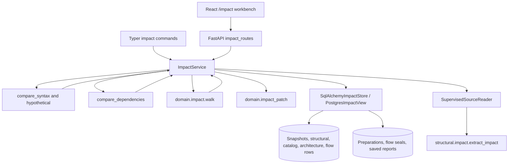
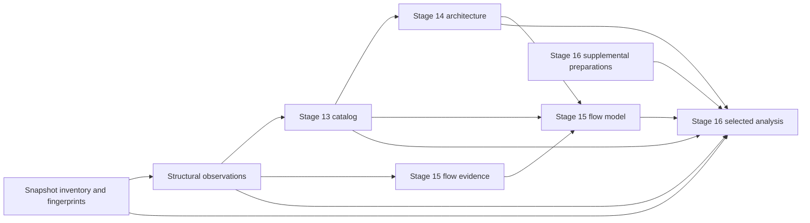
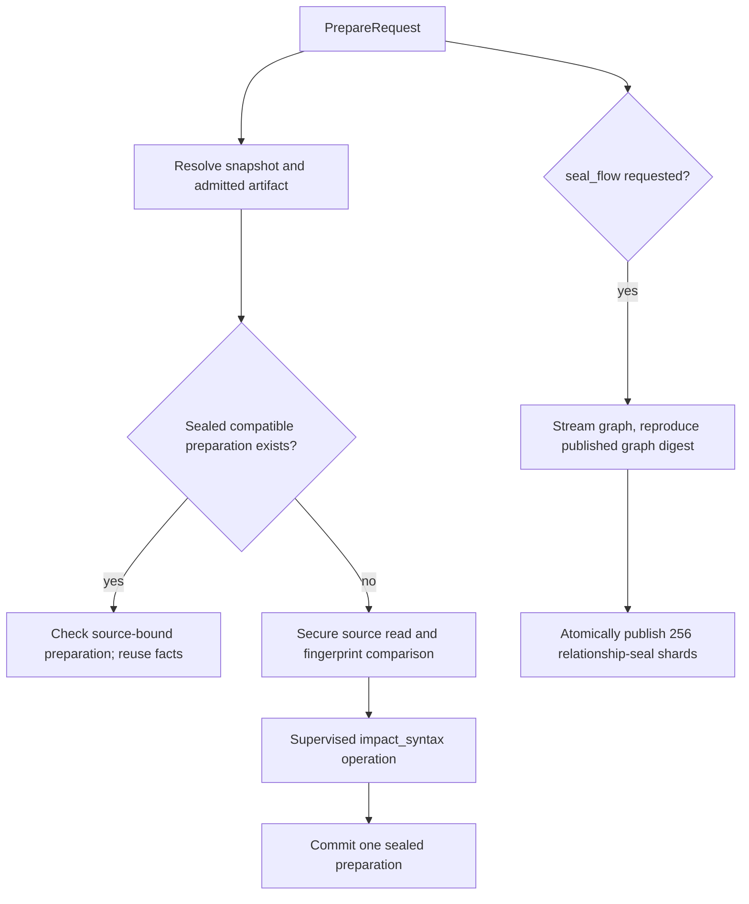
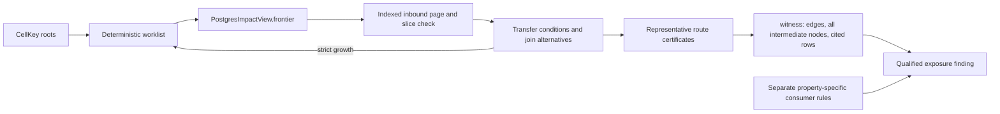
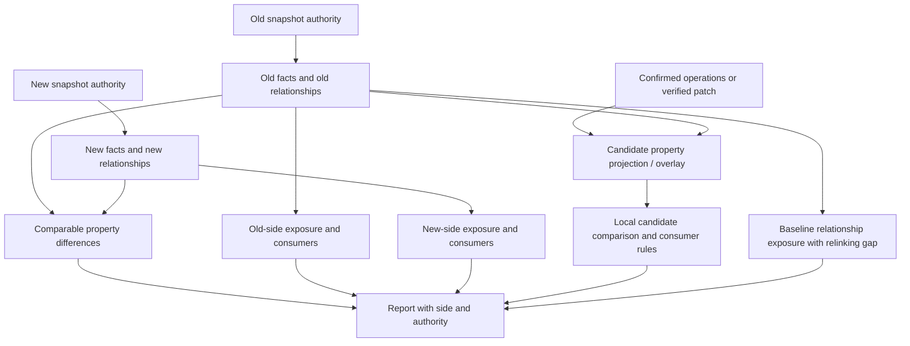
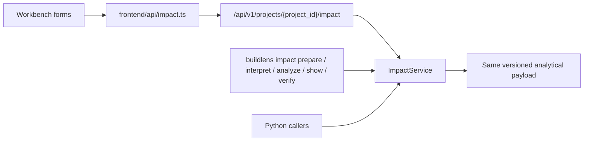
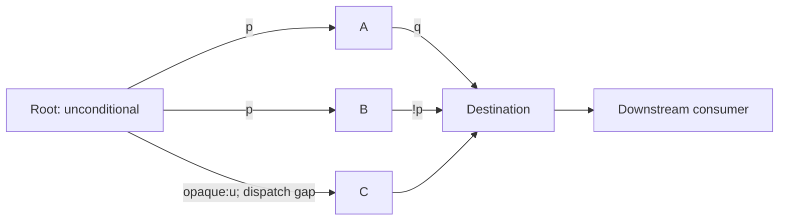

# BuildLens Stage 16 — Final corrected implementation explainer

**Engineering Impact Intelligence · source inspection dated 21 November 2026, India time**

This is a teaching and navigation document for the implementation that actually exists. It explains the corrected source, retained engineering evidence and practical limits. It is not another independent review, an acceptance decision, or a new verification campaign.

**Source identity verified for this document:**

```text
Analytical contract:       impact.v5
Supplemental producer:     impact-syntax.v8
Final analyzer manifest:   b35bace1a962ea977a087a19bc23668989b978a25c4eac03faf48d8d5714d319
Files in that manifest:    448
Working-tree mismatches:   0
Git HEAD:                 febdf143f53ead040d6f980d5e9bc605fe73b867
Branch context:            stage15/flow-tracing, with retained uncommitted implementation
```

The manifest, rather than HEAD alone, identifies the corrected implementation. The independently reviewed 445-file identity `74de18f1c49b3ede7e7c380732853d984dff86e1302aa1e8c82cb8aadb55e77f` is historical. Nine existing manifested files changed during correction and three were added. Section 18 identifies them. The final manifest's digest was recomputed as SHA-256 of Python's `json.dumps(sha256_mapping, sort_keys=True)` UTF-8 bytes, retaining that serializer's default separators; each of its 448 individual file hashes was also compared with current bytes. A different JSON serialization would produce a different aggregate digest.

**Acceptance qualification:** C1–C4 have corrective implementations and focused receipts. C5 has an implemented bounded operation matrix, but its broader scope proposals have no recorded owner acceptance. The retained correction closure explicitly says `understanding_gate: closed`, blocked on that owner decision. Creating this explanation does not change that state. The historical comparative quality outcome remains **inconclusive**. Earlier performance passes retain their earlier source identities. [Final manifest][E-final], [correction closure][E-close], [correction report][D-corrections], [current state][D-state].

The new explanatory document is outside that analyzer manifest. Existing production files, tests, migrations, evidence and untracked work were preserved. No test suite, database, browser journey or benchmark was launched for this task. The repository's [proportional-verification instructions][D-verify] exempt explanation work from implementation campaigns; the installed [Background Execution instructions][D-bg] were read, and no necessary command required their long-running workflow.

## Table of contents

1. [Understanding Stage 16 from first principles](#1-understanding-stage-16-from-first-principles)
2. [Complete Stage 16 architecture](#2-complete-stage-16-architecture)
3. [File-by-file implementation walkthrough](#3-file-by-file-implementation-walkthrough)
4. [Change Intelligence and supported inputs](#4-change-intelligence-and-supported-inputs)
5. [Snapshot identity and semantic comparison](#5-snapshot-identity-and-semantic-comparison)
6. [Propagation: mathematics and implementation](#6-propagation-mathematics-and-implementation)
7. [Program slicing and data-flow analysis](#7-program-slicing-and-data-flow-analysis)
8. [Behavioral differencing and predicate analysis](#8-behavioral-differencing-and-predicate-analysis)
9. [Cross-layer impact analysis](#9-cross-layer-impact-analysis)
10. [Test Intelligence and verification gaps](#10-test-intelligence-and-verification-gaps)
11. [Evidence integrity and reproducibility](#11-evidence-integrity-and-reproducibility)
12. [Exact patches and hypothetical isolation](#12-exact-patches-and-hypothetical-isolation)
13. [Performance, resources and operational behavior](#13-performance-resources-and-operational-behavior)
14. [Product workflows and interfaces](#14-product-workflows-and-interfaces)
15. [End-to-end execution walkthroughs](#15-end-to-end-execution-walkthroughs)
16. [Integration with Stages 1–15](#16-integration-with-stages-115)
17. [Algorithms and engineering decisions](#17-algorithms-and-engineering-decisions)
18. [Independent review and final corrections](#18-independent-review-and-final-corrections)
19. [Verification and evaluation evidence](#19-verification-and-evaluation-evidence)
20. [Final capabilities, limits and practical use](#20-final-capabilities-limits-and-practical-use)
21. [Glossary and technical understanding questions](#21-glossary-and-technical-understanding-questions)
22. [Source and evidence references](#source-and-evidence-references)

## 1. Understanding Stage 16 from first principles

### 1.1 What a change can mean

Imagine an endpoint that creates an order. It checks authorization, validates quantity, saves an order and returns `{"accepted": true, "id": 42}`. A frontend reads `accepted` to decide whether to show a success message. Another client ignores the response and refreshes the order list. A background report later reads the same table.

Changing this endpoint can have several different consequences. Requiring an extra argument can make a previously valid call invalid. Returning `accepted: false` can change the first frontend's decision. The client that discards the response need not have a returned-field consequence. Moving a commit can affect the modeled transaction sequence. A table change can expose the reporting workflow even if it never calls the endpoint. Changing an authorization rule can change which requests reach the write, although proving the real application's authorization behavior requires more evidence than locating a guard.

**Change-impact analysis** asks which supported properties of other code may change because of a particular modification, and what evidence supports that connection. It is more specific than searching for similar words, and more demanding than collecting callers.

| Concept | Meaning in the example |
| --- | --- |
| Direct consequence | The endpoint's immediate client reads the changed response field, or a caller omits a newly required argument. |
| Indirect consequence | A helper transparently forwards the endpoint/service result and a later consumer reads the field. |
| Structural exposure | There is a recorded dependency, invocation, endpoint or table relationship worth investigating. This alone does not establish changed behavior. |
| Behavioral consequence | A modeled operation, consumed value, accepted invocation or ordering differs under stated conditions. |
| Compatibility regression | A previously valid producer/consumer interaction becomes invalid under a supported binding or wire-contract rule. |
| Causal dependency | A particular changed property is connected to a particular consumer through an applicable data, control, binding or shared-state mechanism. |
| Evidence-backed reasoning | The change, identity, relationship and source observations used by the rule can be inspected and checked against retained authorities. |

A dependency can exist without carrying the changed property. A call can execute without consuming its return. A test can import a function without asserting the affected field. Two transactions can touch the same table but different rows. Stage 16 keeps these distinctions visible.

### 1.2 Seven different questions

1. **Find related code.** Search for `accepted` or “order creation.” This suggests relevant locations but does not establish a relationship.
2. **Find dependencies.** Identify imports, references and callers. This establishes a structural connection at its recorded evidence tier.
3. **Trace possible execution.** Determine which modeled calls and continuations may be reached from an entry point. This adds execution structure, guards and boundaries.
4. **Identify data and control influence.** Determine whether this invocation's result reaches this field read, or whether this predicate gates this operation.
5. **Compare two program states.** Establish which signature, field, condition or declaration changed, using compatible old/new observations.
6. **Establish supported findings.** Apply a property-specific rule to the comparison and its consumer evidence, with an inspectable witness and explicit assumptions.
7. **Recommend relevant verification.** Identify a test that asserts the property or supplies an input in the changed region; identify missing applicable assertions in the inspected scope.

These questions build on one another, but none makes the next one automatic. In particular, a reachable endpoint does not prove authorization correctness, and a modeled field read does not prove that a browser exercised it.

### 1.3 What the earlier stages supplied

Stage 13's Semantic Model supplied snapshot-qualified entities, stable declaration identities, relations, coverage and source-backed facts. It could identify symbols, references and recognized framework concepts, and let users inspect verified evidence. Its optional generated interpretations were separate from deterministic authority.

Stage 14 added modules and dependency classes, API endpoint/request candidates, database mappings, subsystem context and owner-declared architectural rules. It could explain a module relationship or an inferred client-to-endpoint match, subject to its recognizer and evaluation qualifications.

Stage 15 added scope control-flow graphs, callsites, bindings, control dependence, invocation alternatives, continuations, outcomes and selected effects. It could trace a modeled browser-shaped path through HTTP and backend code to a table and response. It did not make every reachable statement a proven value consumer, and it did not compare arbitrary old/new program properties. [Semantic Model][D-semantic], [Architecture Intelligence][D-architecture-intelligence], [corrected Stage 15 explainer][D-stage15].

Stage 16 adds a common change request, supported candidate models, exact overlays, source-specific property comparison, bounded matched result consumption, numeric predicate differencing, separate old/new exposure and retained impact findings. BuildLens can now investigate consequences of actual and proposed changes, with different mechanisms for different properties. It remains a bounded static investigation system. Absence of a discovered finding can mean no supported relationship was found, missing evidence, unsupported source, an exhausted budget or genuinely unchanged observed properties. It never universally proves that a change is safe.

## 2. Complete Stage 16 architecture

### 2.1 Responsibilities and actual module boundaries

The implementation is a dedicated analytical layer inside the existing modular monolith. There are no separate deployed Change Intelligence or Impact Intelligence services. Those names describe responsibilities distributed across a small set of modules.

| Responsibility | Actual owner | Degree of support |
| --- | --- | --- |
| Change Intelligence, input normalization, authority selection and orchestration | `application/impact.py`: Pydantic requests and `ImpactService` | Four analytical modes; a separate deterministic proposal interpretation operation. |
| Candidate property edits and behavioral comparison | `application/impact_properties.py`: `hypothetical`, `compare_syntax` | Specific supported properties; no general semantic equivalence engine. |
| Architecture-rule comparison | `application/impact_architecture.py`: `compare_dependencies` | Selected paths, exact/module-glob selectors, forbid/layer rules; one-sided observations. |
| Finite propagation machinery | `domain/impact.py`: `walk` and immutable state contracts | General bounded condition/context worklist; production graph transfers chiefly structural/shared-state. |
| Supplemental extraction | `infrastructure/structural/impact.py` | Small Python AST and JS/TS tree-sitter projections; selected Python framework declarations. |
| Exact patch mechanics | `domain/impact_patch.py` | Pure same-path exact text overlays. |
| Indexed queries, preparation proofs, seals, witnesses and retained reports | `infrastructure/persistence/impact.py` | PostgreSQL adapter implementing the application ports. |
| Risk and test-gap presentation | Logical steps in `ImpactService.analyze` and property comparison | Deterministic priorities, static test signals and scoped gaps; no probability model. |
| Product adapters | `api/impact_routes.py`, `cli/impact.py`, frontend impact files | Shared service, JSON contracts, basic workbench and witness JSON inspection. |

Program-dependence reasoning is not a standalone whole-program graph builder. It occurs in the supplemental body's binding/read extraction, local `_field_consumers`, cross-file service routines and predicate-specific findings. Evidence verification is primarily adapter code, while the service binds the consumed proof references into the report. [Service][S-service], [properties][S-properties], [worklist][S-domain], [producer][S-producer], [adapter][S-store].

### 2.2 Complete architecture



The service decides what operation is being performed. Pure modules compare or traverse supplied facts. The PostgreSQL adapter selects and verifies evidence. The worker parses screened bytes during explicit preparation or patch analysis. The product surfaces all call the same service; none implements an alternative impact algorithm.

### 2.3 Input to report

```mermaid
flowchart LR
  INPUT["Entity / snapshot pair / confirmed hypothesis / exact patch"] --> VALIDATE["AnalysisRequest.check_mode"]
  VALIDATE --> AUTH["Resolve coherent authorities"]
  AUTH --> FACTS["Inventory, retained declarations, preparations, candidate facts"]
  FACTS --> COMPARE["Property comparison where applicable"]
  COMPARE --> REASON["Local consumers, cross-file rules, exposure walk"]
  AUTH --> REASON
  REASON --> VERIFY["Verify consumed witnesses and provenance"]
  VERIFY --> REPORT["Changes, findings, tests, gaps, frontier, priority"]
  REPORT --> SAVE["Digest and optional immutable retention"]
```



Entity mode bypasses a concrete property delta and asks for exposure. Comparison modes identify changed properties first. Verification happens during evidence consumption and witness construction; reopening adds checks over retained proofs. This diagram is a logical sequence, not a list of separate service processes.

### 2.4 Integration with earlier stages



Stage 16 consumes coherent retained authorities. It does not rewrite Stage 13 facts, Stage 14 graph meanings or Stage 15 CFG/trace contracts. Supplemental preparations have their own producer identity and tables. A valid syntax cache entry cannot authorize reuse of another snapshot's semantic relationships.

### 2.5 Preparation and relationship preparation



Syntax preparation and relationship sealing are distinct. A user can prepare one file without sealing a flow model, or seal an existing flow model without preparing source. Completed artifact units survive a later preparation deadline; an incomplete seal is not published as valid.

### 2.6 Propagation and witness construction



The worklist maintains analytical alternatives independently of the three-witness display cap. Production graph traversal supplies exposure; precise signature/field/predicate consequences also come from separate property rules. The last arrow prevents a misleading interpretation that all source semantics are transfer functions inside `walk`.

### 2.7 Historical and candidate comparison



Actual snapshot pairs can use each side's actual graph. Candidates have no published after-snapshot graph. Their supported local facts can be compared, while baseline graph relationships remain explicitly baseline exposure. Eight touched files do not create a fully relinked candidate repository.

### 2.8 Persistence and reopening

```mermaid
sequenceDiagram
  participant Caller
  participant Service as ImpactService
  participant View as PostgresImpactView
  participant DB as PostgreSQL
  Caller->>Service: analyze(save=true)
  Service->>View: Resolve, compare, construct checked evidence
  Service->>Service: Canonical payload and result_digest
  Service->>View: save(payload)
  View->>DB: Lock current snapshot rows; recheck pointers; insert report
  Caller->>Service: show(result_digest, verify=true)
  Service->>View: Load project-owned retained report
  Service->>Service: Check payload digest
  Service->>View: verify_report
  View->>DB: Check authorities, preparations, comparisons, declarations, witnesses
  View-->>Service: Qualification reasons or integrity error
  Service-->>Caller: Integrity, freshness, compatibility, verification, original completeness
```

A stale report can retain valid historical evidence. An altered consumed row is a different outcome: verification fails closed. The dimensions are intentionally separate.

### 2.9 Shared interfaces



The browser adds form state, confirmation and rendering. HTTP adds bounded request reading and disconnect observation. CLI adds local file loading, JSON output and exit codes. Analytical behavior belongs to the service.

## 3. File-by-file implementation walkthrough

### 3.1 How to navigate this map

“New” below means introduced for Stage 16 relative to its pre-implementation source, even though many files remain untracked in Git. “Modified” means an existing integration file gained Stage 16 code. Earlier locally modified Stage 15 files are explicitly distinguished from Stage 16 additions. Paths are repository-relative labels linked to their actual local files. Detailed internal sequences follow in Sections 4–15.

### 3.2 Application orchestration and pure analysis

**[`backend/src/buildlens/application/impact.py`][S-service] — new; corrected.** This 1,842-line file owns use-case coordination and ports, not SQL or parsing implementation.

- `SnapshotSelection` selects a snapshot and optional retained flow run. `Operation` admits fifteen bounded edit kinds and validates family/name/constraint combinations. `AnalysisRequest.check_mode` rejects inconsistent mode fields, requires confirmed hypotheses over one locator, and bounds architecture-rule comparison to snapshot mode with 1–16 selected paths. `PrepareRequest` and `ProposalRequest` are separate input contracts.
- `Authority` captures snapshot manifest, inventory completeness, structural/catalog/architecture/flow IDs, flow digests/contracts and historical selection. `Artifact`, `Preparation`, `CallObservation` and `EndpointObservation` carry the evidence needed by the service without exposing ORM rows.
- `ImpactView`, `ImpactStore` and `ImpactSource` define the adapter boundaries. The application can ask for verified evidence without importing infrastructure.
- `Deadline.remaining` raises on cancellation or expiry; `near` supports graceful cutoffs. `_safe_locator` checks canonical project-relative paths. `_property_coverage` reports per-family availability from prepared facts.
- `interpret` screens proposal text, matches one complete grammar phrase, resolves catalog candidates and returns a suggestion requiring confirmation. `_read` delegates to the secure reader using captured root device/inode identity.
- `coverage` reports each side's inventory, declarations, graph-exposure source, preparation and per-property state. Producer equality gates supplemental comparability. This is capability information, not an accuracy score.
- `prepare` reuses checked facts or reads/extracts/commits one artifact at a time; optionally seals the flow model. Worker cleanup is in `finally`.
- `analyze` resolves old/new authorities, constructs a report skeleton and request identity, dispatches the selected mode, derives test signals and assertion gaps, assigns priorities, classifies completeness, caps size, hashes the analytical payload and optionally saves. Attempt ID, retention flag and elapsed milliseconds are added after the retained digest.
- `_snapshots` classifies artifact evidence and compares prepared facts, falling back to `_retained_declarations`. `_snapshot_exposure` selects both sides' roots and orchestrates API, database, signature, return and graph-exposure reasoning. `_entity` seeds exposure without a concrete change.
- `_properties` calls `compare_syntax`, binds old/new input digests and proof references into a comparison ID, and attaches that ID to local changes/findings. `_hypothesis` constructs one candidate from compatible prepared facts. `_patch` constructs an exact separately identified overlay. `_candidate_baseline_exposure` labels old relationships as baseline exposure.
- `_cross_file_signatures` compares byte-identical continuing Python caller shapes under both signatures. `_call_in_projection` aligns the **full** call span. `_cross_file_returns` follows verified synchronous calls and bounded forwarding. `_database_column_consumers` combines table mapping, callsite and prepared column facts. `_api_compatibility` retains producer/consumer direction and HTTP uncertainty.
- `_prioritize`, `_limit_size`, `_status`, `show` and `history` finish the product contract. `show` checks payload identity even without `verify=True`; verification adds evidence/freshness/contract checks.

The API, CLI and runtime factory call this file. It calls the pure property, rule, worklist and patch modules plus its ports. Missing preparation, incoherent authority, unsupported candidates, deadlines, integrity errors and budgets have explicit outcomes. This placement keeps transport and database details out of analytical orchestration.

**[`backend/src/buildlens/application/impact_properties.py`][S-properties] — new; corrected.** This 962-line pure module turns compatible projections into property changes and local findings. It is called by `ImpactService`, retained-comparison verification and focused tests.

- `argument_problem` checks positional/named binding and reports too many positional arguments, duplicate binding, unexpected keywords or missing required arguments. Unpacking has no precise determination here; callers guard that case.
- `_by_name` retains only uniquely named functions. `_input_binding` identifies a parameter's supported slot for numeric comparisons.
- `_findings` applies eligible synchronous local call rules. `_field_consumers` builds a reverse index of local calls, follows matching result indexes and transparent single-return forwarding, excludes sibling-field reads and invalid invocations, and adds test assertions when they read that exact property.
- `_integer_test_inputs`, `_http_test_findings` and `_column_findings` attach specific static test or ORM evidence. They do not run tests or database operations.
- `compare_syntax` aggregates projection/function gaps; aligns unique names; compares declaration membership, signatures, literal return fields, invocation/exception shapes, integer guards, route/schema fields, selected module properties and session sequences; emits changes/findings/gaps. It is not a generic AST equivalence proof.
- `_scalar`, `_module_operation` and `hypothetical` deep-copy the baseline, validate supported old facts, apply candidate edits, reject collisions/unsupported composition and check combined signature validity. They return `None` for an unsupported hypothesis.

These responsibilities are application rules because they interpret source-derived observations for a use case; they need no database or parser imports. Important invariants are exact property family, matched invocation, retained uncertainty and common-baseline candidate validation.

**[`backend/src/buildlens/application/impact_architecture.py`][S-rules] — new.** `compare_dependencies` compares the same owner rule set against two verified selected edge lists. `_matches` handles exact `module:` keys and compiled path globs. Forbid rules test source/target selectors; layer rules reject an edge toward an earlier layer. It bounds rules to 32, records overlap/hierarchical-selector limitations and emits `one_sided_observation`, rather than claiming newly established or repaired whole-graph conformance. The service supplies rule and graph authorities; the adapter supplies verified edges. Cached regex compilation is a small pure optimization.

### 3.3 Domain contracts

**[`backend/src/buildlens/domain/impact.py`][S-domain] — new; corrected contract.** Owns `CONTRACT = "impact.v5"`, deterministic budgets, `CellKey`, `AbstractValue`, `Supports`, `Transfer`, `Frontier`, `Walk`, `refuted`, `walk`, `Threshold` and `integer_difference`. It knows neither SQL nor language ASTs. `walk` consumes a caller-supplied frontier reader and expiry predicate and returns states, witness representatives, gaps and unfinished frontier. `Threshold.accepts` and `integer_difference` implement the six-operator integer fragment. The separation lets synthetic tests establish worklist properties independently of extraction accuracy.

**[`backend/src/buildlens/domain/impact_patch.py`][S-patch] — new.** `parse_patch` validates supported headers, paths, hunk counts and context into immutable `PatchFile`/`Hunk` values. `apply_patch` verifies byte fingerprint and exact hunk positions/text before constructing postimage bytes. `PatchRejected` carries a stable reason code. `fingerprint` is SHA-256 over bytes. It has no filesystem access; source admission and worker orchestration belong to the application/infrastructure layers.

### 3.4 Supplemental source producer and supervision

**[`backend/src/buildlens/infrastructure/structural/impact.py`][S-producer] — new; corrected.** This 1,673-line module is the actual producer of Stage 16 syntax facts.

- `syntax_contract` hashes `impact-syntax.v8`, Python runtime, installed tree-sitter package versions and screening version. The stored producer contract is this digest, not just the readable version string.
- `_parameters` extracts Python binding slots; `_literal` retains safe scalar shapes and hashes strings; `_syntax_hash` ignores AST location attributes. `_integer_guard` recognizes the narrow exact-int rejection pattern; `_threshold` recognizes one supported comparison.
- `_Body.expression` processes ordered Python uses/calls and tracks call-result origins; `_Body.block` processes statements, branch continuation, overwrites, returns, raises and selected assertions. They return analysis-safe facts and explicit gaps.
- `_python` selects bounded top-level synchronous functions, checks namespace/binding prerequisites, preserves signature facts for oversized bodies, records body/declaration/module syntax digests and omitted-scope gaps, and attaches framework projections.
- `_JsBody.expression` and `.statement` implement the JS/TS subset. `_javascript` chooses a grammar, rejects parse errors, selects function declarations, records `result_kind` and qualified direct-use facts. Arrow functions and arbitrary class/module execution are not promoted into this subset.
- `_framework_manifest` reads selected exact package pins. `_import_names`, `_qualified`, `_safe_route`, `_query_fields`, `_body_model`, `_response_models` and `_module_properties` recognize bounded local framework/configuration shapes.
- `_http_tests` identifies narrowly bound same-file TestClient probes and assertions. `_database_accesses`, `_column_access` and `_column_records` retain selected annotated-session reads, constructor write inputs and lexical transaction sequences.
- `extract_impact` decodes and screens input, dispatches manifest/Python/JS parsing and returns a JSON-compatible projection. No target application is imported or executed.

**[`backend/src/buildlens/infrastructure/structural/supervisor.py`][S-supervisor] — modified.** Adds the trusted `impact_syntax` worker operation and `SupervisedSourceReader.extract_impact`. Existing source reading, timeout/process replacement, memory checks and screening infrastructure remain in use. This is supervised trusted parsing, not a general OS sandbox. Worker errors become bounded source-read/extraction outcomes. The service creates and closes a reader; it does not invoke a shell or run target code.

### 3.5 PostgreSQL adapter, models and migrations

**[`backend/src/buildlens/infrastructure/persistence/impact.py`][S-store] — new; corrected.** Its 1,750 lines implement the `ImpactStore`/`ImpactView` ports.

- `SqlAlchemyImpactStore.open` obtains a repeatable-read connection, applies remaining-budget SQL timeouts, acquires one nonblocking database-wide advisory slot and always rolls back/releases or invalidates the connection. It classifies pool, database, migration and authority-change failures.
- `PostgresImpactView.authority` checks project/snapshot ownership and coherent selected structural/catalog/architecture/flow records. `artifact`, `changed`, `root`, `absent` and `candidates` provide bounded inventory, source-root, complete-searched-absence and entity lookup.
- `preparation`, `_input_seal`, `_preparation`, `_source_identity`, `_checked_preparation` and `prepare` implement fact-content integrity, source-bound identity, safe cache selection and per-unit publication.
- `declarations` projects retained structural signatures/state and proofs. It uses stable symbol identities and producer contracts, not guessed name continuity.
- `_get_flow`, `_get_node`, `graph_root`, catalog fallback helpers and `frontier` implement selected relationship reads. `callers`/`_observed_call` bind verified synchronous graph callsites to complete source spans and fingerprints. `endpoint`, `requests_to` and `database_calls` supply domain-specific relationship evidence.
- `_verify` checks actual selected element digests and cited evidence on the same read view. `witness` checks all intermediate nodes and reverse-chain continuity. `_verify_slice` checks selected membership against seals; `seal` streams and anchors whole-graph membership once during preparation.
- `architecture_rule_set`, `_architecture_run`, `architecture_dependencies` and `_architecture_witnesses` verify selected Stage 14 evidence. `save`, `report` and `history` retain/retrieve project-owned reports.
- `_verify_comparisons`, `_verify_retained_authority`, `_verify_declaration_changes` and `verify_report` implement corrected reopening semantics across report shapes.

**[`backend/src/buildlens/infrastructure/persistence/models.py`][S-models] — modified.** Adds `ImpactPreparationRecord`, `ImpactSealRecord`, `ImpactSealShardRecord` and `ImpactReportRecord`. Preparations have project/snapshot ownership, locator, fingerprint, producer, facts/digest, nullable legacy source identity and input seal. Reports use `(project_id, result_digest)` as primary key, retain request digest/time/payload, and do not overwrite equivalent results. Seal shards use `(flow_run_id, shard)`.

**[`backend/alembic/versions/0020_impact.py`][S-migration20] — new.** Creates the four Stage 16 tables and ownership/uniqueness constraints. Downgrade refuses while retained Stage 16 evidence exists.

**[`backend/alembic/versions/0021_impact_provenance.py`][S-migration21] — new during correction.** Adds `source_identity` and `input_seal_digest` without inventing provenance for old rows. Replaces unconditional reusable-input uniqueness with a partial unique index applying to sealed rows. A fresh verified extraction can coexist with a legacy row. Downgrade refuses while any preparation remains.

### 3.6 Runtime and product integration

| Exact file and status | Responsibility, contracts and dependencies |
| --- | --- |
| [`backend/src/buildlens/infrastructure/runtime.py`][S-runtime] — modified | `impact_service` wires store, supervised reader and current syntax contract; `LocalRuntime` owns a dedicated bounded impact connection pool and disposes it on close. |
| [`backend/src/buildlens/api/impact_routes.py`][S-api] — new | `_run` streams and bounds JSON, creates a `Deadline`, watches disconnects, runs the shared synchronous service in a thread pool and maps `ImpactError` to safe HTTP errors. Routes cover prepare, coverage, interpret, analyze, history and show/verify. |
| [`backend/src/buildlens/api/main.py`](/Users/drivyaanshyadav/Desktop/BuildLens/backend/src/buildlens/api/main.py) — modified | Registers `impact_router` and includes impact POST resources in the existing JSON media-type guard. |
| [`backend/src/buildlens/cli/impact.py`][S-cli] — new | `prepare`, `interpret`, `analyze`, `show`, `verify`; local bounded text/JSON reads; `_run` constructs/closes `LocalRuntime`, prints JSON or safe error codes. |
| [`backend/src/buildlens/cli/main.py`](/Users/drivyaanshyadav/Desktop/BuildLens/backend/src/buildlens/cli/main.py) — modified | Mounts the Typer `impact` sub-app. |
| [`frontend/src/api/impact.ts`][S-client] — new; corrected | `ImpactSelection`, `ImpactOperation`, `ImpactInput`, `ImpactReport`, `Coverage`, `Preparation`, `Interpretation`, `ImpactVerification`; abortable request wrappers. This is a typed view of JSON, not a second analyzer. |
| [`frontend/src/components/impact/ImpactPage.tsx`][S-ui] — new; corrected | `ImpactPage` resolves project/snapshot; `Workbench` owns forms, preparation/interpretation/confirmation and request state; `Report` renders changes, findings, witnesses, tests/gaps/frontier in increments of 30. |
| [`frontend/src/components/impact/Impact.test.tsx`][S-ui-tests] — new; corrected | Three mocked request tests: selected rule version/path submission, confirmed API-field-family hypothesis submission, and separate historical integrity/freshness/contract rendering. Cancellation/stale-response behavior also relies on reused request hooks and their earlier-stage coverage; this file is not an exhaustive impact UI suite. |
| [`frontend/src/App.tsx`](/Users/drivyaanshyadav/Desktop/BuildLens/frontend/src/App.tsx) — modified | Imports `/impact`, registers the route and dashboard navigation. |
| [`frontend/src/components/explore/ExplorePage.tsx`](/Users/drivyaanshyadav/Desktop/BuildLens/frontend/src/components/explore/ExplorePage.tsx) — modified | Opens impact with project/snapshot/entity context. |
| [`frontend/src/components/architecture/ArchitecturePage.tsx`](/Users/drivyaanshyadav/Desktop/BuildLens/frontend/src/components/architecture/ArchitecturePage.tsx) — modified | Adds impact navigation with selected project/snapshot. |
| [`frontend/src/components/flows/FlowsPage.tsx`](/Users/drivyaanshyadav/Desktop/BuildLens/frontend/src/components/flows/FlowsPage.tsx) — modified | Passes selected flow entry into impact navigation. Earlier trace behavior remains separate. |
| [`frontend/src/styles.css`](/Users/drivyaanshyadav/Desktop/BuildLens/frontend/src/styles.css) — modified | Adds `.impact-before-after` layout and child sizing. |
| [`frontend/src/api/projects.ts`](/Users/drivyaanshyadav/Desktop/BuildLens/frontend/src/api/projects.ts) — modified integration dependency | `listProjects` supports an abort signal, used by the workbench's project-loading hook. |

### 3.7 Tests, evaluation and retained documentation

| Exact path and status | What it establishes or preserves |
| --- | --- |
| [`backend/tests/unit/test_impact.py`][T-unit] — new | Mandatory `RESERVE` triad, repaired combined callsite, oversized signature fallback, worklist joins/contexts/witness cap, integer regions, exact patch controls, API/database/configuration/test and JS direct-field cases. |
| [`backend/tests/unit/test_impact_corrections.py`][T-correction-unit] — new during correction | C1 short-circuit/omitted body/declaration semantics; C2 Promise/container barriers; C3 identity-column tampering/legacy behavior; C5 valid/invalid operations, common-baseline composition and rename collisions. |
| [`backend/tests/integration/test_impact.py`][T-integration] — new | Sealed relationship deletion, changed row and saved witness; empty migration round trip; cross-file signature/field/forwarding; directional API, database and rule cases. |
| [`backend/tests/integration/test_impact_corrections.py`][T-correction-integration] — new during correction | Source-seal reuse and legacy re-preparation, both-side declaration proof/freshness checks, inventory addition/removal and pruned parents, real HTTP/CLI saved-report contract. |
| [`backend/scripts/impact_evaluate.py`][S-eval] — new | `_seal`, `_verified`, `_counts`, `quality_readiness`, `quality`, `performance`, `main`: digest-bound local scoring/readiness tooling. It does not independently author truth labels or collect measurements. |
| [`backend/tests/unit/test_impact_evaluate.py`][T-eval] — new | Unknown/abstention denominators, scoped baseline validation, incomplete packets and fast deadline exclusion. |
| [`docs/IMPACT_ANALYSIS.md`][D-impact] — new | Implemented product use, scope and chronological verification/evaluation record. |
| [`docs/STAGE16_CORRECTIONS.md`][D-corrections] — new during correction | C1–C5 dispositions, bounded capability matrix, outstanding owner decisions and revision-specific receipts. |
| [`CURRENT_STATE.md`][D-state] — modified | Latest Stage 16 corrections/open gate precede historical stage-status paragraphs. Historical headings must not override the newer record. |
| [Approved revised plan][D-plan] and [earlier plan][D-plan-old] — retained outside repository | Intended architecture, R1–R13 refinements, constraints and acceptance design. Differences from code are explained here, not silently treated as delivered. |
| [Implementation receipts][E-implementation], [follow-up quality packet][E-quality-packet], [performance correction][E-performance], [closure identity][E-reviewed], [exploratory quality review][E-quality-review], [correction closure][E-close] — retained, unchanged | Historical observations and source identities; they are not newly executed verification. |

Important reused test support includes [`backend/tests/flow_support.py`](/Users/drivyaanshyadav/Desktop/BuildLens/backend/tests/flow_support.py) (`FlowStack`, source fixtures), [`backend/tests/semantic_support.py`](/Users/drivyaanshyadav/Desktop/BuildLens/backend/tests/semantic_support.py) (`CatalogStack`) and [`backend/tests/integration/test_schema.py`](/Users/drivyaanshyadav/Desktop/BuildLens/backend/tests/integration/test_schema.py) (schema/ORM checks). Their role is constructing real retained authorities in disposable tests.

Several existing tests also received Stage 16 integration maintenance. These are part of the source surface, not new analytical features:

| Exact modified path | Actual change |
| --- | --- |
| [`backend/tests/integration/test_flow_evidence.py`](/Users/drivyaanshyadav/Desktop/BuildLens/backend/tests/integration/test_flow_evidence.py) | Imports `ScriptDirectory`; downgrade-refusal assertion checks the current Alembic head instead of hardcoding `0019_flow_explanations`. |
| [`backend/tests/integration/test_flow_model.py`](/Users/drivyaanshyadav/Desktop/BuildLens/backend/tests/integration/test_flow_model.py) | Same current-head maintenance for retained model downgrade refusal. |
| [`backend/tests/integration/test_flow_explanation.py`](/Users/drivyaanshyadav/Desktop/BuildLens/backend/tests/integration/test_flow_explanation.py) | Same current-head maintenance for explanation HTTP/downgrade integration. |
| [`backend/tests/integration/test_persistent_embeddings.py`](/Users/drivyaanshyadav/Desktop/BuildLens/backend/tests/integration/test_persistent_embeddings.py) | Same current-head maintenance for retained persistent evidence downgrade behavior. |
| [`backend/tests/unit/test_evaluation.py`](/Users/drivyaanshyadav/Desktop/BuildLens/backend/tests/unit/test_evaluation.py) | Runtime-close regression now supplies an `impact_engine` and requires its disposal before the main engine even when another owner close raises. |
| [`frontend/src/components/flows/Flows.test.tsx`](/Users/drivyaanshyadav/Desktop/BuildLens/frontend/src/components/flows/Flows.test.tsx) | Wraps an existing initial render in async `act`; this is test scheduling maintenance, not new flow semantics. |

### 3.8 Important earlier-stage dependencies

The corrected Stage 15 `application/flow_trace.py`, `application/flow_trace_service.py`, `domain/flow_trace.py`, their tests and Part F scripts are already present as local work. Their modified/untracked Git status does **not** make them new Stage 16 features. Likewise, the local `application/architecture_views.py` distinct-table F4 repair and its regression belong to the inherited Stage 14/15 history. `infrastructure/persistence/flow.py` supplies existing cited-row verification and Part F batching. Stage 16 reuses that verifier while checking its own witness intermediates.

Other unchanged authorities include `application/flow_inputs.py` (`scope_key`); `domain/flow.py` (canonical flow elements and graph identity); `domain/architecture.py` and `domain/architecture_rules.py`; `infrastructure/persistence/architecture.py`, `architecture_rules.py` and `semantic.py`; `application/source_ports.py`; `domain/source.py` (decoding, screening and canonical digest); `domain/eligibility.py`; and `frontend/src/components/architecture/useRequest.ts`. These dependencies provide identities, immutable source/evidence semantics, secure admission and stale-safe request handling. Section 16 connects their responsibilities without reopening their reviews.

## 4. Change Intelligence and supported inputs

### 4.1 What it means to understand a modification

A text differencer can report that `10` became `5`. An analytical system must also establish that those literals belong to comparable predicates over the same input, that the input is an exact integer in the supported fragment, and that a particular operation is guarded by that predicate. Otherwise the useful statement is only that source changed.

Stage 16 uses progressively richer observations:

| Change category | Actual recognition |
| --- | --- |
| Textual | Artifact fingerprints differ; an exact patch has verified pre/postimages. The tool need not explain every byte delta. |
| Syntactic | Location-independent Python declaration/body/module syntax hashes, JS declaration source digest, retained declaration state. |
| Structural | Supported declaration membership, changed calls, inventory presence/absence, selected module relationships. |
| Signature/interface | Python parameter slots/default digests, binding compatibility; retained structural `binding_signature`; selected API fields/routes. |
| Data flow | Named return-field membership/literal changes connected to matched local or prepared cross-file consumers. |
| Control flow | Narrow integer-guard differences connected to one supported conditional call; broader body changes remain partial. |
| Side effects | Changed invocation/explicit exception observations, selected conditional operation and annotated session ordering; no general effect equivalence. |
| API contract | Matched local route method/path/status and simple query/body/response fields. |
| Database | Selected mapped column declaration/membership/explicit constraints and session sequence. |
| Configuration | Unique Python `os.getenv` default/key and selected exact manifest package pins. |
| Architecture | Same owner rules evaluated over selected verified module dependency observations. |

The common representation is a JSON-compatible **change record**, usually with `id`, `entity`, `locator`, `property`, `before`, `after`, `comparison`, `authority`, source lines and proof references. There is no single universal `Change` class that normalizes all possible programming-language semantics. The report is a versioned dictionary assembled by `ImpactService`, not a backend `ImpactReport` dataclass. The frontend has an `ImpactReport` TypeScript type. [Service][S-service], [comparators][S-properties].

### 4.2 Entity-centered analysis

A developer selects a catalog `symbol:<stable UUID>` or an actual flow key. `graph_root` resolves a symbol to its flow scope when uniquely evidenced, or falls back to a catalog entity. An existing flow node is verified before use. The service creates `CellKey(entity, "old", target, "structural", "exposure")` and follows applicable inbound relationships.

The report says `potential_exposure`, records direct/indirect distance from the representative path and retains graph/catalog caveats. Without a specified signature, field or predicate edit, it cannot say which behavior changed. Catalog-only fallback adds `CATALOG_STRUCTURAL_EXPOSURE_ONLY` and `CATALOG_SLICE_UNSEALED`.

### 4.3 Structured hypothetical analysis

The selected admitted artifact must have a sealed preparation under the current syntax contract. The request contains one locator, one or more operations and `confirm: true`. `hypothetical` deep-copies the facts and applies all supported edits before comparison. It checks actual old-property existence and kind rather than assuming a requested member exists. There is no arbitrary patch generation or execution.

An important detail: `require_parameter` makes an **existing optional parameter required**. It does not introduce a newly named parameter. A literal new parameter addition is observable through snapshot/patch signature comparison, but there is no `add_parameter` structured operation.

The candidate is a property model. It is not a recompiled executable program, and its synthetic declaration digest records modeled changes rather than newly parsed Python bytes. API/database/configuration operations change supported module-property projections. Repeated writes, rename collisions and unsupported sequential composition are rejected. Module-operation preconditions are checked independently against the common baseline and then against the combined candidate. [Operation validation][S-service], [`hypothetical`][S-properties].

### 4.4 Precise operation matrix

| Operation/input | Final status and supported preconditions | Boundary |
| --- | --- | --- |
| `require_parameter` | Implemented before review: observed optional non-variadic Python parameter; valid combined signature. | No named-parameter addition; no JS signature semantics. |
| `remove_parameter` | Implemented before review: uniquely observed non-variadic parameter. | Removing it does not rewrite the function body or callsites. |
| `remove_return_field` | Implemented before review: one explicit returned object/dict with named field. | General computed/dynamic return schemas unavailable. |
| `set_return_boolean` | Implemented before review: existing field and boolean proposed value in a single supported return. | No general scalar-return edit operation or Promise unwrapping. |
| `set_integer_threshold` | Implemented before review: one supported conditional-call predicate and bounded integer threshold. | One exact-integer formal binding; no arithmetic, float, JS coercion or general path solver. |
| `rename_symbol` | Added during correction: eligible uniquely bound, undecorated top-level synchronous Python function; complete qualifying projection; valid unoccupied name. | Declaration-only; references/export/import aliases are not rewritten. |
| `remove_symbol` | Added during correction with the same declaration restrictions. | Remaining call target has unknown replacement/external binding; no unconditional `NameError` prediction. |
| `remove_api_field` | Added during correction: unique local route, existing supported field, `family=query|body|response`. | No arbitrary schema transformations. |
| `require_api_field` | Added during correction: same, old field optional. | Requiredness declaration is not proof of deployed validation behavior. |
| `rename_api_field` | Added during correction: same, new valid unoccupied field name. | Compared as removed/introduced field; no automatic consumer rewrite. |
| `set_endpoint_path` | Added during correction: recognized unique local route and supported different literal full path. | Includes known router prefix; not a mount/rewrite operation. |
| `set_endpoint_method` | Added during correction: different recognized uppercase method. | `GET`, `POST`, `PUT`, `PATCH`, `DELETE`, `HEAD`, `OPTIONS`; no structured endpoint addition/removal. |
| `remove_database_column` | Added during correction: explicit column and matched model inventory. | Source declaration removal only; no migration execution. |
| `set_database_constraint` | Added during correction: existing explicit boolean `nullable`, `unique` or `primary_key`, proposed different boolean. | No inference of implicit constraints; no general type/default/foreign-key editor. |
| `set_configuration_default` | Added during correction: unique direct unshadowed Python `os.getenv` lookup, existing known literal kind, bounded scalar replacement. | Bool/int/string/null; strings hashed; effective overrides unknown. `__module__` names module scope. |
| Snapshot artifact introduction/removal | Added classification during correction when presence is admitted/fingerprinted and opposite absence is established by complete nonlegacy searched inventory. | Contained properties remain unexamined; excluded/pruned parents prevent absence. |
| Snapshot/patch supported signature, fields, calls, exceptions, local ORM/API/config properties | Implemented comparison, with individual family restrictions. | Not all changes have causal consumers or complete body semantics. |
| General symbol kinds, reference-preserving rename | Unsupported; proposed C5 deferral awaiting owner decision. | Class/method/async/inheritance/descriptor and rebinding behavior is not manufactured from the catalog. |
| Structured field/column creation, type/default edits, endpoint creation/removal, Alembic operation changes | Unsupported; proposed broader schema deferral awaiting owner decision. | Existing snapshot/patch comparators cover only their actual selected facts. |
| JS configuration defaults/general configuration systems | Unsupported; proposed C5 deferral awaiting owner decision. | Environment replacement and build substitution require evidence not supplied by this producer. |
| AI/provider-assisted proposal interpretation | Explicitly deferred in revised approved design. | Local deterministic engine does not depend on a model. |

The fifteen operation names are delivered. That count must not be confused with unrestricted support for the five broad input families. C5's acceptance reconciliation remains open. [Correction matrix and scope proposals][D-corrections].

### 4.5 Actual snapshot comparison

`before` and `after` belong to the same project. The user may select paths or let `changed` obtain bounded differing file slots through a full outer join of the inventories. Compatible equal fingerprints skip byte comparison. Modified admitted files use same-contract prepared projections when available. Otherwise continuing structural observations can supply signature/state changes, qualified by missing supplemental evidence.

Actual old/new flow graphs are analyzed separately. The output retains `side`; it does not collapse an old removed relationship into a supposedly current one. The implementation does not construct a universal correspondence graph pairing every old/new operation. Section 5 details actual alignment.

### 4.6 Exact patch analysis

The supplied diff is validated against fingerprint-verified source bytes and applied only in memory. Each pre/postimage is parsed in the supervised worker. A separate overlay digest binds baseline authority, patch hash, file hashes, fact digests and producer contract. Candidate source never enters actual snapshot tables or the preparation cache. Cross-file candidate relinking remains unavailable; local candidate facts and qualified baseline exposure are separate. Section 12 gives the complete sequence.

### 4.7 Natural-language proposals

`_PROPOSALS` is five regular-expression grammars, matched with `fullmatch`, case-insensitively, after whitespace trimming and removal of one trailing period:

- `require [parameter] notify in/on reserve`
- `remove [parameter] notify from reserve`
- `remove return field accepted from reserve`
- `set return field accepted in/on reserve to true/false`
- `set [integer] threshold in/on reserve to -5`

`interpret` returns the operation candidate and up to twenty catalog symbol candidates with locator/line/key. Multiple targets remain a user selection, and no candidate gives `TARGET_UNRESOLVED`. Unmatched text gives `UNSUPPORTED_PROPOSAL`. It does not parse arbitrary clauses, infer a safe edit from prose or call an LLM. Interpretation alone does not validate all old property facts; the confirmed hypothesis subsequently does.

The new ten structured operations did **not** expand the local language grammar. Documentation's generic “common phrases” wording must be read with this code restriction. The browser lets the user choose a target path and confirm the structured operation. [Interpreter][S-service], [workbench][S-ui].

## 5. Snapshot identity and semantic comparison

### 5.1 Why identities matter

The same name can refer to different functions, and the same function can move down twenty lines. A file path can be reused for unrelated bytes. A parser upgrade can change what a recorded fact means. Comparing text alone cannot distinguish these cases.

| Identity | Actual role |
| --- | --- |
| Project | Ownership boundary for snapshot, preparation, candidate discovery and saved report lookup. |
| Snapshot | Captured repository inventory and manifest, with selected upstream analysis pointers. It is not a complete byte archive. |
| Artifact observation | One inventory file record in one snapshot, including admission and fingerprint status. |
| Artifact path-slot identity | Stable project/path slot used upstream. It does not establish historical rename continuity. |
| Content fingerprint | Comparable SHA-256 of admitted artifact bytes under a fingerprint scheme; identical bytes permit syntax reuse, not semantic-link reuse. |
| Declaration identity | Upstream stable symbol identity for compatible lexical slots; used by retained declaration fallback and catalog-to-flow resolution. |
| Operation/callsite identity | Run-qualified flow key plus source evidence. Cross-file matching uses caller fingerprint and full `(start_line, start_column, end_line, end_column)`. |
| Source anchor | Locator, span and input fingerprint under producer/coordinate contracts. A line alone is insufficient. |
| Producer contract | Exact extraction/runtime/parser/screening identity defining what facts mean. |
| Analytical contract | `impact.v5`, defining current result/comparison behavior. |
| Historical authority | Captured retained model bundle, which can remain intact after active pointers move. |

### 5.2 Actual alignment order

The revised plan described richer normalized operation/move matching. The delivered code uses several narrower matching strategies:

1. `PostgresImpactView.authority` validates the selected snapshot and coherent upstream IDs. An explicit historical flow run selects its captured upstream records when it differs from the active run. Bad ownership or incoherent explicit authority fails.
2. `changed` joins **same locator slots**, orders paths and bounds the selection. `_snapshots` then checks presence/admission/fingerprint scheme and bytes. It does not use content similarity to infer renames.
3. Both compatible preparations are selected by project, locator, fingerprint and exact syntax contract. Missing preparation triggers retained declarations, not an unverified current disk read during ordinary snapshot analysis.
4. `compare_syntax._by_name` aligns **unique function names in the same artifact**. Duplicate names generate `AMBIGUOUS_DECLARATION_MATCH`; it does not guess a continuing symbol. Membership is asserted only under complete qualifying projections.
5. Continuing functions compare supported property shapes. Signature compatibility uses uniquely continuing local call shapes; cross-file signature calls must also match locator, fingerprint and full span on both sides.
6. Return reads use a call index in the exact prepared function and the selected field. Transparent forwarding carries that invocation's result into a bounded next caller. This is not general operation-site alignment by semantic similarity.
7. Module properties use producer-specific IDs: `route:<handler>:<decorator index>`, `column:<model>:<attribute>`, `model:<model>`, `getenv:<scope>` and `framework:<group>:<package>`. Each has separate comparison rules and membership restrictions.
8. If supplemental facts are missing, `_retained_declarations` aligns shared stable symbol IDs, requires equal producer contract and compares non-null `binding_signature`/`declaration_state`, retaining both proof identities.
9. `_snapshot_exposure` resolves supported roots on each side independently; API endpoint alignment additionally requires one matching method/path/handler relationship, and database column matching requires the model/table mapping and exact callsite evidence.

This order explains why a simple line move can be comparable while an ambiguous rename remains unresolved. It also explains why supported exact facts can survive an unsupported function body, with the body comparison explicitly partial. [Inventory/declaration adapter][S-store], [snapshot service][S-service], [property alignment][S-properties].

### 5.3 Seven concrete cases

**1. Function moves within a file.** Add a blank line above `reserve`. The artifact fingerprint changes, but Python AST syntax hashes ignore location attributes. Unique name alignment preserves the supported property comparison. Source anchors update; a line change does not itself establish a behavior change. The comparator may still process unequal projection records because lines differ. Moving to a different file is a different case: no automatic move correspondence is established.

**2. Symbol renamed ambiguously.** `reserve` disappears and `reserve_items` appears. Snapshot mode does not prove rename continuity; under complete supported projections it can observe declaration removal/addition. If duplicate names or incomplete source prevent membership proof, it records ambiguity/partial evidence. `rename_symbol` is an explicit candidate instruction, not proof that two historical declarations are the same symbol.

**3. Declaration body changes.** A returned literal field changes from `true` to `false`. `return_field` can establish that selected property difference. The changed declaration/body syntax also gets uncertainty (`BODY_BEHAVIOR_COMPARISON_PARTIAL`, `DECLARATION_SEMANTICS_NOT_FULLY_COMPARED`) because the implementation did not prove the rest of the body equivalent. A changed scalar return may yield a syntax delta and partial behavior without a specialized scalar-return consequence.

**4. API field removed.** A continuing simple response model no longer declares `ready`. Matched old/new route field maps establish `api_response_contract`, `comparison: removed`, with both field/route anchors. An inferred old client gets conditional compatibility exposure; supported same-file test assertions can identify a real source consumer. External clients remain unknown.

**5. Function introduced.** A new top-level sync function in a complete supported Python projection is `declaration: introduced`. This does not prove it executes or has consumers. In an incomplete projection, unmatched membership cannot be upgraded to established declaration absence.

**6. Artifact deleted.** Old `shop.py` is admitted/fingerprinted, new inventory is complete/nonlegacy, the path is absent and no excluded/pruned/non-directory parent blocks the search. `absent` establishes searched absence and `_snapshots` records `artifact_bytes: removed`. It adds `ARTIFACT_MEMBERSHIP_ONLY_PROPERTIES_UNEXAMINED`; it does not enumerate every deleted field or execute every former caller.

**7. Historical facts missing.** Old bytes are no longer on disk, but retained compatible structural observations exist. Declaration fallback can compare supported continuing signatures/states. If old prepared facts under the current producer exist, they can support richer comparison without rereading bytes. If neither exists, missing evidence remains unavailable. A current file that no longer matches the old fingerprint cannot stand in for old source.

### 5.4 Absence and incomparability are different outcomes

| Outcome | What has been established |
| --- | --- |
| Observed addition/removal | Supported membership proof within a comparable complete selected namespace; artifact membership has its own inventory proof. |
| Modified continuing property | Both aligned supported observations exist and differ. |
| Unknown relationship | Target/link/continuity cannot be resolved sufficiently. |
| Missing evidence | The required preparation, source bytes, authority or fact is unavailable. |
| Incompatible producer | Observations were produced under contracts the current path cannot safely compare. Re-extraction requires verified bytes. |
| Established absence | The relevant scope was searched completely under the applicable admission/membership contract, rather than merely returning no rows. |

Old/new graph exposure retains removed-side relationships by analyzing old authority and introduced-side relationships by analyzing new authority. It does not universally label relationship additions/removals by a complete graph diff. Architecture-rule differences are deliberately one-sided observations because selected indexed membership is not globally sealed. Corrected artifact absence handles pruned parents; it does not make every domain's missing row an established absence. Renames, moves, dynamic binding and unsupported historical producers remain bounded or unresolved.

## 6. Propagation: mathematics and implementation

### 6.1 From graphs to change-specific state

A graph contains **nodes** and directed **edges**. A node may represent a function scope, callsite, endpoint, database operation or table. An edge records a relationship such as “this callsite invokes this function.” Direction matters: if caller A invokes B, an impact investigation starting at changed B often follows the relationship backward to A.

**Reachability** means there is a sequence of applicable directed edges. A direct dependent is one relationship away; a transitive dependent is reached through intermediate relationships. Ordinary breadth-first search explores by distance; depth-first search explores a route before returning to alternatives. Both can answer a structural question using a visited-node set.

A single visited-node bit cannot answer a change-specific question. The same function can be reached from two different changes, on old and new sides, for two fields, under contradictory or unknown conditions, and in different call contexts. Reaching it once does not mean later information is redundant. BuildLens therefore keeps **cells**, not just visited nodes. [Worklist implementation][S-domain].

### 6.2 Actual state representation

`CellKey` is an immutable ordered dataclass:

```text
(origin, side, subject, mechanism, property, context)
```

- `origin` distinguishes the entity query or particular changed-property ID.
- `side` is `old` or `new`; relationships from one program state never silently become those of the other.
- `subject` identifies the current program point/entity key.
- `mechanism` distinguishes the current reasoning kind.
- `property` preserves the tracked property label, such as `return_field`, `signature`, `table_exposure` or `exposure`.
- `context` is a tuple of at most four opaque frame strings. The core can push/pop exact frame identities supplied by a transfer.

The **key** identifies the question being asked at a location. `AbstractValue` holds the accumulated answer: an exact set of condition conjunctions, or widened/top, plus a set of gaps. `Walk` also stores supporting certificates, unfinished frontier, global gaps and relationship-expansion count.

In production roots, `property` is commonly a family label such as `return_field`; the particular field is also distinguished by its change-origin ID and comparison record. It is not always a literal field-name slot. The core exposes refutation/support data, but `_propagate` currently publishes supported exposure witnesses rather than a complete user-facing catalog of refuted routes.

This is a small abstract interpretation: many possible concrete execution histories are represented by finite symbolic condition alternatives. It is “lattice-like” in the operational sense used here; the implementation uses finite sets and union, not a numerical solver or a general language-semantics framework.

### 6.3 Conditions, ordering and joins

A `Condition` is a `frozenset[str]`: all atoms in one term must hold together. Let a term be

\[
t = \{a_1, a_2, \ldots, a_n\} \quad\text{meaning}\quad a_1 \land a_2 \land \cdots \land a_n.
\]

A set of terms means alternatives:

\[
T = \{t_1,t_2,\ldots\} \quad\text{meaning}\quad t_1 \lor t_2 \lor \cdots.
\]

The empty term is unconditional support. The empty set of terms is bottom: no feasible contribution has been accumulated. `None` is top/widened: exact condition alternatives have exceeded the retained analytical domain.

For exact values, the implemented order is set inclusion:

\[
T_1 \sqsubseteq T_2 \iff T_1 \subseteq T_2, \qquad T \sqsubseteq \top.
\]

This is an order on retained alternatives, not a Boolean implication minimizer. For example, the code does not automatically subsume `{"p", "q"}` merely because `{"p"}` is present.

The join used by `AbstractValue.join` is:

\[
(T_1,G_1) \sqcup (T_2,G_2)
 = (W(T_1 \cup T_2),\ G_1 \cup G_2).
\]

Here `G` is a set of uncertainty/coverage reasons. `W` leaves at most sixteen exact terms intact; the seventeenth distinct term widens to top and adds `CONDITION_ALTERNATIVES_LIMIT`. Joining with top stays top. Gaps are never removed by a later supported route.

This is why a supported route cannot erase unresolved coverage, and a refuted route cannot erase a supported route. They are independent pieces of evidence, not votes for one shared verdict.

### 6.4 Transfer functions

A `Transfer` contains edge ID, target subject, next mechanism, conditions/gaps and optional push/pop frame. For each exact source term `t` and edge conditions `c`, the candidate destination term is:

\[
t' = t \cup c.
\]

That is conjunction **along** a route. Contributions are joined with existing destination terms, giving disjunction **across** routes. The origin, side and property remain in the key. The mechanism and subject can change; context changes only through the supplied matching frame operations.

`refuted(t')` recognizes only an atom together with its explicitly signed opposite: `x` and `!x`. It does not infer that two arbitrary strings are inconsistent, or that two opaque evaluations of similar source text have opposite truth. Refuted contributions add a refutation certificate but no feasible downstream value. An atom budget above sixteen widens that contribution and adds `CONDITION_ATOMS_LIMIT`. A widened source transfers as widened possibility with gaps.

The core assumes a producer uses signed atoms only when opposite outcomes refer to the **same certified activation**. It cannot establish that identity itself. Actual indexed flow exposure prefixes model conditions with `model:` and carries them as qualifications; it does not invoke Stage 15's numeric/opaque feasibility solver. The richer signed-route demonstrations are core regression fixtures, not evidence that every production flow edge receives precise Boolean conditions.

### 6.5 Step-by-step worklist processing

`walk` performs the following sequence:

1. Sort and deduplicate roots. Seed each with one unconditional term and an empty witness path.
2. `add` joins a contribution into its cell. Before creating a cell, enforce the state limit. Independently retain representative support certificates.
3. Re-enqueue the cell only if its abstract value strictly grows. A `queued` set avoids duplicate pending entries; the queue is FIFO.
4. On removal, call the supplied `read(key)` to obtain its bounded frontier. Accumulate current/page gaps.
5. For each transfer, check relationship count and expiry. A pop is accepted only if the current top frame matches; otherwise that transfer is skipped. A push beyond four frames records `CONTEXT_LIMIT` and an unfinished boundary.
6. For exact terms, conjoin conditions, drop only contradictory contributions, widen excessive atoms and append edge IDs to compact paths. For top, propagate top without inventing an exact path.
7. Join at the destination and repeat until no queued cell changes or a resource/deadline boundary stops the walk.

`paths` retains one representative path for **every exact analytical term**, up to the analytical term cap. `Supports.records` keeps at most three display certificates. A fourth, fifth or sixth analytical route still contributes to joins even when it cannot become a fourth displayed witness. `Supports.refuted` records that a refuted contribution also existed.

### 6.6 A worked graph with supported, refuted and unresolved routes

The following is an illustrative graph in the exact vocabulary accepted by `walk`, not a claim that this particular graph came from a repository run:



Use one origin, old side, data mechanism, selected field and empty context. Fix the frontier order to A, B, C.

| Iteration | New contribution | Destination analytical state | Explanation |
| --- | --- | --- | --- |
| Seed | Root gets `{∅}` | No D cell yet | Root exists unconditionally. |
| Expand root | A:`{p}`, B:`{p}`, C:`{opaque:u}` plus `DISPATCH_UNKNOWN` | No D cell yet | Different branches remain separate. |
| Expand A | D receives `{p,q}` | `{{p,q}}` | One supported conditional route exists. |
| Expand B | D candidate `{p,!p}` | Still `{{p,q}}`; `refuted=True` | Only B's contribution is contradictory. A's support survives. |
| Expand C | D receives `{opaque:u}` and gap | `{{p,q},{opaque:u}}`, with dispatch gap | Opaque activation is unresolved rather than refuted. |
| Expand D | E receives both alternatives | `{{p,q},{opaque:u}}`, same gap | The shared suffix sees all accumulated alternatives. |

If D was already expanded before a longer route through C arrived, `add` detects strict growth and re-enqueues D, so E is updated. A visited-node BFS would incorrectly stop at the first route. A global “refuted destination” flag would incorrectly let B erase A. A global “supported destination” flag would incorrectly hide C's unresolved coverage.

If two origins use the same graph, their cells remain distinct. If D links back to A without adding new information, the join becomes equal and no new queue work is scheduled. If a cycle adds too many alternatives, widening or explicit budgets bound it. If different invocation frames are present, they remain different cells.

### 6.7 Fixed points, monotonicity, widening and termination

A **fixed point** is reached when processing all applicable transfers can add no abstract information. For an unchanged finite frontier, `join` only adds terms/gaps or moves to top. It never removes earlier supported information. Therefore cell updates are monotone.

In an unbounded powerset domain, a long chain of distinct conditions or contexts could be impractical. The implementation bounds context to four frames, terms and atoms to sixteen, states to 2,000 and expansions to 6,000. Source/graph scope is finite. Exact terms can only grow finitely before widening; widened cells cannot return to exact. These facts support termination of the bounded machinery.

There are several stopping cases:

- **Queue empty:** fixed point for the supplied frontier and retained domain.
- **State limit:** record the rejected cell in `frontier`, add `STATE_LIMIT`; other admitted work can continue.
- **Context limit:** record the attempted boundary and add `CONTEXT_LIMIT`; no unmatched context is silently reused.
- **Relationship limit:** return with current/pending frontier and `RELATIONSHIP_LIMIT`.
- **Deadline/cancellation-near:** record `DEADLINE` and pending work, preserving checked findings that fit remaining verification time.
- **Condition limits:** widen and preserve explicit gaps; this is loss of precision, not proof of feasibility or impossibility.

Determinism comes from sorted roots/terms, stable adapter edge ordering and monotone update rules. It is conditional on the same inputs, contracts and deterministic limits. Wall-clock cutoffs can stop at different frontiers and therefore do not promise byte-identical partial results.

### 6.8 What the machinery does and does not prove

`PostgresImpactView.frontier` produces reverse structural transfers and shared-state transfers for `on_table`. It currently does not supply push/pop frames for a general argument-to-return slicing engine, nor map arbitrary source variables through `Transfer`. The core supports these operations and synthetic tests cover matched returns; local and cross-file field matching use separate bounded routines.

The termination argument establishes properties of the worklist. It does not prove that a Python extractor correctly models all expressions or that a JS call yields a resolved value. C1 and C2 were errors at precisely that source-semantics boundary. Correcting them with gaps/barriers preserves useful machinery without claiming complete language soundness. The product's graph findings remain qualified exposure, and property-specific findings carry their narrower assumptions. [Core tests][T-unit], [correction tests][T-correction-unit], [production frontier and witnesses][S-store].

## 7. Program slicing and data-flow analysis

### 7.1 The intuition: track a value, not everything nearby

```python
def checkout(order):
    amount = calculate_price(order)
    log_checkout(order.id)
    save_payment(amount)
    return amount
```

Conceptually, a change to the returned price can influence `save_payment(amount)` and the caller of `checkout`. It need not influence the order ID passed to `log_checkout`. A generic call graph sees all three calls. A dependence analysis asks which values and conditions connect them.

This scalar example teaches the concept; the final Stage 16 producer does **not** implement arbitrary scalar taint propagation from `calculate_price` through every argument to `save_payment`. Its strongest direct value rules concern selected fields of tracked call results and transparent forwarding. It can retain execution exposure for the calls, while a richer scalar slice remains unavailable. This distinction prevents a teaching example from silently becoming a capability claim.

### 7.2 Definitions, uses, kills and CFGs

A **definition** assigns a value to a binding. A **use** reads it. A definition **reaches** a use when some modeled execution path connects them without an intervening definition of the same binding. An overwrite **kills** the previous definition on the path where the overwrite occurs.

A control-flow graph represents statement execution alternatives. For a conventional may reaching-definition analysis:

\[
IN(n)=\bigcup_{p\in predecessors(n)}OUT(p)
\]

\[
OUT(n)=GEN(n)\cup(IN(n)\setminus KILL(n)).
\]

The first equation merges possible incoming definitions. The second adds definitions made by the statement and removes overwritten ones. Stage 15's `domain/flow_cfg.py` supplies this kind of finite intraprocedural fixed point; its resolver uses reaching bindings to determine possible call targets. It includes ordinary and exceptional CFG edges. The corrected Stage 15 explainer documents `ScopeView.of`, `reaching_at` and entry-state use. [Stage 15 reaching definitions][D-stage15], [CFG source][S-cfg].

Stage 16's `_Body` is a deliberately smaller ordered projection. It maps a local name to a **call index**, representing the tracked result of one invocation. It is not a second full CFG solver. When a branch merges, it keeps a binding only if surviving alternatives agree on that same origin. This is narrower than carrying an arbitrary set of possible definitions, but it avoids a false precise field claim.

### 7.3 Dependence and sensitivity vocabulary

| Term | Intuition | Actual Stage 16 relationship |
| --- | --- | --- |
| Data dependence | A later use obtains a value from an earlier definition. | Tracked call-result origin to selected direct field read/forwarded result. |
| Control dependence | A condition decides whether an operation is reached. | One supported exact-integer guard to its direct conditional call; Stage 15 supplies broader CFG guard context for exposure. |
| Forward slice | What can be influenced by this source property? | Selected result consumers, predicate-controlled operation and reverse dependency exposure. |
| Backward slice | What facts could influence this observation? | Relevant evidence/witness reconstruction and upstream models; no generic user-selectable whole-program backward data slicer. |
| Call graph | Which callsites can invoke which scopes? | Reused run-qualified Stage 15 invocation relationships, with their resolution tiers. |
| Interprocedural analysis | Follow relationships across function boundaries. | Bounded direct local calls and verified synchronous cross-file forwarding. |
| Callsite sensitivity | Keep two invocations of the same callee distinct. | Read `call` index and full cross-file span/fingerprint matching. |
| Field sensitivity | Distinguish `accepted` from `quantity`. | Selected literal named fields; no arbitrary heap field model. |
| Context sensitivity | Distinguish the same scope reached through different call histories. | Core bounded frame keys; separate bounded forwarding histories. |
| Flow sensitivity | Respect statement order and overwrites. | Ordered expression/statement projection and branch continuation. |
| Path sensitivity | Preserve conditions distinguishing alternatives. | Core conjunction/disjunction; selected branch/guard qualifications, with broad source paths intentionally partial. |

### 7.4 Exact Python extraction sequence

For `value = reserve(7, notify=True); return value["accepted"]`:

1. `_python` establishes a bounded top-level function and namespace eligibility. It prevents locally rebound names/nested scopes from automatically becoming direct local callees.
2. `_Body.block` sees an assignment and calls `expression` on its right-hand side **before** changing the target binding.
3. `expression(Call)` visits argument expressions and an attribute receiver where applicable, detects escaping tracked result origins, then records target, full source span, positional count, keyword names, unpacking, local status, guarded status and literal inputs. It returns that call's index.
4. The assignment kills any old `value` origin and binds `value` to the new index.
5. `expression(Subscript)` resolves `value` to that index and records a read with field `accepted`, source line and guarded status. It does not treat a field read as the whole object result.
6. `_field_consumers` later selects this read only when its call index targets the changed provider and its field matches the changed field.
7. The finding contains call location, caller/target, read line, conditional-read flag and any forwarding history. `_properties` attaches comparison provenance.

If the source becomes:

```python
value = reserve(7, notify=True)
value = {}
return value["accepted"]
```

then the second assignment removes the origin. The later read is not a supported consumer of `reserve`'s result. This does not assert that the program is valid; it asserts that this particular earlier result no longer supplies the read.

### 7.5 Conditional assignments and completion

`_Body.block(If)` analyzes branch copies of bindings and integer knowledge. If both branches terminate, later statements are not visited. If one terminates, only the surviving branch's state continues, marked guarded. If both continue, only identical origins survive the join. Conflicting definitions add `CONDITIONAL_DEFINITION_JOIN` and lose precise binding.

```python
if stop:
    raise ValueError()
else:
    value = reserve(7, notify=True)
return value["accepted"]
```

The else definition reaches the return on the only continuing path, so the selected read can be retained with a conditional qualifier. Conversely, a read after both branches return/raise is unreachable in this projection and cannot become a consumer. An implicit fallthrough alternative prevents treating a partly returning wrapper as a transparent single normal-return forwarder.

A direct `Raise` records exception type and selected literal HTTP status and ends the block. It does not simulate handler matching or establish all exceptional continuations for value flow. Stage 15 models richer exception/cleanup CFGs, but Stage 16's supplemental pass does not compose arbitrary try/except/finally into a full dependence graph. Unsupported statements clear bindings and integer facts and record `UNSUPPORTED_ORDERED_STATEMENT`.

### 7.6 Calls, returned values and the wrong-invocation problem

```python
first = reserve(2, notify=False)
second = reserve(7, notify=True)
return first["accepted"]
```

Both calls target `reserve`; only the first invocation's result supplies this read. Matching by function name alone would allow the second call's context to justify the first result's consumer. Stage 16 records separate call indexes, so reads and `returns.forward` refer to the exact invocation.

`_field_consumers` builds a reverse call index, then considers reads tied to that index. If a function has exactly one return forwarding that result, it can enqueue the wrapper with bounded context and cycle checks. A wrapper returning some other invocation is not transparently connected.

For cross-file snapshot analysis, `callers` admits supported `invokes` edges, excludes known false normal continuation and records unsupported await/callback/dispatch alternatives. `_observed_call` verifies the callsite, containing scope and callee, loads its flow source record and fingerprint, and requires a full span. `_call_in_projection` requires exactly one matching prepared call. Caller preparation must match the fingerprint. `_cross_file_returns` then follows matching reads/forwarded returns per side, with a 384-examination budget and explicit context/deadline boundaries. Its relationships are `inferred`, with `MODELED_NORMAL_RETURN_ONLY`, rather than upgraded into verified runtime execution.

A discarded-result caller can still be exposed to changed binding, exceptions or side effects. It has no selected returned-field influence merely because it calls the function. A combined signature change can prevent a candidate invocation from reaching a normal return; the service checks relevant changed signatures before following that result.

### 7.7 Alias escapes and deliberate precision loss

Simple assignment aliases can retain the same call-origin index. The analysis loses precision when the tracked object can escape or be mutated by an operation it does not model:

```python
value = reserve(7, notify=True)
unknown_mutator(value)
return value["accepted"]
```

Python call-argument/receiver escape adds `CALL_ARGUMENT_ALIAS_ESCAPE` and removes bindings for escaped origins. Containers add `CONTAINER_ALIAS_ESCAPE`; dynamic field access adds `DYNAMIC_FIELD_ACCESS`; aliased writes clear bindings. Unknown expression order clears precise bindings. It does not assume an unknown call preserves an object's fields.

In JS/TS, unsupported object/array construction clears the environment, records a container gap and stops precise transfer. Destructuring declarations are explicitly `UNSUPPORTED_JS_DESTRUCTURING`. Python non-name assignment targets also clear binding precision. Therefore “supported destructuring” in the original design must not be read as a delivered general destructuring engine. Structural exposure may still be useful.

### 7.8 Short-circuit evaluation

For Python Boolean operations the producer visits operands in source order. A literal `False and ...` or `True or ...` stops before the nonexecuting operand. An unresolved earlier operand makes later evaluation guarded and adds `SHORT_CIRCUIT_CONDITION_COMPARISON_UNAVAILABLE` when relevant.

```python
flag and emit()
flag or emit()
```

These execute `emit` under different conditions. The corrected implementation does not collapse them into a complete behavioral comparison. It records the syntax/body difference and the explicit comparison gap. It does not yet derive a precise changed truth region for arbitrary Boolean formulas. JS binary/logical expression forms outside its selected ordered subset produce unsupported-expression gaps rather than full short-circuit semantics.

### 7.9 Corrected JavaScript async behavior

```typescript
async function p() { return {a: true}; }
function directPromiseRead() { return p().a; }
async function resolvedRead() { const x = await p(); return x.a; }
```

`p()` returns a Promise. `p().a` reads a property on that Promise, not on the object eventually used to resolve it. The corrected producer records `result_kind: "promise"`. `_findings` and `_field_consumers` refuse the precise resolved-field rule across that result kind. An explicit `await` clears precise local bindings and records `ASYNC_RESULT_TRANSFER_UNAVAILABLE`; it does not pretend to perform general Promise unwrapping.

A synchronous `function p(){ return {a:true}; }` with a direct `p().a` consumer remains a positive supported case. Discarded results and `p().b` are negative controls. The whole JS/TS projection remains partial and its signature comparator unavailable. Python `Await` similarly records `AWAITED_SOURCE_TRANSFER_UNAVAILABLE`. These are conservative boundaries, not claims that asynchronous effects do not exist. [Producer][S-producer], [field rules][S-properties], [async/alias correction regressions][T-correction-unit].

## 8. Behavioral differencing and predicate analysis

### 8.1 Syntax differences versus observable properties

Changing `return True` to `return False` clearly changes source syntax; proving its effect on callers requires knowing what those callers observe. Changing a decorator or annotation may have runtime effects in Python, but this producer does not model all of them. The corrected comparator records changed declaration semantics as partial even if selected body facts look equal.

`compare_syntax` returns three values: change records, findings and a set of reasons. An exact supported difference and broader incompleteness can coexist. That is intentional: a report can accurately establish a missing required argument while withholding a claim that the whole changed function is understood.

### 8.2 Property-specific rules

| Property | Comparison and consequence |
| --- | --- |
| Function signature | Compare parameter name/kind/requiredness/default digest. For uniquely continuing local call shapes, check old-valid/new-invalid binding. Cross-file calls additionally require unchanged bytes/full-span identity and prepared Python facts. |
| Return field | Require one supported return object on each side; compare membership and known literal values. For nonintroduced fields, seek matching field consumers. Computed values represented as unknown do not become exact value differences. |
| Explicit exceptions | Compare location-independent selected raise shapes, including type/status when retained. No general exception equivalence or exhaustive implicit-exception prediction. |
| Invocations | Compare sorted hashes of call observation shapes excluding source coordinates; added/removed targets/shapes can be observed. Multiplicity in these recorded observations is not a proof of runtime loop count. |
| Integer guard | Compare one matched exact-integer predicate controlling the same call target/argument digest/input binding; derive truth-difference regions and conditional operation finding. |
| API schema | Compare supported matched route field membership/type/requiredness, separately for query/body/response. Route method/path/status/mount form their own property. |
| Database | Compare selected column declarations and inventory-qualified membership; compare common function/session lexical operation sequences. |
| Configuration | Compare matched lookup default/key or exact declared package version; retain runtime-effective uncertainty. |

Same-file signature alignment deliberately excludes an added or repaired call shape from being treated as the unchanged old invocation. Combined source changes are compared as one postimage. Cross-file signature analysis requires byte-identical continuing callers, so changed callers there remain unresolved rather than being evaluated using stale old bytes. [Property comparator][S-properties], [cross-file application rules][S-service].

### 8.3 Argument binding in plain terms

For `def f(a, /, b=0, *, strict=False)`, the binder separates positional-only/positional slots from keyword-capable slots. It records which slots are supplied by positional arguments, handles named arguments, detects duplicate/unknown names, honors `*args`/`**kwargs` availability and checks required slots.

It does not execute default expressions or resolve arbitrary unpacking. `_findings` uses a mismatch only when the same supported invocation was valid before and invalid afterward. A pre-existing invalid caller is not counted as a new compatibility regression. JS permits call patterns different from Python and is not given Python binding-error semantics.

### 8.4 Exact-integer qualification

An annotation `quantity: int` alone does not prove the runtime value is an exact built-in integer. Python `bool` is an `int` subclass; user classes can override comparison. JavaScript has coercion, floating-point numbers, `NaN` and Promise values. A small sound fragment needs a clear input-domain contract.

The delivered Python producer recognizes the dominating rejection form:

```python
if type(quantity) is not int:
    raise ValueError()
```

It requires trusted unshadowed builtins, a supported formal input, no rebinding of that formal and a suitable simple control shape. On the continuing path, `quantity` is then an exact Python int. `_threshold` accepts a single comparison of that name with a bounded signed integer literal using `<`, `<=`, `>`, `>=`, `==` or `!=`.

The comparator also requires the same input binding kind/position on both sides, the same controlled call target, unchanged argument digest and exactly one selected conditional call. A moved/rebound formal yields incomparability or no precise guard finding. Broad arbitrary dominating numeric constraints are not reconstructed by this producer.

The core `integer_difference` accepts an optional integer interval domain and tests exercise clipping. The production comparator currently invokes it with the default unbounded integer interval after exact-int qualification; it does not feed a general solver-derived region from surrounding guards. JS `Number.isSafeInteger` qualification was in the design but is not implemented as a Stage 16 numeric comparison producer. [Guard extraction][S-producer], [integer comparison][S-domain], [input-binding checks][S-properties].

### 8.5 Partitioning thresholds without an SMT solver

Suppose the source changes:

```python
if quantity > 10:
    record_order(quantity)
```

to:

```python
if quantity > 5:
    record_order(quantity)
```

under the exact-integer precondition. Let

\[
P(x)=(x>10),\quad Q(x)=(x>5),\quad x\in\mathbb Z.
\]

The difference set is the symmetric truth difference:

\[
D=\{x\in\mathbb Z\mid P(x)\ne Q(x)\}.
\]

`Q` is true from 6 upward; `P` is true from 11 upward. Thus

\[
D=\{6,7,8,9,10\}=[6,10]\cap\mathbb Z.
\]

For these inputs old is false and new is true. For `2`, both are false; for `12`, both are true. That is why `7` is a useful distinguishing test input.

`integer_difference` forms sorted partition points from both thresholds and their successors. For limits 10 and 5 these are 5, 6, 10, 11, producing integer intervals on which both comparisons have constant truth values. It clips to an optional supplied domain, chooses a representative from each interval, compares `Threshold.accepts`, discards equal-truth regions and merges adjacent difference regions with the same direction. The output here is:

```json
[{"min":6,"max":10,"sample":6,"old":false,"new":true}]
```

Testing one representative works because the supported comparisons can change truth only at those boundaries. It would not work for arbitrary arithmetic, string coercion, modular expressions, multiple variables or custom comparisons. No SMT dependency is needed for this deliberately small fragment.

### 8.6 Connecting the region to an operation

`_Body.block` records a `conditional_calls` item only for its supported simple `if` body: one direct expression call, no `else`, known integer predicate and suitable unguarded context. It hashes the call target/arguments. `compare_syntax` aligns those records and emits `integer_guard` plus `conditional_operation_changed`, carrying regions and old/new guard lines.

There are four distinct levels:

1. **Truth-value difference:** for common exact integer inputs 6–10, these two predicates differ.
2. **Guarded reachability:** within the supported statement shape, the call is newly enabled in that region if normal execution reaches the comparison.
3. **Possible effect difference:** if the call performs a write, more modeled inputs may reach that write. A name like `record_order` alone does not prove its external effect or successful completion.
4. **Application consequence:** asserting that orders are now persisted, unauthorized users gain access or a customer is charged needs additional state, identity and runtime evidence the fragment does not supply.

A call may raise, configuration can differ, a transaction may roll back and the endpoint may never be requested. The region is therefore a precise conditional property result, not unrestricted symbolic execution or proof of end-to-end program equivalence.

## 9. Cross-layer impact analysis

### 9.1 One connected software example

Consider this illustrative application shape:

```text
React OrderForm → createOrder API client → POST /orders
→ FastAPI handler → reserve service → SQLAlchemy Order → PostgreSQL orders
```

Stage 13 supplies symbol/module identities and source facts. Stage 14 supplies request sites, endpoint/mount candidates and ORM/table mappings. Stage 15 supplies entry/call/HTTP/effect/response relationships. Stage 16 compares a selected property and attaches supported consumers or exposure on each side.


Solid arrows still mean modeled source relationships, not measured runtime execution. Dashed arrows emphasize HTTP inference and shared-table coupling. The code does not supply an uninterrupted, fully field-sensitive React-to-database lineage for every application.

### 9.2 API identity and direction

Endpoint identity is more than a Python function name. The producer records a recognized handler/decorator, local path including known router prefix, HTTP method, selected status and `mount: unverified_local_declaration`. The service then asks `endpoint` for one corresponding `handled_by` relationship whose actual endpoint attributes contain that method/path. Missing or multiple matches become `API_MOUNT_OR_ENDPOINT_ALIGNMENT_UNAVAILABLE`.

The supplemental schema fragment supports:

- Explicit scalar FastAPI `Query` parameters with bounded literal defaults/aliases.
- A simple same-file Pydantic `BaseModel` containing scalar annotated fields, with no validators, arbitrary class body behavior, inheritance mixtures or dynamic aliases.
- One supported request-body model and a supported simple response model on a continuing local route.
- Selected literal declared status codes, without treating them as a runtime response distribution.

Consumer compatibility has a direction. An old client may omit a newly required query/body field. A new response may omit a formerly declared field on which an old consumer relies. Adding a response field generally does not invalidate a consumer that ignores it. Type/requiredness deltas can be observed without an implemented complete wire-type compatibility rule; `_api_compatibility` leaves unsupported variants unresolved.

`requests_to` reads old `calls_endpoint` edges. The resulting finding carries `OLD_CONSUMER_TO_NEW_PRODUCER`, the relevant omission/reliance condition and routing/schema uncertainty. `HTTP_LINK_INDEPENDENT_EVALUATION_PENDING` remains inherited from the model. The generic HTTP path does **not** prove that every JavaScript client reads a particular response field: it adds `HTTP_CLIENT_FIELD_BEHAVIOR_UNVERIFIED` and `RUNTIME_SCHEMA_AND_CLIENT_FIELD_BEHAVIOR_UNKNOWN` for field rules.

A supported same-file TestClient response assertion can independently evidence a source consumer of a removed response field. Arbitrary frontend fetch/deserializer/React field lineage is less complete. The workbench may show the frontend as an evidenced HTTP consumer exposed to a changed declaration, while the precise field dependency remains conditional. External consumers are outside the captured repository. [API extraction][S-producer], [`endpoint`/`requests_to`][S-store], [`_api_compatibility`][S-service].

### 9.3 Database schema, field use and shared state

The producer recognizes literal SQLAlchemy table names and selected `Column`/`mapped_column` declarations. It retains named column shape, explicit `nullable`/`unique`/`primary_key` literal properties and whether a default is declared. It does not compare arbitrary SQL types, default expressions or deployed database constraints. Qualified model inventory lets it establish selected column addition/removal on a continuing supported model; inherited/runtime schema stays unknown.

Stage 14/15 supply table mapping and ORM/query effects, including broader references such as foreign-key/table evidence. A ForeignKey reference is not itself a Stage 16 structured foreign-key edit contract. Raw SQL, migration declarations and schema evolution are not generalized into column lineage.

For field-level source use, `_database_accesses` requires an un-rebound annotated SQLAlchemy `Session`. It recognizes selected direct shapes:

```python
session.scalar(select(Order.quantity))
session.add(Order(quantity=quantity))
session.query(Order).with_entities(Order.quantity)
```

These examples illustrate selected extraction shapes; the precise imported/local binding and lexical restrictions still apply. Constructor keyword inputs are write inputs, not proof of successful persistent writes. Cross-file `_database_column_consumers` requires verified `maps_table` identity, imported model reference, caller preparation fingerprint and exact call span before labeling a matched column read/write input. It retains an inferred tier and unmeasured execution/durability condition.

Shared-table exposure is deliberately coarser. If checkout writes `orders` and a report reads `orders`, they share a storage boundary. They may filter different tenant IDs, rows or time windows. Table identity does not prove row overlap, value influence or ordering between transactions.

`_database_accesses` also collects supported lexical sequences of `add`, `flush`, `commit`, `rollback` and `return`, per annotated session. `compare_syntax` compares operation order for continuing function/session keys when commit/flush/rollback matters, producing `declared_session_operation_order_changed`. An operation after a terminating return is not treated as executed. Unknown control or escaping session use stops the sequence. This is source order under normal reachability, not runtime durability.

Stage 15 has selected FastAPI dependency teardown/response-boundary semantics. Stage 16 can expose those relationships and compare its local session sequence, but it does not implement a universal comparator proving transaction placement relative to actual network response send across arbitrary dependencies/framework versions. The original item/commit example remains conditional where those prerequisite facts are missing. No migration is run. [Database producer][S-producer], [database service rules][S-service], [Stage 15 framework semantics][D-stage15].

### 9.4 Configuration and dependency declarations

A configuration default matters only if it is actually used. `os.getenv("CACHE_MODE", "private")` falls back only when there is no environment override. `_module_properties` requires a uniquely aligned direct unshadowed lookup in one supported scope. It records key, scope, known literal kind, default digest and `no_environment_override`. String source defaults are hashed, and the analyzer does not read the process's actual environment value to settle effective configuration.

Changing the default yields `conditional_source_default_changed`; changing the key yields a distinct `environment_key` property. Both retain `EFFECTIVE_CONFIGURATION_UNAVAILABLE`. Arbitrary override precedence, configuration-file merging, feature-flag targeting, JavaScript build substitution and deployed environment are unavailable. A feature flag may create structural exposure or appear in upstream evidence, but Stage 16 does not become a flag evaluator.

For `pyproject.toml`/`package.json`, `_framework_manifest` accepts selected exact version declarations for FastAPI, Pydantic, SQLAlchemy, Starlette, React, React DOM, Axios and TanStack React Query. Ranges such as `^1.2.3` do not meet its exact-version fragment. A declaration change is not proof that the package was installed, that an import resolves to that distribution or that behavior changed under that version. `effective_version` remains unresolved. [Manifest/configuration extraction][S-producer], [configuration comparison][S-properties].

### 9.5 Architecture and workflows

Owner-declared forbid/layer rules are compared at one immutable rule version across both snapshots. The adapter reads selected source modules' import/re-export edges through indexes, verifies both endpoint modules and their cited evidence, and returns bounded observations. `compare_dependencies` supports exact module IDs and globs. Container/workspace selectors, overlapping layer membership and unresolved dependencies carry gaps.

A violation on one side and no returned counterpart on the other is `rule_violation_observed_on_one_side`; the code does not call that a globally established new violation or repaired architecture. Entry points and dependent workflows are represented through flow entities and reverse exposure paths, not a separate exhaustive Stage 16 workflow catalog. Structural workflow exposure and control/data influence retain separate mechanisms.

## 10. Test Intelligence and verification gaps

### 10.1 Five different kinds of test evidence

A test file importing `reserve` supplies a reference. A test that calls it may execute it. A test reading/asserting `accepted` may verify the changed field. A test using quantity `7` can be relevant to a threshold difference in `[6,10]`. A test runner receipt can establish that a selected test actually ran and passed. These are five distinct statements.

Stage 16 supplies static test signals and retained engineering receipts separately. It does not run the investigated repository's tests as part of impact analysis or claim exhaustive regression selection.

### 10.2 What the implementation discovers

`_integer_test_inputs` scans supported functions whose names start `test_`, finds local calls to the provider, checks unpacking/binding and positional literal integer inputs, and emits `test_literal_input_in_changed_region` when an input lies in a reported region. It does not evaluate general parametrization or arbitrary fixture-generated values.

For field changes, `_field_consumers` connects exact call/read indexes. `_Body.block(Assert)` records a selected comparison assertion only when exactly one tracked field read and a supported literal expected value were observed. A test asserting `quantity` does not become an `accepted` assertion.

`_http_tests` recognizes a bounded same-file FastAPI/Starlette TestClient tied to a known app, including a no-argument direct `@pytest.fixture` function with one TestClient return. Test function parameters can bind those fixtures. It tracks simple response assignments and `.json()` results into direct field assertions, literal JSON body field membership and literal non-template paths. Detected app `dependency_overrides` setup is retained as a signal; its effective runtime behavior is unknown.

This is limited fixture-parameter binding, not general `pytest.mark.parametrize`, fixture graphs or mocks. Cross-file fixture discovery, general mock severing, Jest/Vitest assertion semantics, arbitrary async clients and actual coverage are incomplete. JS test functions may participate in supported ordinary call relationships, but there is no complete JS test-discovery/assertion framework in this producer. [Static test extraction][S-producer], [test-specific rules][S-properties].

### 10.3 Why quantity 7 is more relevant than 20

For old `quantity > 10`, new `quantity > 5`, and a proven integer input:

| Input | Old guard | New guard | Static verification relevance |
| --- | --- | --- | --- |
| 2 | false | false | Negative control outside the changed region. |
| 7 | false | true | Distinguishing input inside `[6,10]`. |
| 20 | true | true | Exercises the operation on both sides; does not distinguish this threshold change. |

A literal `reserve(7, notify=True)` inside a supported test can receive `matching_input: 7`. That still does not establish that the test asserts `record`, that an override preserves the real dependency, or that the test passed. An effect assertion would need its own supported or manually inspected evidence. The analyzer's condition-specific execution remains `unmeasured`.

### 10.4 Into the report and UI

After collecting findings, `ImpactService.analyze` creates `tests` entries only from findings with `test_assertions` or `test_candidate`. Entries record origin, test, locator, potential execution, assertions, optional matching input and `condition_specific_execution: "unmeasured"`.

It then records which origins have applicable static assertions. For selected property families—signature, return field, integer guard and API query/body/response—it creates a verification gap when no such assertion was discovered:

```text
NO_APPLICABLE_ASSERTION_DISCOVERED_IN_ANALYZED_SCOPE
```

A test candidate with input 7 but no applicable assertion can coexist with that gap. Priority reasons can include `ASSERTION_NOT_DISCOVERED`. The frontend displays “Property assertion found” versus “Potential execution,” the matching literal and the unmeasured condition status. It does not show a green runtime test pass based on static source alone.

No discovered test is not proof that none exists. An import alone is not a property assertion. A static assertion can be wrong, skipped or unreachable at runtime. These limits are built into the wording of the gap and its inspected scope. [Report construction][S-service], [verification UI][S-ui].

## 11. Evidence integrity and reproducibility

### 11.1 Six questions that must stay separate

1. **Present:** did the query return a fact?
2. **Source-consistent:** does that fact still match the observation/producer it claims?
3. **Scope-complete:** did the query return all relevant relationships in the selected neighborhood?
4. **Witness-valid:** do the intermediate nodes/edges/bindings and conditions used by this reasoning still match their retained evidence?
5. **Historically intact:** does a saved report still match the evidence it originally consumed?
6. **Current:** are those captured authorities still the active ones, under compatible analytical rules?

A row can pass a content hash while its source fingerprint has been relabeled. Every returned edge can be valid while a relevant edge has disappeared. A historical report can be intact but stale. C3 and C4 corrected paths where these distinctions were insufficiently enforced.

### 11.2 Row and witness integrity

For flow witnesses, `PostgresImpactView._verify` recomputes actual selected `FlowNode`/`FlowEdge` element digests and compares them with stored digests. It gathers their evidence digests and calls the existing Stage 15 cited-row verifier on the **same session/read view**. It bounds verification to 8,000 rows/references and memoizes checked identities for the operation.

`witness` loads every selected edge, requires a non-null target, loads every source/target node—including intermediate nodes—and checks reverse-chain continuity:

```text
previous.source_key == current.target_key
```

This orientation follows impact traversal backward through dependencies. It returns semantic edge fields, element/evidence digests, reached label/locator and source/target digests. Saved report verification reconstructs those witnesses and compares the retained steps with the checked current retained rows.

Catalog fallback verifies the relation's project/run membership, its semantic fact, derivation relation/resolution, target source-ref identity and cited fact content. Architecture witnesses verify selected module nodes, edges and cited Stage 14 evidence. These are separate namespaces and evidence contracts.

Expected identity is anchored in captured producer/report references and retained canonical digests. Hashing a newly read row without comparing any trusted expectation would not authenticate an earlier claim. Stage 16's witness checks are its own path and do not silently close Stage 15 F3. [Witness implementation][S-store], [upstream flow verifier][S-flow-store].

### 11.3 Indexed-slice completeness

Suppose a function has three incoming call edges. An index query returns two, and both have valid digests. The missing third edge could conceal an affected caller. Row integrity alone cannot detect that omission.

`seal` establishes a retained membership expectation during explicit preparation:

1. Require a compatible flow model contract.
2. Read bounded diagnostics and stream all edges in canonical C-collation key order, checking each edge digest.
3. For every edge, update outgoing membership for `out:<source>` and incoming membership for `in:<target>`.
4. Stream all nodes in canonical order and check their digests.
5. Reproduce the exact canonical graph digest and compare it with the published `flow.graph_digest`. A missing/extra/changed graph element prevents seal publication.
6. For each neighborhood, retain `[count, digest]`, where the digest covers ordered `[edge_key, edge_digest]` rows with newline separation.
7. Distribute those neighborhood records among 256 shards using the first byte of `digest(key)`. Hash each shard and bind all shard hashes to the graph digest under `impact-flow-slice.v1`.
8. Commit root and shards atomically.

Interactive `_verify_slice` checks the root against captured graph identity, verifies the selected shard hash and compares actual returned neighborhood count/digest. A key absent from the sealed directory means an empty neighborhood under that sealed full-graph publication. The query need only read the relevant shard, not every edge.

A deleted relevant relationship yields `IMPACT_FLOW_SLICE_MEMBERSHIP_CHANGED` even if the remaining edges are valid. An unsealed flow yields `FLOW_SLICE_UNSEALED`, allowing verified positive findings with an explicit completeness gap. A page beyond 96 relationships yields `RELATIONSHIP_PAGE_LIMIT`; the truncated page is not falsely compared as complete. Catalog and selected architecture slices retain their own unsealed/scoped-membership qualifications.

The seal binds graph element membership and stored element digests. It is not a replacement for full source/cited-evidence inspection of every graph row. Interactive witness verification still checks what a finding consumes. Full model integrity has wider scope and belongs to explicit offline operations. [Seal and slice routines][S-store], [missing-relationship regression][T-integration].

### 11.4 Corrected preparation identity

A preparation's `facts_digest` authenticates the analytical JSON. It does not by itself say which bytes produced that JSON. C3 adds an input seal:

\[
seal = H(version,id,project,snapshot,locator,fingerprint,syntaxContract,factsDigest,sourceIdentity).
\]

`sourceIdentity` includes artifact observation/stable identity, full retained snapshot manifest/policy, fingerprint scheme/reader, language and admission/ignore/exclusion metadata. `_preparation` checks facts and seal consistency; `_checked_preparation` also reloads the originating snapshot/artifact and checks ownership, locator, fingerprint and exact source metadata.

Current cache selection requires a sealed row matching project, locator, fingerprint and syntax contract. The currently selected artifact must itself be admitted/fingerprinted. An identical-byte preparation can be reused across snapshots within that project/locator/producer contract after its original provenance verifies. It does not carry the original snapshot's imports/flow relationships into the new snapshot.

Migration 0021 leaves old rows unsealed. Legacy rows can be inspected and historical reports qualified with `LEGACY_PREPARATION_PROVENANCE_UNVERIFIED`. They are never promoted by hashing their possibly inconsistent current identity columns. Fresh trusted extraction requires fingerprint-verified bytes; the partial unique index lets a fresh sealed row coexist with legacy data.

Examples:

- Modify facts without updating their digest: `IMPACT_PREPARATION_INTEGRITY_FAILED`.
- Modify fingerprint, locator or producer while leaving the seal: `IMPACT_PREPARATION_IDENTITY_CHANGED`.
- Modify the originating artifact/source relationship: `IMPACT_PREPARATION_SOURCE_CHANGED`.
- Historical bytes unavailable and no current compatible preparation: capability unavailable; no invented source.

These are consistency guarantees within retained trust roots. A privileged actor rewriting every source row, manifest, seal and report root coherently is outside the threat model. The hashes are not signatures from an external trusted party. [Preparation implementation][S-store], [migration][S-migration21], [identity regressions][T-correction-unit], [live reuse/legacy tests][T-correction-integration].

### 11.5 Request, attempt and result identity

`_request_identity` hashes the project, normalized request, resolved authority fields except the incidental historical-selection flag, analytical/syntax contracts and patch hash where relevant. It sorts/deduplicates locators and excludes raw baseline bytes, raw patch, confirmation and save preference. The current contract/constants implicitly define budgets; request JSON does not expose arbitrary user-selectable worklist limits.

An **attempt ID** is a fresh UUID for one service invocation. It is returned with elapsed time and retention state outside the canonical analytical payload. There is no Stage 16 attempt table recording every failed/canceled interaction. Operational receipts in `.buildlens-eval` are engineering artifacts, not a product job/attempt subsystem.

The **result digest** hashes the canonical analytical payload before adding `result_digest`; it includes changes, findings, evidence references, captured authority, comparisons, gaps/frontier and status. Preparations reached and checked witnesses therefore affect result identity. Saving uses a project/result primary key with conflict-ignore deduplication. Re-running the same request can produce a different verified partial result if a deadline stops elsewhere.

Replay is deterministic for the same pinned facts/contracts, comparable completed scope and deterministic bounds. Current-authority selection may resolve different upstream runs later. New preparations can change available evidence. Wall-time truncation is not deterministic replay.

### 11.6 Corrected local/declaration report verification

`ImpactService.show` always recomputes the retained payload digest. With `verify=True`, the adapter then:

1. Checks **every captured authority**, even if the report has no graph paths: project/snapshot/manifest, inventory state, retained upstream existence, active-pointer freshness and flow contract/digests.
2. Rechecks artifact observations and any established absence used by artifact membership changes.
3. Rechecks captured owner rule set identity and relevant architecture graph/witnesses.
4. Loads every consumed preparation, checks its facts/source seal and compares the report's expected preparation proof.
5. Checks every retained comparison ID and old/new fact digest. Snapshot comparisons reference preparations; hypotheses retain a screened candidate projection; patches retain analysis-safe projections bound to overlay fact digests.
6. For current comparable contracts, reruns `compare_syntax` over those retained inputs and checks the consumed local change/finding records. Historical incompatible comparison rules get an explicit qualification rather than unsafe current replay.
7. Rechecks retained structural declaration observations on **both** sides, including signature/state, producer and proof over symbol identity/source fingerprint/span.
8. Accepts both plural `witnesses` and a singular `witness` containing `steps`, verifies graph paths independently of presentation shape, and qualifies a local witness with missing comparison provenance.

Raw patch/preimage bytes and raw configuration-default strings are not retained. Reopening a patch adds `OVERLAY_REPLAY_REQUIRES_ORIGINAL_BYTES`; the retained analytical facts can be checked, but exact patch reconstruction requires original inputs.

### 11.7 Integrity, freshness and compatibility output

The corrected verification response has independent fields:

| Field | Meaning |
| --- | --- |
| `status` | `verified` only when no qualification reasons remain; otherwise `qualified`. Integrity corruption raises an error instead. |
| `integrity` | `verified`, `partial` provenance or `unverified_legacy`, based on retained proof qualifications. |
| `freshness` | `current` or `stale` relative to captured snapshot active pointers. This is not a live filesystem scan. |
| `compatibility` | Current versus changed analytical/producer contracts. |
| `evidence_verification` | Complete checking of consumed evidence versus explicit unverified/replay qualifications. |
| `analysis_completeness` | The saved analysis's original status, independent of whether its consumed evidence checks now pass. |

A report can have verified evidence and `evidence_incomplete` analysis. A historically intact report can be stale. A changed contract can qualify replay without making old bytes corrupt. A missing consumed row or modified proof fails closed. Missing local provenance in a hash-valid report yields a qualification; hash-validity alone is insufficient.

The verifier checks consumed claims and their retained inputs. It does not prove that all possible findings were discovered or independently validate every language rule. [Reopening service][S-service], [report verifier][S-store], [declaration/local API/CLI correction tests][T-correction-integration].

The replay scope is specific: `_verify_comparisons` rederives local comparator findings linked by `comparison_id`. Cross-file findings additionally retain prepared-fact references and checked graph steps; reopening checks those preparations and graph steps, but does not reconstruct every service-level cross-file inference through a fresh complete analysis. Likewise, verifying retained edge conditions is not a general solver proof of arbitrary path-condition strings. These distinctions keep “evidence verification” from being read as independent proof of all analytical semantics.

## 12. Exact patches and hypothetical isolation

### 12.1 Five authorities that should never be conflated

An actual captured snapshot is retained inventory/source identity. A current working-tree edit is live filesystem state that may no longer match it. A supplied patch is a requested transformation against a particular baseline. A structured hypothesis is an edit to supported analytical properties. A published impact report is an immutable analytical result about its captured inputs.

None of the last three creates an actual repository snapshot. A patch overlay can be internally consistent while the proposed application would fail to import, typecheck or run. BuildLens parses selected source; it does not build or execute the candidate target.

### 12.2 The exact implemented patch sequence

1. **Admission and screening.** `AnalysisRequest` admits patch mode without `after`, entity, operations or selected locators. The API caps the entire request body separately. `_patch` screens patch text for forbidden content.
2. **Parse supported headers/paths.** `parse_patch` accepts ordinary `---`/`+++` same-path headers, optionally a matching Git `diff --git` header and supported `index` metadata. Paths must be canonical relative POSIX paths with an allowed character/suffix set.
3. **Select the baseline.** Resolve the selected snapshot/authority. Every touched path must be an included fingerprinted file under `artifact-bytes.v1`, with no current policy exclusion.
4. **Obtain bytes.** Use the secure source reader at the captured root identity, or decode explicitly supplied base64 baseline bytes. Supplied paths not used by the patch are rejected. Old bytes must match the selected snapshot fingerprint exactly.
5. **Validate hunks.** Require supported numeric hunk headers, actual preimage lines, at least one context line per hunk, exact old/new positions, ordered nonoverlap and exact counts. There is no fuzzy offset search.
6. **Apply in memory.** `apply_patch` builds a new byte sequence. Neither this pure function nor the service writes the target tree.
7. **Screen/decode both sides.** `extract_impact` uses shared decoding and content screening for preimage and candidate; patch syntax itself is UTF-8/LF. Unsupported encodings/line formats are rejected.
8. **Supervised parsing.** Both projections are extracted through `SupervisedSourceReader.extract_impact`; time/memory/source limits apply. A failure rejects the request rather than publishing half an overlay.
9. **Construct overlay identity.** Bind baseline authority, exact patch digest, ordered file pre/post fingerprints, old/candidate fact digests and syntax contract. Hash that overlay to `overlay.id`.
10. **Compare properties.** `_properties` invokes the same `compare_syntax` used for snapshots/hypotheses, with `authority: candidate` and retained safe old/new projections.
11. **Local relationship reasoning.** Supported local calls/reads in each parsed candidate can be used. There is no general cross-file candidate relinker; the report adds `OVERLAY_CROSS_FILE_RELINK_UNAVAILABLE` and, for applicable property changes, `CROSS_FILE_PROPERTY_PROPAGATION_UNAVAILABLE`.
12. **Baseline exposure.** `_candidate_baseline_exposure` resolves old declaration roots and traverses baseline relationships with `baseline_relationship_exposure` and `CANDIDATE_RELATIONSHIP_NOT_RELINKED`.
13. **Evidence and report.** Bind comparison/overlay digests, verify consumed baseline graph witnesses, derive tests/gaps/priority and classify completeness.
14. **Optional retention.** Save the safe analytical payload under a result digest. Raw patch/source/base64 bytes are transient, not report source authority.

The complete sequence lives in `_patch`, `domain/impact_patch.py`, the source supervisor and the report verifier. [Patch service][S-service], [pure mechanics][S-patch], [producer][S-producer], [retained overlay checks][S-store].

### 12.3 Exact limits and rejection behavior

| Dimension | Implemented limit/boundary |
| --- | --- |
| Patch bytes | 256 KiB UTF-8. Pydantic bounds text length and the parser enforces encoded bytes. |
| Touched files | At most 8, no duplicate locator. |
| File types | Existing admitted `.py`, `.ts`, `.tsx`, `.js`, `.jsx`. |
| Pre/postimage | At most 1 MiB each, further narrowed by configured structural source limit. |
| Lines | LF only, final newline for nonempty text; CR, NUL and unsupported no-newline forms rejected. |
| File operations | No creation, deletion, rename, binary patch or mode-change operation. |
| Hunk context | Exact positions/text, nonzero preimage and at least one context line; no fuzzy matching. |
| Paths | No absolute path, `..`, noncanonical spelling or unsupported characters/suffix. |
| Source identity | Exact baseline fingerprint, admitted artifact and comparable scheme. |

Examples of stable errors include `PATCH_BASELINE_MISMATCH`, `PATCH_CONTEXT_MISMATCH`, `PATCH_UNSUPPORTED_FILE_OPERATION`, `PATCH_CONTEXT_REQUIRED`, `PATCH_UNSUPPORTED_PATH` and `PATCH_UNUSED_BASELINE`. The API converts source/patch rejection into safe codes rather than echoing raw request content.

### 12.4 Candidate facts and authority reuse

Within one file, comparing the combined parsed postimage avoids pretending that a caller still omits an argument when that same patch repaired it. Across files, each touched file is parsed, but the implementation does not resolve a complete new import/call graph for the overlay. Old inbound edges therefore remain evidence of **baseline exposure**, not proof they still target the renamed candidate symbol.

Historical supplied bytes are useful only when their fingerprint matches. They cannot override admission policy or become arbitrary parser input attributed to a different snapshot. Candidate facts never enter the reusable preparation cache. Reopening can verify retained analytical projections and baseline evidence, but exact reconstruction requires the original verified preimage and patch. This is why patch verification carries a replay qualification.

## 13. Performance, resources and operational behavior

### 13.1 Where analysis costs arise

A short graph walk can be expensive if each step loads a large database object graph, resolves freshness or verifies many cited rows. High fan-out creates many candidates. Different origins/conditions/contexts multiply states. Interprocedural forwarding requires prepared source and exact callsite alignment. Serialization and cleanup take time even after the analytical loop stops.

Stage 15's trace service commonly hydrated the full graph and adjacency into a cache. The corrected Stage 15 explainer records Polar's 251,595 nodes/517,779 edges and completed cold queries around 22–52 seconds; its original statistical performance qualification remains separate. Stage 16 uses a selected-neighborhood adapter instead of importing that full trace loading strategy. [Prior performance qualifications][D-stage15], [indexed adapter][S-store].

### 13.2 Actual PostgreSQL query path

For a changed scope:

1. `authority` resolves a coherent flow run and captured digests.
2. `frontier` queries `FlowEdgeRecord` by `(flow_run_id, target_key)` using the existing target index, ordered by `edge_key COLLATE "C"`, limit 97.
3. At most 96 edges form the selected page. A 97th indicates `RELATIONSHIP_PAGE_LIMIT`.
4. A full selected neighborhood is checked against its seal shard; an unsealed neighborhood carries a gap.
5. Relevant edge kinds become reverse transfers. The operation caches adjacency by run/subject/mechanism and nodes/edges by run/key.
6. Only selected displayed witness paths trigger node and cited-row verification. Checked rows and shard records are memoized within the operation.
7. Domain-specific `callers`, `requests_to`, `endpoint` and `database_calls` use similarly bounded relationship reads. Cross-file preparation and callsite matching are separate from the generic walk.

This is stable indexed paging and bounded per-operation memoization, not a precomputed transitive-impact index or a graph database. A wide neighborhood is truncated with a frontier/gap; the service does not silently load every continuation page and call it interactive completion. Scope preparation and full seal construction remain outside ordinary query latency.

### 13.3 Resource budgets

| Budget | Actual implementation |
| --- | --- |
| Explicit operations/change roots | 32 operations; selected eligible propagation origins capped at 32. Comparison can still retain additional nonpropagated property records with gaps. |
| Changed artifacts | 128 per snapshot comparison; changed inventory requests one extra to detect a cutoff. |
| Core contexts | 4 frames. |
| Core abstract states | 2,000. |
| Core relationship expansions | 6,000. |
| Conditions | 16 terms and 16 atoms per term; widening with explicit reasons. |
| Display supports | 3 per core cell, separate from analytical routes. |
| Indexed page | 96 relationships plus one cutoff detector. |
| Verified flow/catalog rows/references | 8,000 scoped budget; selected architecture evidence also has bounded checks. |
| Cross-file signature examinations | 192. |
| Cross-file return examinations | 384, with explicit deadline/context limits; local forwarding separately bounds expansions to 2,000 and uses the four-frame constant. |
| Architecture rules/scope | 32 rules; 1–16 selected source paths; bounded edge page. |
| Canonical report | 1 MiB, with 2 KiB reserve in `_limit_size`. It removes tail halves of large lists and marks `REPORT_BYTES_LIMIT`, or refuses if still oversized. |
| Patch | 256 KiB, 8 files, at most 1 MiB per pre/postimage before any configured narrowing. |
| Supplemental producer | 128 functions, 512 selected AST/event inspection bounds; unsupported/oversized scope is qualified. These are selected-pass limits, not whole-language completeness promises. |
| Preparation | 300 seconds; 64 selected paths; 32 MiB accumulated source-read threshold; at most the per-artifact source ceiling each. The total is checked between units. |
| Interactive operation | 3-second service deadline; 2 seconds is the retained performance target, not a theorem. |
| Pool | Dedicated impact engine: size 2, overflow 0, pool timeout 0.3 s, connect timeout 2 s. |
| Admission | Two database-wide advisory slots: one interactive and one preparation, shared by API/CLI processes. |

These are product defaults/bounds. A partial result due to a budget does not imply that all interesting paths fit inside the chosen envelope. Some local helper loops have their own conservative caps rather than being governed by the central worklist state count. [Constants/service][S-service], [domain limits][S-domain], [adapter][S-store], [runtime pool][S-runtime].

### 13.4 Admission, locks and cleanup

`SqlAlchemyImpactStore.open` uses repeatable-read isolation for the admitted operation. It obtains a connection and calls `pg_try_advisory_lock` on a namespaced slot, without waiting for another analysis to finish. The slots are database-wide, not per project; an operation for another project can legitimately return `IMPACT_BUSY`. Preparation uses the other slot and may commit completed units while retaining its session-level lock.

Before saving a current report, `save` locks captured snapshot rows in stable snapshot-ID order and rechecks selected active pointers. It does not publish under authority that changed mid-operation. Historical selections retain their own captured authority.

`tick` sets `statement_timeout` from remaining budget before relevant SQL. SQLSTATE query cancellation/lock timeout becomes `IMPACT_DATABASE_TIMEOUT`; repeatable-read serialization failure becomes `IMPACT_AUTHORITY_CHANGED`; unavailable tables yield migration-required. On exit, the session rolls back, unlocks, rolls back the unlock transaction and invalidates the connection if release is uncertain or fails.

The code does not implement a universal asynchronous driver-cancel subsystem. The API watches disconnects every 0.1 seconds and sets a cancellation event; service deadline checks and server-side statement timeouts constrain subsequent work. Source parsing is supervised and its worker can be terminated/replaced on timeout. The CLI uses the same service and closes its runtime in `finally`; it does not expose a persisted job ID or a general cancel command. A fast HTTP cutoff does not prove that every possible blocking OS/DB operation cleans up within a universal hard deadline.

### 13.5 Outcome taxonomy

| Outcome | Meaning |
| --- | --- |
| `complete_for_scope` | No accumulated analytical gaps for the inspected supported scope; not universal language or safety completeness. |
| `evidence_incomplete` | Checked findings exist or analysis returned, but missing/unsupported/unsealed evidence prevents full selected-scope interpretation. |
| `budget_limited` | A deterministic analytical/report budget was exhausted; retain checked work and uncovered frontier. |
| `deadline` | Graceful analytical cutoff due to remaining-time reserve; some checked partial results may remain. |
| `IMPACT_DEADLINE` / database timeout | An operation could not continue/return the analytical result within its checked budget; mapped to a safe error. |
| `IMPACT_BUSY` | Admission slot already held; no claim that the requested analysis ran. |
| Canceled/disconnected | Event/transport cancellation; no successful saved canceled result claim. Retained probes check particular cleanup checkpoints. |
| Integrity failure | Consumed evidence or identity changed; fail closed, not an ordinary unknown finding. |

A **verified partial result** means its consumed evidence and supported findings can be checked. It does not mean the remaining frontier was examined. “Show more” in the frontend only reveals more of the already returned report; a new narrower analysis is required to investigate an analytical frontier.

### 13.6 Retained performance experiments and source identities

The fixed experiment has three corpora—BuildLens, full-stack-fastapi-template and Polar—and five modes: entity, hypothesis, snapshots, patch and proposal interpretation. Each corpus/mode has two cold-application and two warm attempts: `3 × 5 × 4 = 60` observations. Expected findings and completion states were frozen before measurement.

The scorer requires at least 18/20 qualifying verified results within two seconds per corpus and all 20 classified as declared result/deadline within three seconds. It uses `max(wall_seconds, cleanup_completed_seconds)`. A deadline can satisfy classification but never completed-analysis credit. Missing required findings and unexpected truncation fail completion even when the response is fast. [Performance scorer][S-eval], [frozen packet][E-performance-packet].

| Checkpoint | Identity and observed result |
| --- | --- |
| Initial implementation manifest | `17c6f1a3ab88c519f3687607285a67e6971c944af7d70ed2188b6b81cf4ee7ee` (443 files); earlier engineering/browser work, not final correction performance. |
| Follow-up retained manifest | `612c498b33ad2d180b2285767b2328a020d7ef4b5450486b861369d70452c5f6` (443 files); follow-up implementation checkpoint. |
| First frozen performance score | BuildLens 8/20, template 20/20, Polar 20/20; **failed**. BuildLens oversized-body handling suppressed required signature evidence. The first packet/run is retained separately; its score binds observations and the frozen packet, not today's analyzer. |
| Permitted performance correction | Manifest `8f20916fbce8f809c5b2b2db67d9bc17864ff2876117acd3be521485ff48a6db` (443 files); **60/60**, maximum **0.909228375 s**. |
| Later targeted dependence/request smoke | `58ea17efebfd185eb2bc7bc6d3527a8a1159864ca5d2c62ac696df03c51ecc49`; five BuildLens modes, separate from full campaign. |
| Pre-review final `impact.v4` smoke | `74de18f1c49b3ede7e7c380732853d984dff86e1302aa1e8c82cb8aadb55e77f`; five BuildLens requests, maximum **0.929602292 s**. |
| Early correction five-mode smoke | `98c7bf76afc0ad381cf92fbc35133515769868a742996b0d6d2a52c81d2c9fe9`; five isolated-copy BuildLens requests all met frozen requirements, maximum **0.993597458 s**. |
| Later C1 comparison-only smoke | `5f35427f49fc930eab00ee7f9ec8310a7d7f999dc73e5baf5e7862a64d4eecfe`; snapshots **0.398258375 s**, patch **1.019028750 s**, both met original declared requirements. |
| Final retained corrected manifest | `b35bace1a962ea977a087a19bc23668989b978a25c4eac03faf48d8d5714d319`; no new full three-corpus performance campaign over these exact final bytes. |

The full successful run had **48 expected `evidence_incomplete` analyses** with required checked findings and **12 complete proposal interpretations**. Qualified completion was specified in advance; it was not retroactively used to excuse missing findings.

Cold application meant a fresh process/cache/pool; process startup was outside the recorded request timer. The retained collection timed ASGI requests through response parsing/handler cleanup, with connection work inside the request as exercised. Warm used declared priming. PostgreSQL/OS buffers were uncontrolled; equal case priming did not create a cold-database benchmark. Preparation was measured separately; retained Polar preparation/sealing was roughly 25–30 seconds per side. Those costs must not be hidden inside a claimed subsecond full initial workflow.

Cancellation probes retained no saved canceled result and subsequent slot release. Fan-out probes returned `budget_limited`. These are focused checkpoint observations, not all-blocking-state cancellation proofs. The successful campaign demonstrates its frozen local workload, not a population p95, universal repository scaling guarantee or hard real-time deadline theorem. The later annotation-only change and new-operation composition guards have separately qualified verification, not relabeled full-campaign measurements. [Historical performance scores][E-performance], [pre-review smoke][E-smoke-reviewed], [correction smokes][E-smoke-correction], [later C1 smoke][E-smoke-final], [correction chronology][D-corrections].

## 14. Product workflows and interfaces

### 14.1 Shared Python service

A Python caller constructs `ImpactService(store, source_factory, syntax_contract, max_source=...)`. Public methods are `coverage`, `prepare`, `interpret`, `analyze`, `show` and `history`. A caller can supply a `Deadline` to operations that accept it. The infrastructure runtime normally wires the concrete implementation.

Entity exploration can work from coherent flow or catalog evidence without repository-wide supplemental preparation. Rich source hypotheses require compatible preparation for their one selected artifact. Snapshot comparisons can use retained declarations when supplemental facts are absent. Exact patches require verified bytes and parse candidate facts during analysis. These are capability-based prerequisites rather than a single mandatory “prepare everything” operation.

### 14.2 HTTP contract

All paths below share `/api/v1/projects/{project_id}/impact`:

| Method/path | Actual behavior |
| --- | --- |
| `POST /preparations` | Prepare selected artifacts and/or explicitly seal flow relationships. |
| `GET /preparations/{snapshot_id}` | Capability information; optional locator, flow run and after-snapshot. |
| `POST /proposals/interpret` | Deterministic suggestion and target candidates, requiring confirmation. |
| `POST /analyses` | Execute entity/snapshot/hypothesis/patch `AnalysisRequest`; optional save. |
| `GET /analyses` | Latest up to 50 retained report summaries for the project. |
| `GET /analyses/{result_id}` | Load one saved report; 64-hex digest validation. |
| `GET /analyses/{result_id}?verify=true` | Corrected retained-evidence/freshness/compatibility response. |

`_run` starts a deadline before reading POST data, reads bounded streaming JSON, uses Pydantic validation and watches disconnects while running the synchronous service in a thread pool. Body limits are 96 KiB for preparation, 16 KiB for proposal, 12 MiB for analysis; the default nonbody wrapper limit is 8 KiB. The large analysis envelope permits bounded base64 baselines; it does not enlarge patch/source limits.

Error payloads carry code and a safe message. Examples visible to users include “Prepare the selected source artifact first,” “The hypothesis cannot be applied to the prepared facts,” “A coherent flow model is unavailable for this snapshot,” and “An impact operation is already using this slot.” Unknown error codes use a generic failure message. Rejected source text is not echoed. [Routes][S-api], [request models][S-service].

### 14.3 CLI behavior

The actual command surface is:

```text
buildlens impact prepare PROJECT SNAPSHOT --locator PATH --seal-flow
buildlens impact interpret PROJECT SNAPSHOT PROPOSAL_FILE
buildlens impact analyze PROJECT REQUEST_JSON
buildlens impact show PROJECT RESULT_DIGEST
buildlens impact verify PROJECT RESULT_DIGEST
```

These are usage forms, not commands executed for this explanation. `analyze` loads the same JSON accepted by HTTP and therefore supports multiple structured operations even though the current browser form submits one. `interpret` reads at most 2,049 characters so an oversized proposal fails request validation; `analyze` bounds its file read to the HTTP envelope ceiling plus one byte. The API/CLI can supply base64 baseline bytes; the browser patch form does not expose that facility.

`_run` prints sorted pretty JSON; analytical errors exit 1 with their code, invalid request/read errors exit 2. Runtime cleanup occurs in `finally`. There is no separate CLI analytical implementation or CLI-only acceptance status. [CLI adapter][S-cli].

### 14.4 The implemented workbench

`ImpactPage` loads projects, uses selected or latest snapshot, and remounts `Workbench` by project/snapshot/entity context. URL parameters preserve entry navigation from Explore/Architecture/Flows. Snapshot IDs and historical flow IDs are text inputs, not a sophisticated snapshot timeline browser.

`Workbench` exposes:

- Entity exposure, snapshot comparison, structured hypothesis, exact patch and developer-proposal selections.
- Optional historical baseline flow run, after snapshot and architecture rule version.
- Fifteen operation choices, with appropriate field family, new name, constraint or scalar-value controls.
- Explicit hypothesis confirmation. Proposal mode first interprets, then shows candidates and asks for confirmation before sending a hypothesis.
- Source path entry, capability checks for a selected path, baseline/after preparation and an optional flow-seal checkbox.
- Save preference, cancel, saved-result digest input and verification of saved evidence.

`Report` renders status, counts/digest, gaps, before/after property JSON, findings ordered by backend priority, source locators and singular/plural witness JSON. It displays test assertion versus potential execution, matching input and verification gaps. It shows an unfinished frontier and reveals additional returned rows in batches of 30.

The corrected verification panel separately renders evidence integrity, current authority, analytical contract, evidence verification and original completeness. It avoids presenting historically verified-but-stale evidence as a fresh all-clear. Static test assertions are not rendered as test-run passes.

Requests use `useLatestRequest`/`useRequest` and abort signals. Changing form context cancels in-flight work; remounting prevents old project/snapshot results from replacing current context. Errors and working/cancel state are explicit. The impact-specific test file contains three submission/verification-rendering cases. Shared-hook stale-response safety has earlier architecture/flow coverage; this is not a new comprehensive impact cancellation/error-journey suite. The browser receipt covers its recorded journey separately. [Frontend types/client][S-client], [page][S-ui], [frontend tests][S-ui-tests].

### 14.5 Implemented behavior versus planned polish

There is an API history resource, but the workbench's history interaction is primarily “open by digest,” not a full history browser. Witness/source inspection is mostly JSON and locators; this page does not implement a dedicated captured-source viewer for every proof. It exposes workflows as reached entities/paths, not a separate complete workflow dashboard.

Scoped follow-up is currently manual: use listed paths to narrow a snapshot comparison or a frontier node as a new entity request with the same snapshot/flow authority. The UI does not build a new prefilled analysis for every frontier automatically. “Show more” is presentation pagination, not analytical continuation. These are descriptions of delivered behavior, not a new UI roadmap.

## 15. End-to-end execution walkthroughs

### 15.1 Reading the examples

The following traces use actual module/function paths and supported contracts. Example names/UUIDs are illustrative unless explicitly identified as retained fixture source. No new test result or report ID is invented. All modes ultimately use `ImpactService`; HTTP invokes it through `impact_routes._run`, CLI through `cli.impact._run`, and the browser through `frontend/src/api/impact.ts`.

### Scenario A — Entity-centered impact exploration

**Request.** Select an existing function's `symbol:<UUID>` from Explore, with project and snapshot. No modification is specified.

**Validation/authority.** `AnalysisRequest.check_mode` admits entity mode. `PostgresImpactView.authority` checks snapshot/project and selects a coherent active or explicit historical flow bundle. `graph_root` resolves the symbol to a scope or falls back to catalog exposure.

**Preparation/facts.** No supplemental whole-repository preparation is required. A prepared flow seal strengthens neighborhood completeness; an unsealed query retains the gap. Selected graph/cited source evidence remains authoritative for positive hits.

**Reasoning.** `_entity` seeds a structural exposure cell. `_propagate` invokes `walk`, whose reader is `frontier`. Inbound `invokes` and `contains_callsite` can reach callers and their containing scopes; endpoint/table relationships can extend the exposure where present.

**Evidence/report.** `witness` verifies edges, all intermediate nodes and cited rows. `_prioritize` labels structural inspection. The report has exposure findings, gaps and perhaps frontier, but no invented property change or guaranteed regression.

**Output.** CLI/API return the same JSON. Browser shows direct/indirect findings and witness JSON. `save: true` retains a digest-bound report. Its expected `evidence_incomplete` status can coexist with valid exposure witnesses because static flow exposure itself remains qualified.

### Scenario B — A new required argument and existing callers

Use this illustrative source:

```python
def reserve(qty, *, notify=False):
    return {"accepted": True}

def explicit():
    reserve(7, notify=True)

def omitted():
    reserve(7)
```

**Request.** “Require parameter notify in reserve.” `interpret` returns a candidate and matching catalog locations. The developer selects the path, prepares it if necessary, and confirms a hypothesis containing `require_parameter`.

**Validation/facts.** `prepare` verifies admitted source bytes and seals extracted facts. `hypothetical` requires observed optional `notify`; it changes requiredness and default digest in a copy. It does not invent a new formal name.

**Comparison.** `_properties` calls `compare_syntax`. Both call shapes continue uniquely. `argument_problem` sees old-valid/new-valid for `explicit`, and old-valid/new-`missing_required_argument` for `omitted`.

**Reasoning/evidence.** The latter gets a compatibility finding with call location/caller/target and comparison provenance. Baseline graph exposure can include both callers, but its consequence is distinct from the binding mismatch. A new literal parameter can instead be added by exact patch/snapshot and compared under the same binder; it has no dedicated structured addition operation.

**Report/product.** Compatibility gets `review_first`, and a scoped assertion gap can be emitted. Saved local evidence is verified by retained comparison inputs, even with no graph paths. The browser displays the hypothesis confirmation, old/new signature and finding; CLI accepts the same request JSON.

**Interacting edit.** If the same supported postimage changes `omitted` to `reserve(7, notify=False)`, it is no longer an unchanged incompatible call. The local combined-edit regression expects no mismatch. For changed cross-file caller bytes, the code withholds the continuing-callsite proof rather than assuming compatibility.

### Scenario C — Returned field, sibling field, discarded result and overwrite

Use the actual `RESERVE` fixture in `backend/tests/unit/test_impact.py`. It has `consume` reading `accepted`, `quantity` reading `quantity`, `discard` ignoring the return and `overwritten` replacing the result before reading `accepted`.

**Request/facts.** Compare two captured prepared snapshots or make a confirmed `set_return_boolean` hypothesis changing `accepted` from true to false. Authority/source checks and producer equality precede comparison.

**Comparison.** `compare_syntax` sees one supported returned dict on each side. `accepted` changes; the computed `quantity` expression is not asserted to have changed merely because it occurs in the same return.

**Propagation.** `_field_consumers` matches the call result and selected field. `consume` receives `matched_field_consumer`. The sibling reader is excluded by field name, `discard` has no read, and `overwritten` lost its origin at assignment. A transparent `forward` wrapper can supply a bounded indirect read; another invocation's result cannot justify it.

**Evidence/report/output.** `_properties` attaches the comparison ID and safe input proofs. `show(..., verify=True)` checks preparation seals and replays current-compatible local comparison. UI shows a data finding and any property assertion/test gap. This establishes a matched consumed-field difference under supported normal return, not a runtime UI rendering outcome.

**Unsupported extension.** If the provider is JavaScript async and the consumer reads `p().accepted`, C2's Promise barrier prevents the resolved-field finding. Explicit await remains qualified rather than silently unwrapped.

### Scenario D — Conditional side-effect and verification opportunity

The actual fixture checks exact `int`, then calls `record(qty)` for `qty > 10`. Compare a snapshot/patch with `qty > 5`, leaving the return fields unchanged.

**Validation/preparation.** Fingerprint-bound projections are selected or parsed from the overlay. The input formal must remain the same unmodified binding, and trusted builtins must qualify its integer domain.

**Comparison.** `_threshold` and `compare_syntax` align the one conditional call and its argument digest. `integer_difference` returns `[6,10]`, old false/new true, representative 6.

**Reasoning.** The result is `conditional_operation_changed` for `record`, with guard lines and common-exact-input condition. It is not an automatic `accepted` change. If `record` is a database write, the operation can be exposed through flow/table evidence, while actual rows, success, exceptions and commit remain conditional.

**Tests/gaps.** An illustrative supported `test_midpoint` containing literal `reserve(7, notify=True)` can receive `matching_input: 7`. A test using 20 does not distinguish the guard. Unless an applicable property assertion is found, the gap remains. Static test discovery does not create a passing test-run receipt.

**Output.** API/CLI report regions and witness; browser shows control priority, matching literal and unmeasured condition execution. A short-circuit `and`→`or` variant instead reports C1's specific incomplete comparison, not a fabricated numeric region.

### The mandatory three-change fixture as one extended lesson

The actual `RESERVE` source includes inputs 2, 7 and 12 and exact-int rejection. Three edits are analyzed **independently**, not accumulated:

| Independent edit | Actual designed finding | Decoys and invariant |
| --- | --- | --- |
| Remove `notify`'s default | `discard` gets compatibility mismatch. | Callers explicitly passing notify remain compatible, even when they read/discard values differently. |
| `accepted: True` → `False` | `consume` gets data finding. | `quantity`, `discard`, `overwritten` do not receive this field mechanism. |
| `qty > 10` → `qty > 5` | `record` gets control finding with `[6,10]`. | No return-field delta is invented; 2/12 are outside the truth-difference region. |

The retained unit test asserts these outcomes, and the independent technical review reproduced the triad on the reviewed revision. Corrections preserve the positive cases while qualifying unsupported body/declaration scope. This is strong designed evidence that mechanisms differ by property; it is not independent population accuracy. [Mandatory fixture][T-unit], [historical quality source packet][E-quality-packet].

### Scenario E — API response field removal/rename

**Request.** Compare two snapshots where a supported same-file response model for a continuing literal route removes `ready`; or confirm `remove_api_field`/`rename_api_field`, `family: response`, on that route.

**Validation/facts.** `_module_properties` recognizes simple route/model fields. Snapshot mode can align old/new endpoint handler evidence; hypothesis mode remains local candidate evidence with baseline exposure.

**Comparison.** `compare_syntax` emits a removed response-field property. Rename produces removal/addition, not a magically rewritten client.

**Cross-layer reasoning.** `_snapshot_exposure` obtains both endpoint observations. `_api_compatibility` reads old inferred request links and describes old-consumer/new-producer exposure, conditioned on reliance on that field. A React client reached through `calls_endpoint` remains inferred; generic JS response-field behavior is unverified. A supported same-file TestClient assertion reading `response.json()["ready"]` supplies more precise source evidence for that consumer.

**Evidence/report.** The old HTTP witness and new handler witness are checked and both sides retained. External consumers, rewrites, alternate routes and runtime schemas remain unknown. Adding a new response field alone is not turned into a consumer regression.

**Output.** Workbench shows API field changes, conditional compatibility exposure and test assertions/gaps. The API/CLI use the same fields and qualification codes. Broader schemas may reject a hypothesis or yield unavailable comparison rather than an authoritative field claim.

### Scenario F — Database column or transaction modification

**Request.** Remove an explicit mapped `Order.quantity`, change an explicitly declared boolean constraint, or compare source moving a supported session commit relative to other modeled operations.

**Validation/facts.** A column hypothesis requires the exact model/column inventory. Snapshot comparison uses both admitted projections and existing Stage 14/15 model/table authority. An annotated un-rebound session qualifies selected source accesses/sequences.

**Comparison/reasoning.** Column change creates local mapped read/write-input findings where evidenced. `_database_column_consumers` can add cross-file matches only with model mapping, exact span and fingerprint preparation. `_snapshot_exposure` also seeds old/new table roots for shared-state exposure. A sequence edit yields declared operation-order change, with normal-execution/durability conditions.

**Evidence/report.** Graph/table/call intermediates and preparation proofs are verified. A report reader touching the same table is exposed even without a direct call to the writer; the tool does not claim it reads the same row. Migration execution, deployed constraints and runtime transaction durability remain unmeasured.

**Output.** API/CLI/browser display shared-state and selected column/order findings, not a certified safe migration. Unsupported implicit constraints are rejected rather than filled in by assumption.

### Scenario G — Exact in-memory patch

**Request.** Supply a same-path unified diff changing the fixture's threshold, with exact context. Select a baseline snapshot; optionally supply base64 bytes matching its retained fingerprint if historical disk bytes are unavailable.

**Validation/authority.** `parse_patch` checks path/header/hunk limits. `_patch` checks admission, scheme, policy and source fingerprint, then `apply_patch` checks positions/context. One wrong context line rejects the request; it does not try a neighboring location.

**Candidate/facts.** Supervised parsing extracts old/postimage projections. Overlay identity binds all file/fact hashes and baseline. Supported local properties are compared together. No target file changes and no target code executes.

**Propagation/evidence.** Local field/binding/guard rules use parsed candidate facts; baseline inbound paths remain explicitly baseline exposure. Cross-file relinking gap survives. Witnesses are checked before reporting.

**Retention/output.** Save retains safe projections and overlay hash, not raw patch/source. Reopen verifies those references and reports `OVERLAY_REPLAY_REQUIRES_ORIGINAL_BYTES`. The browser accepts patch text; supplied historical bytes require API/CLI. A parsed postimage is not proof that the complete candidate application runs.

### Scenario H — Historical snapshots, save and reopen

**Request.** Compare old/new snapshots in one project, optionally pinning an old retained flow run. Select paths with compatible preparations or retained declaration facts.

**Authority/comparison.** `authority` uses coherent captured bundles. `_snapshots` handles modified properties, established artifact membership or explicit unavailable/incomparable facts. `_snapshot_exposure` examines old/new relationships independently. Deletion of a file is established only through complete searched absence; an ignored parent remains unknown.

**Save.** `analyze` hashes canonical output. `save` locks current snapshot rows, rechecks pointers and inserts the immutable project/result payload. Attempt UUID/time are response metadata, not report identity.

**Later reopening.** `show` verifies payload hash; `verify_report` checks all captured authority even if only declaration/local facts were consumed. Both declaration proofs and producer identities are checked. Changing active analysis pointers yields stale freshness while historical content can remain intact. A changed analytical/syntax contract qualifies replay. Missing source bytes need not break already retained compatible facts, but prevent new extraction/exact overlay reconstruction where needed.

**Tampering variant.** A changed cited edge, modified declaration proof or altered preparation identity fails verification. Deleting a sealed relationship is detected on the next selected-neighborhood analysis. A local finding stripped of comparison provenance can remain payload-hash-valid but is explicitly qualified for missing provenance. UI renders these dimensions, and the CLI returns the same verifier response.

**Resource variant.** A 97-edge neighborhood or state/context cap returns `budget_limited` with a frontier, not evidence of no further impact. Missing/unsupported Python async body facts or incompatible old producer facts return qualified evidence. Use an explicitly narrower same-authority request for follow-up; the saved partial result remains immutable.

## 16. Integration with Stages 1–15

### 16.1 Platform foundations

Stages 1–4 supply projects, snapshots, admitted inventory, root device/inode observation, fingerprint schemes, structural observations and stable path/declaration identities. These make “compare this artifact” a source-qualified operation rather than an unchecked live path read.

Stages 5–10 supply processing, retained screened chunks, retrieval and grounded inspection infrastructure. Stage 16's deterministic proposal parser does not become RAG-based change reasoning and does not consume generated semantic prose as authoritative graph facts. Historical chunks are not assumed to be complete historical source archives.

Stages 11–12 supply disciplined evaluation/persistence practices and the existing local platform; their qualifications remain historical. PostgreSQL, explicit application operations, immutable evidence and API/CLI separation are reused. The installed Background Execution skill governs Codex's engineering work; it is not a newly implemented BuildLens background-job platform. [Blueprint][D-blueprint], [platform architecture][D-architecture].

### 16.2 Stage 13: authoritative semantic inputs

`SemanticEntityRecord` supplies catalog keys and source identity. `SemanticRelationRecord` and `SemanticFactRecord` supply imports/references/inheritance and evidence derivations for catalog exposure. The adapter checks relation direction, subject/target source references and `verify_facts` results. Generated interpretations do not rewrite those relations.

Retained structural `SymbolRecord` identity/signature/state remains useful even when current Stage 16 supplemental facts cannot be produced. It provides a narrower continuing-declaration comparison with both-side proofs, rather than pretending missing bytes were reparsed.

Carry forward deferred real-model quality, recognizer ground-truth review and real-provider strict-schema confirmation. None is closed by deterministic Stage 16 tests.

### 16.3 Stage 14: cross-layer structure

Modules/import classes, literal HTTP candidates, database table mappings and owner rule sets give Stage 16 domain boundaries. Indexed rule comparison uses exact run-bound edges and verifies module/evidence identities. Endpoint alignment and database mapping use these authorities without upgrading their inference tier.

The human API-label evaluation and independent remediation re-review remain open. Exploratory AI-assisted API scores remain exploratory. The F4 distinct-table projection repair retains its earlier status; Stage 16 does not reopen it or claim a new acceptance decision.

### 16.4 Stage 15: execution structure and its limits

The unchanged flow model supplies scopes, calls, entry points, endpoint relationships, injected dependencies, selected table operations and continuations. Stage 16's adapter reuses cited-row verification from `SqlAlchemyFlowStore`, but its `witness` explicitly verifies all path intermediate nodes and retained step content. It does not route through the Stage 15 shortest-witness endpoint with F3's narrower behavior.

Stage 15's CFG/reaching definitions support resolution and guards. They do not retain every ordered call-result/field use needed for Stage 16's property question. The supplemental producer therefore adds an independently versioned projection. It does not reinterpret the meaning of Stage 15 rows or expand Stage 15's feasibility fragment by stealth.

Final F1 taught the shared-route lesson: a late unconditional route must update a shared downstream suffix even if an earlier route was contradictory. Stage 16 implements monotone joins/re-enqueue from the start, keeps signed refutation local to the contribution and separates witness retention from analytical state. It is a different engine informed by the corrected invariant.

Preserve Stage 15's independent human/original cross-layer evaluation gap, TypeScript precision lower-bound miss, F2 paraphrase-validation limitation, F3 witness-cache parity limitation, F5 lexical-timeout classification and historical performance identities. F1's final correction and F4's repair retain their recorded qualifications. Inferred HTTP links keep `HTTP_LINK_INDEPENDENT_EVALUATION_PENDING`. [Corrected Stage 15 account][D-stage15].

### 16.5 The existing machine-readable boundary

`impact.v5` report JSON exposes captured authorities, normalized request identity, changed properties, mechanisms/conditions/witnesses, tests, verification gaps, frontiers and completeness. A downstream planning consumer can read that structured evidence without parsing an AI narrative. This is the current interface intended to be consumable by Stage 17; this document neither implements nor plans Stage 17.

## 17. Algorithms and engineering decisions

The approved revised plan records the principal choices below. “Implementation interpretation” identifies explanatory reasoning inferred from the code, rather than an invented design conversation.

| Decision | Rationale and actual tradeoff | Provenance |
| --- | --- | --- |
| Dedicated impact layer | Execution tracing and comparing program properties answer different questions. Separate service/contracts prevent turning Flow Tracing into a universal analysis engine. | Revised plan; actual module split. |
| Common request/change representation | All modes can share comparators and reports while preserving snapshot/hypothesis/candidate authority. | Revised plan and `AnalysisRequest`/`_properties`. |
| Typed mechanisms | A field read, binding failure, guard change and table relationship justify different conclusions. Generic reverse dependency traversal cannot establish them. | Revised plan; production property rules plus exposure adapter. |
| Bounded dependence | Selected direct bindings/fields/forwarding give useful decoys and inspectable witnesses without pretending to solve arbitrary heap/concurrency behavior. | Explicit whole-program SDG deferral in plan. |
| Source-aware property comparison | Bytes/syntax reveal change; anchored supported properties explain selected meaning. | Revised plan and producer/comparator. |
| Separate old/new analysis | Removed relationships exist in old authority; introduced relationships exist in new. Merging them prematurely would invent a program state. | R2 refinement and service. |
| Combined postimage | A simultaneous caller repair can remove the mismatch produced by a signature-only edit. | R2/R12 and combined-edit regression. |
| Finite monotone worklist | Keep late information and alternative routes while bounding convergence. | R1 formalization and domain implementation. |
| Widening | Excess condition alternatives must become explicit uncertainty rather than silently dropping routes or running without bounds. | R1 and `AbstractValue.join`. |
| Context/callsite matching | Return values belong to invocations; wrong continuations create false causes. | R4 and local/full-span matching. General balanced slicing is narrower than the plan's ambition. |
| Selected field sensitivity | Distinguish `accepted` from `quantity` without an unrestricted object graph. Escape barriers sacrifice precision to avoid false data mechanisms. | Plan plus C2 correction. |
| Narrow numeric partitioning | Exact thresholds need finite boundary analysis, not a general SMT/symbolic executor. | R5; delivered Python fragment is narrower than planned JS safe-integer support. |
| Indexed PostgreSQL access | Reuse authoritative relational storage and avoid per-query graph-wide hydration costs shown by Stage 15. | Explicit plan; selective adapter. No graph database adopted. |
| Scoped evidence seals | Returned-row hashes cannot detect deleted relationships; sealed membership can, without full graph reads on every request. | R3 and explicit preparation seal. |
| Capability-based preparation | Simple exposure need not wait for whole-repository extraction; historical facts may remain usable without bytes. | R6 and coverage/preparation APIs. |
| Immutable reports | Separate result identity from attempt metadata; retain historical qualifications and avoid overwriting failed/inconclusive evidence. | R13 and persistence. |
| Strict overlay isolation | Proposed source must not masquerade as actual snapshot evidence. Exact context/fingerprints prevent fuzzy attribution. | R7 and pure patch module. |
| Multidimensional priority | Compatibility/control/data and missing assertions guide review without invented regression probabilities. | Plan and `_prioritize`; implementation uses fixed mechanism reasons, not a learned risk model. |
| Deterministic local proposals | Explicit small grammar is reproducible, locally validated and independent of provider availability. | Revised plan; provider-assisted interpretation explicitly deferred. |
| Conservative refusal/gaps | Missing facts or unsupported source cannot justify definitive behavior or safety. | Plan and C1/C2 corrections. |
| Safe typed projections | Retaining field names, spans, literal shapes and digests supports reproducibility while avoiding raw patch/default-string retention. | Code observation; explanatory implementation interpretation. |

Documented alternatives include generic reverse file/symbol traversal as baselines; whole-program dependence and unrestricted equivalence/symbolic execution as out of scope; full graph hydration as unsuitable for the interactive path; precomputed transitive sets/new graph infrastructure deferred; and provider-assisted proposal interpretation deferred because the durable authorization lifecycle is specific to semantic generation/pinned flow explanation. SCC scheduling was deferred until evidence justified it; the current core uses a simple worklist.

The plan's numerical limits started as unmeasured defaults. The frozen performance packet measured one bounded local workload afterward. The implementation's smaller source subsets and remaining C5 reconciliation must not be retroactively described as fully approved design alternatives. [Revised plan][D-plan], [correction scope proposals][D-corrections].

## 18. Independent review and final corrections

### 18.1 Review authority and final disposition

The independent technical review is retained in the Codex chat **“Review Stage 16 implementation”**, chat ID `01a1fc89-ad78-7b73-b6cd-8cf35b18dc66`, original review turn `01a1fc89-af70-7a93-b36e-e0ac1f4c2f97`. Its verdict was **CORRECTIONS REQUIRED**. It accepted the architecture as a credible bounded implementation but identified five material issues. This explanation read that actual review and the later correction turn, rather than inferring findings from the correction request alone.

| Finding | Corrected implementation disposition | Acceptance qualification |
| --- | --- | --- |
| C1 false completeness | Implemented conservative gaps and changed-scope coverage; focused tests/receipts. | Does not implement general short-circuit equivalence or omitted bodies. |
| C2 JS async/alias transfer | Implemented Promise result barrier, await/container fallbacks and controls. | General Promise/heap analysis remains unavailable. |
| C3 preparation source identity | Implemented source-bound seals, originating-source checks and legacy separation. | Legacy facts remain explicitly unverified; unavailable old bytes can block new preparation. |
| C4 saved evidence/freshness | Implemented both-side declaration/comparison proofs and authority checks independent of witness shape. | Historical contracts/patch replay can remain qualified; no whole-program correctness claim. |
| C5 approved capability breadth | Fifteen operations plus complete-inventory artifact membership now implemented in bounded subsets. | Broader symbol/schema/configuration scope proposals still need owner acceptance; gate remains closed. |

These dispositions agree with inspected code, named correction tests, `docs/STAGE16_CORRECTIONS.md`, `CURRENT_STATE.md` and the retained `CLOSURE.json`. No later owner approval was found in those records or the correction conversation. “Please implement the plan” approved the revised plan earlier; it is not retroactive acceptance of the later C5 reductions. [Correction report][D-corrections], [closure][E-close], [reviewed source identity][E-reviewed].

### 18.2 C1 — False analysis completeness

**Original behavior.** `flag and emit()` changed to `flag or emit()` retained essentially the same generic guarded call shape. The comparator could emit only a declaration-syntax change, no control finding, no relevant gap, and `complete_for_scope`. Python `async def` bodies could be omitted entirely while the overall projection was marked complete. The retained quality run independently recorded the short-circuit completion mismatch.

**Why wrong.** The condition for evaluating `emit` differs. An omitted body or unmodeled condition cannot justify complete selected-scope understanding. Failing to discover a property consequence is acceptable when uncertainty is explicit; falsely certifying completeness is not.

**Root cause.** `_Body.expression` did not retain enough Boolean activation semantics or qualify their loss. `_python` counted only the selected synchronous declarations without sufficient omitted-scope accounting. `compare_syntax` did not consistently turn unexplained changed declaration/body/module semantics into comparison gaps.

**Changes.** The corrected producer records `SHORT_CIRCUIT_CONDITION_COMPARISON_UNAVAILABLE` for unresolved operand activation, preserves literal short-circuit stops, records unsupported Python async/class bodies and module execution, and retains separate body/module syntax digests. `compare_syntax` collects projection and function gaps, qualifies changed body/module behavior and adds `DECLARATION_SEMANTICS_NOT_FULLY_COMPARED` when declaration syntax changes. Annotation/decorator changes cannot hide behind equal selected body facts.

**Final invariant.** Supported signature/field facts may still be reported, but unexamined changed scope prevents a complete analysis classification. Unsupported semantics are not silently equated.

**Verification.** Named correction tests cover `and`/`or`, omitted async/class bodies, changed scalar returns, annotations/decorators, constant short-circuit decoys and a supported signature positive. Both final affected unit/scorer selections passed 56 tests. Later snapshot/patch smoke rechecked the affected modes after the final declaration qualification. This is focused evidence, not a rerun of the 24-pair quality experiment.

**Remaining limit.** The code conservatively reports incomplete comparison; it does not derive arbitrary Boolean truth regions or fully analyze Python async/class/module execution. [Producer][S-producer], [comparator][S-properties], [C1 tests][T-correction-unit], [later smoke][E-smoke-final].

### 18.3 C2 — JavaScript async and alias-based field transfer

**Original behavior.** For `async function p(){ return {a:true}; }` and `function c(){ return p().a; }`, changing `a` could emit derived `matched_field_consumer` for `c`. Object-container escape could leave unsafe field precision intact.

**Why wrong.** `p().a` reads a Promise property. An object stored inside an escaping container can be changed by code the analysis does not model. Overall partial status does not make a specific incorrect derived mechanism acceptable.

**Root cause.** `_javascript` did not retain the result-kind distinction consumed by local field propagation. `_JsBody.expression` did not consistently invalidate precise result bindings for unsupported object/array aliases.

**Changes.** JS declarations now retain `result_kind: promise|value`; async declarations carry `ASYNC_RESULT_TRANSFER_UNAVAILABLE`. `_findings` and `_field_consumers` reject precise resolved-field transfer across Promise results. `_JsBody.expression` clears precision across `await_expression`, object and array construction, with explicit async/container gaps.

**Final invariant.** A derived field mechanism requires a supported value-kind/binding path, not merely a syntactic return object somewhere in the callee. Unsupported unwrapping/escape cannot be papered over by a general gap.

**Verification.** `test_promise_barrier_sync_consumer_and_unrelated_reads` exercises async, explicit await, discarded and sibling-field cases plus a synchronous positive. Parameterized object/array escape tests preserve a separate direct-consumer positive and exclude the escaped consumer. These tests are part of the retained affected selections.

**Remaining limit.** No general Promise unwrapping, heap alias analysis, callback scheduling or async whole-program slicing is claimed. Existing flow relationships remain modeled exposure at their recorded tiers. [Async producer][S-producer], [local consumer barriers][S-properties], [C2 regressions][T-correction-unit].

### 18.4 C3 — Preparation source-identity integrity

**Original behavior.** Preparation proof hashed facts but not the identity columns used to retrieve them. Changing fingerprint/locator/producer while keeping facts/digest could pass the old preparation validator.

**Why wrong.** A valid fact-content digest cannot authorize attaching those facts to different source bytes. Lookup identity and derivation provenance are part of the proof, not incidental cache metadata.

**Root cause.** `prepare`/`_preparation` lacked a seal over project, source observation, fingerprint and contract. Cache selection trusted mutable unsealed selection columns.

**Changes.** New preparation records include `source_identity` and `input_seal_digest`. `_input_seal` binds ID, project/snapshot, locator, fingerprint, syntax contract, facts digest and source metadata. `_checked_preparation` reloads the originating artifact/snapshot and rechecks ownership/source/admission. Lookup selects only sealed compatible rows. Migration 0021 preserves legacy null provenance and permits fresh sealed extraction beside legacy rows through a partial unique index.

**Final invariant.** Reusable syntax must be both content-consistent and source-identity-consistent. Identical bytes can justify syntax reuse across a new snapshot, while semantic relationships are selected from that new snapshot's authorities.

**Verification.** Unit tests mutate each identity column and remove seals; live integration covers identical-byte reuse across snapshots, tampering, historical inspection and fresh preparation beside legacy facts. A legacy row is not upgraded by hashing current columns. Both runtimes have focused receipts.

**Remaining limit.** The seal is a retained consistency root, not an external signature or proof against a privileged coordinated rewrite. Missing historical bytes remain a real preparation boundary. [Seal implementation][S-store], [migration][S-migration21], [unit][T-correction-unit], [integration][T-correction-integration].

### 18.5 C4 — Saved-report evidence, freshness and compatibility

**Original behavior.** Retained declaration changes contained observation IDs and producer information, but reopening did not recheck all those directly consumed observations. Authority checking could be skipped when no plural graph `witnesses` existed; many local findings used singular `witness`. An old contract/local report could therefore appear verified without the necessary qualifications.

**Why wrong.** Verification must follow consumed evidence families, independently of presentation shape. A report with no graph path still depends on source facts, producer identity and authority. Historical validity and current freshness answer different questions.

**Root cause.** Reinspection was too path-centric; it lacked proof-bound local comparison/declaration inputs and independent authority processing.

**Changes.** `declarations` supplies a digest over stable identity, observation, structural producer/input, signature/state and span. `_retained_declarations` captures old/new proofs. `_properties` captures comparison input digests and retained safe candidate facts. `_verify_comparisons` checks inputs and current-compatible local results; `_verify_declaration_changes` rechecks both observations/producers. `verify_report` always checks captured authorities, artifact membership and singular/plural witnesses. `show` separates integrity, freshness, compatibility, evidence verification and original analysis completeness. The browser exposes those dimensions; CLI returns the same result.

**Final invariant.** A graph-free local or declaration report cannot bypass evidence/freshness checks. Missing local provenance qualifies the result; altered/missing consumed evidence fails closed. A stale intact historical report remains readable without masquerading as current.

**Verification.** Live tests cover local-only and declaration-only reports, alterations on both sides, producer changes, missing local proof references, legacy contracts and stale authority. The API saved a local hypothesis, HTTP verified it and the real CLI verified that same result. Browser evidence exercises current verification and stale historical display.

**Remaining limit.** Historical incompatible rules may not safely replay; exact overlay replay needs original bytes. This verifies retained consumed evidence, not completeness of all possible consequences or every language transfer rule. [Application proof capture][S-service], [report verifier][S-store], [C4 integration][T-correction-integration], [browser assessment][E-browser].

### 18.6 C5 — Approved capability scope

**Original behavior.** The revised approved plan named structured symbol, API/endpoint, database and configuration edits. The reviewed validator admitted only five operations. Snapshot mode treated either missing artifact as unavailable even when a complete inventory could support membership classification. Narrow documentation alone did not establish owner-approved scope reduction.

**Correction.** Ten operations were added to the existing five, with explicit baseline prerequisites. API/CLI/browser now expose the fifteen names listed in Section 4. Snapshot `absent` checks complete nonlegacy inventory and excluded/pruned parents, and `_snapshots` can classify admitted fingerprinted artifact addition/removal. Candidate composition rejects overlapping writes, baseline-invalid sequences and name collisions. The final pruned-parent fixture extension is retained separately from the preceding closure manifest.

**Invariant.** Approved capability families must be delivered in an explicit bounded matrix, and unsupported variants cannot silently become supported facts. Missing evidence remains unknown until the applicable membership/old-value contract is satisfied.

**Verified subset.** Unit tests cover eligible function rename/removal and qualified unchanged-call exposure, API field/method/path edits, explicit column constraints/removal, configuration defaults without raw string retention, invalid inputs/composition and collisions. Database tests cover complete/incomplete/pruned inventory and real source/preparation contracts. Frontend tests cover a confirmed API-field family request.

**Already present before correction:** parameter requiredness/removal; selected returned-field removal/boolean change; integer threshold; supported snapshot/patch property comparison.

**Implemented during correction:** declaration-only eligible Python rename/removal; selected API field removal/rename/requiredness; literal endpoint method/path; column removal/explicit boolean constraint changes; unique Python scalar default edit; inventory-qualified artifact introduction/removal.

**Proposed deferrals, not approved acceptance changes:**

1. General symbol kinds and reference-preserving rename/rebinding, including classes/methods/async/export/import/descriptor/inheritance behavior.
2. General structured API/database creation/type/default/schema/migration declarations and endpoint membership edits.
3. JS configuration defaults and broader configuration/override consumers.

The correction report proposes retaining the implemented subsets and asks the owner to accept that matrix or require separately scoped work. No authoritative record accepts those proposals. This is the unresolved qualification preventing this document from being a fully closed understanding-gate artifact. No further work is initiated here. [Final matrix and owner proposals][D-corrections], [closure block][E-close].

### 18.7 Exact corrected source delta

The final manifest matches all 448 current files. Relative to the reviewed manifest, these nine existing files changed:

```text
backend/src/buildlens/application/impact.py
backend/src/buildlens/application/impact_properties.py
backend/src/buildlens/domain/impact.py
backend/src/buildlens/infrastructure/persistence/impact.py
backend/src/buildlens/infrastructure/persistence/models.py
backend/src/buildlens/infrastructure/structural/impact.py
frontend/src/api/impact.ts
frontend/src/components/impact/Impact.test.tsx
frontend/src/components/impact/ImpactPage.tsx
```

The three new analyzer files are:

```text
backend/alembic/versions/0021_impact_provenance.py
backend/tests/integration/test_impact_corrections.py
backend/tests/unit/test_impact_corrections.py
```

The source identity also evolved **within** correction:

| Retained manifest | Role |
| --- | --- |
| `98c7bf76afc0ad381cf92fbc35133515769868a742996b0d6d2a52c81d2c9fe9` | Earlier corrected source; five-mode smoke. |
| `5f35427f49fc930eab00ee7f9ec8310a7d7f999dc73e5baf5e7862a64d4eecfe` | Final C1 qualification checkpoint; browser and comparison smoke/static attempt. |
| `36d61b1a6fcb69695ffdc632ceb7bc42e1a5708dd8a6bc4a69e16e2e418ccdbb` | Closure checks after later typing/composition work. |
| `b35bace1a962ea977a087a19bc23668989b978a25c4eac03faf48d8d5714d319` | Final retained identity; differs from preceding closure only in `test_impact_corrections.py` integration fixture extension. |

The typing receipt shows equal executable AST after annotation erasure for its narrow persistence annotation fix. That is evidence about that exact change, not license to call every earlier integration/browser receipt a final-byte pass. Documentation/current-state hashes are separately retained in `CLOSURE.json`; they are outside the analyzer's 448-file map. This explainer is another document, not a rewritten closure receipt. [Final manifest][E-final], [closure verification][E-checks], [typing receipt][E-typing].

## 19. Verification and evaluation evidence

### 19.1 What engineering verification establishes

A deterministic regression can establish that a designed positive/negative input receives the expected output under the tested implementation. Integration can establish actual persistence, migrations and shared service behavior in a disposable environment. Browser checks establish an exercised product journey. None automatically measures independent analytical accuracy over arbitrary projects.

This document reuses retained receipts. It does not merge different revisions into one fictional final run. The original implementation, follow-up, pre-review closure and correction records remain separate. [Implementation documentation][D-impact], [correction documentation][D-corrections].

| Phase | Retained verification and qualification |
| --- | --- |
| Initial November 20 implementation | PostgreSQL 16.11/pgvector 0.8.6 selection: 32 Python 3.14 tests; both then-current Stage 16 integration tests on 3.11. Migration round trip, missing sealed relationship and affected Stage 15 checks included. Offline selections: 444 on 3.14, 427 on 3.11 with 10 skips. Lab-runtime selection excluded after sandbox process-memory supervision failures. Frontend lint/build and 56 tests. Synthetic browser prepare→confirm→witness→save→reopen and CLI verification at that revision. |
| Follow-up dependence/request refinements | Affected backend 24 tests on each runtime; focused database row/witness/membership checks; frontend lint/build/56 tests. Five-mode targeted BuildLens smoke after full performance correction. |
| Pre-review November 21 closure, `impact.v4` | 42 backend checks on 3.14 including selected Stage 14/15 integrations; 28 on 3.11; frontend lint/build/57 tests; five-mode BuildLens smoke at `74de18…`. |
| Post-review correction unit/scorer closure | **56 passed on Python 3.14 and 56 on 3.11** in `closure-check-1.log`/`closure-check-2.log`, bound by `closure-verification.json` to `36d61…`. |
| Post-review database selection | **9 passed on 3.14**, job `06ca644cb62a`, including correction, existing impact and migration/ORM parity. This precedes final declaration qualification. |
| Later Python 3.11 correction integration | **4 passed**, job `b1f3fdb52b7d`. |
| Final explicit pruned-parent absence | **1 passed on 3.14**, job `8fbf3a6ce041`, complete/incomplete/ignored-parent conditions; final retained test fixture differs from preceding closure manifest. |
| Static correction evidence | Ruff/mypy passed in closure checks. Earlier final-check attempt caught an `Any` return; annotation fix and erased-AST receipt retained. Final C5 composition guards have focused unit/static evidence. |
| Frontend correction | Lint, production build and **59 tests passed**, job `a0c7cdc827b5`. |
| HTTP/CLI correction | Integration saved/analyzed a local hypothesis over HTTP, verified it over HTTP, then verified the same digest through actual Typer CLI invocation. |
| Browser correction | Cached isolated Chromium exercised confirmed API-response hypothesis, save/current verification and historical stale display. No JS/API failures. Wrapper exited 1 because pre-existing favicon 404; raw failure and assessment retained. Desktop bridge initialization timed out twice before isolated fallback. |

Failed early correction jobs (`f594bad6bf01`, `30838983bd10`, `842cf4598333`) remain listed in closure; successful later receipts do not erase them. The browser wrapper's exit 1 is not relabeled as an entirely clean command. Functional journey evidence and nonblocking favicon assessment are reported separately. No final all-suite or full-three-corpus rerun is asserted. [Closure jobs/status][E-close], [final affected checks][E-checks], [browser assessment][E-browser].

### 19.2 Frozen quality design

The frozen source packet contains **24 paired changes**, four each for calls/signatures, returns/data, predicates/outcomes, API, database and configuration/architecture. The mandatory three independent reserve edits occupy their relevant strata. Expected/forbidden/unknown units and comparable entity scope are labeled from source, and labels must be frozen before predictions for that scored run.

The file baseline traverses reverse imports from changed files. The symbol baseline traverses reverse direct call references from changed declarations. Both use the union of observed dependencies on the two sides and the same eligible entity population. Their outputs are compared at **entity exposure** granularity, not unfairly compared as if file traversal emitted property-level causal proofs.

`quality_readiness` refuses missing/floating label authority and reports independent-label unavailability. `quality` validates sealed packets/labels/observations, unique case membership and scoped baseline units. It separates entity, property, mechanism, witness and test dimensions; uncertain assertions are abstentions, not definitive discoveries. Expected positives missed/abstained remain recall opportunities. Deliberately unknown definitive assertions are overclaims. [Frozen source packet][E-quality-packet], [scorer][S-eval], [scorer regressions][T-eval].

### 19.3 Actual quality results and denominators

For expected set `E` and definitive emitted set `A`:

\[
precision = \frac{|E\cap A|}{|A|},\qquad
recall = \frac{|E\cap A|}{|E|}.
\]

Precision asks how many asserted discoveries match expected claims. Recall asks how many expected claims were recovered. If either relevant denominator is empty, its metric is undefined, not automatically 100%.

The exploratory review labeled 103 expected claims, 24 forbidden claims and 15 unknown claims across dimensions. It collected and reverified 24 Stage 16 reports. Codex authored the labels and had analyzer-development involvement, so every case explicitly records **non-independent provenance**.

| Dimension/system | Correct / emitted | Correct / expected | Precision | Recall |
| --- | --- | --- | --- | --- |
| Stage 16 entity exposure | 49/49 | 49/53 | 100% | 92.4528% |
| File baseline | 53/63 | 53/53 | 84.12698% | 100% |
| Symbol baseline | 50/50 | 50/53 | 100% | 94.3396% |
| Stage 16 property claims | 21/21 | 21/32 | 100% | 65.625% |
| Mechanisms | 7/7 | 7/9 | 100% | 77.7778% |
| Witnesses | 7/7 | 7/9 | 100% | 77.7778% |
| Test relevance | 0/0 | 0/0 | Undefined | Undefined |

There were two recorded abstentions each in property/mechanism/witness dimensions. The score records zero false definitive assertions on its labeled unknown/forbidden units. That is a statement about this frozen normalized population, not proof of universal no-overclaim behavior; the review's independent C2 reproduction exposed an incorrect source rule outside what these denominators established.

Inferred cross-file return findings did not receive definitive property/mechanism credit. Test relevance had no eligible expected units, so it has no demonstrated quality rate. A static engineering test checking test discovery does not fill that independent evaluation denominator.

### 19.4 Acceptance gates and historical misses

The plan/scorer requires comparable entity precision strictly above both baselines, entity recall at least as high as the better baseline, property/witness precision at least 0.90, no definitive unknown overclaims and correct frozen completion states. Independent reviewer provenance is also required for a conclusive result. The scorer reports mechanism correctness separately; it is not a substitute for the property/witness gate.

The exploratory result missed important comparative requirements:

- 49/53 entity recall is below 53/53 and 50/53.
- Entity precision equals the symbol baseline; it does not exceed it.
- The short-circuit case missed its expected completion classification.
- Test quality remains undefined.
- Label provenance is non-independent regardless of numerical results.

Missed property cases included introduced route contracts, a column removal, an untyped commit-call change and a reversed module import. The historical short-circuit completeness defect is preserved in the score. Post-review C1 now reports its specific incompleteness; C5 adds membership/operation support. These corrections do **not** retroactively change the 24-pair predictions, labels, score or acceptance outcome.

The retained score remains **inconclusive**, digest `ca048b4c584ee6cd28ce4608d969cfac89a63d91d762c5c5aeb0836473308aa0`, packet digest `ff2e16103c60429d27814c229023e58176edce2cae42770492eddb822a71e361`, reviewed analyzer identity `74de18…`. A method can have a valid implemented fixed point and useful designed behaviors while lacking independently demonstrated analytical accuracy. These are different claims. [Exploratory review][E-quality-review], [sealed quality score][E-quality-score].

### 19.5 Performance qualification

The historical first 60-observation score failed; the permitted corrected run passed 60/60 with max 0.909228375 seconds under its local/frozen workload. Section 13 identifies the measured source and later smoke revisions. The packet digest remained `2adf2f01db4941bbd0c8efee72d8c4c367b28b18259f3f09a03e2bac8af79d92`.

The first observations digest was `d0edc9dfcfee95fad45c0e01253123e2e05df0b63a6af9fe0888b88b81b6c12a`; the corrected observations digest was `01aeaebb794198870c98a22924f0d2ae601c7bb1edef64d8fbde62972bcd2db0`. This preserves the failed and successful observations as separate evidence. Later five-mode/two-mode smokes support affected paths under later sources but are not a new statistically independent or population-scale experiment.

Implementation completion, focused correction verification, independent quality qualification, performance qualification and owner scope acceptance must therefore be stated separately. No one green test count closes all five.

## 20. Final capabilities, limits and practical use

### 20.1 What a developer can genuinely do

A developer can explore supported dependents of an entity; compare selected captured snapshots; confirm one or more supported structured operations through JSON; interpret five common local proposal forms; analyze exact admitted patches in memory; prepare selected source facts and relationship seals; inspect property differences/causal witnesses; distinguish static test signals/gaps; prioritize review; and save/reopen project-owned historical reports with separate evidence/freshness/contract status.

The strongest deterministic behaviors have designed tests: signature mismatch versus a compatible caller, changed selected field versus sibling/discarded/overwritten results, integer region versus unchanged return fields, bounded callsite forwarding, changed/deleted evidence, source-bound preparation, local/declaration-only reopening and complete-inventory artifact membership. Their precision depends on the documented source patterns.

### 20.2 How to read finding strength

| Report statement | Legitimate interpretation |
| --- | --- |
| Structural exposure | A supported modeled dependency path reaches this subject. Investigate it; no property consequence follows automatically. |
| Conditional modeled consequence | A supported rule connects the change to a consumer/operation under explicit conditions. |
| Established comparable property difference | The aligned supported before/after facts differ in that property. This is narrower than whole-program behavioral difference. |
| Inferred relationship | Source/model evidence suggests the relationship under retained assumptions; runtime execution is not verified. |
| Evidence-incomplete | Some scope/relationship/semantics are unknown; absence of a finding cannot settle them. |
| Historical finding | Valid relative to captured retained authority, potentially stale for current active models. |
| Hypothesis/candidate | Conditional analytical postimage; no actual published repository snapshot or executed program. |
| Verified report evidence | Consumed retained facts/proofs check under their stated contracts; discovery completeness and runtime outcome remain separate. |

Priority is a deterministic review order. Compatibility/control precede selected data, then shared-state/architecture/configuration and structural exposure. Missing applicable assertions add a reason. There is no numeric regression probability or automatic release decision.

### 20.3 Limits that matter in practice

**Language understanding.** Python body facts cover bounded top-level sync functions and selected statements/expressions. Async/class/module execution has explicit gaps; dynamic attributes, decorators, nested scopes, generators and arbitrary exceptions are not fully modeled. JS/TS function-declaration field use is partial; signature comparison, Promise unwrapping and general destructuring/heap semantics are unavailable.

**Aliases, dispatch and context.** Unknown alias escape stops precise field transfer. Dynamic targets/callbacks/overloads/unresolved imports carry uncertainty. Local and cross-file forwarding have finite contexts and examination limits. A source-level graph target remains modeled, not a runtime dispatch observation.

**Cross-layer behavior.** HTTP matching is inferred and independently unqualified. Generic frontend field lineage is incomplete. External services/clients are not captured. Table identity is not row identity. Source session order is not durability. Arbitrary migration safety, runtime schema and deployed package behavior are not established.

**Configuration.** Defaults are conditional on overrides; feature-flag/runtime configuration evaluation and JS build substitutions are not generalized. Exact declared package pins do not establish effective installed versions.

**Authority and evidence.** Admission policy can exclude files. Snapshots do not archive all bytes. Producer contracts can be incompatible. Historical facts may remain useful while fresh extraction cannot proceed. Unsealed slices permit checked positive findings with unknown completeness. Coordinated rewriting of every trust root is outside the integrity model.

**Resource/operational envelope.** High fan-out, many origins and condition/context growth can leave frontiers. Preparation/sealing have separate costs. Report truncation is analytical output loss, not harmless display paging. The retained performance packet measures chosen local workloads and historical revisions, not universal scale/deadline behavior.

**Qualification.** The exploratory quality labels are non-independent and comparative gates were missed. C1–C4 have focused corrective evidence; C5's broader owner scope decision remains unresolved. Stage 13–15 qualifications remain as described in Section 16.

### 20.4 What `complete_for_scope` actually means

`_status` returns `deadline` for deadline reasons, `budget_limited` for recognized analytical limits, `evidence_incomplete` for other accumulated gaps and `complete_for_scope` only when the gap set is empty. After C1, producer/function/changed declaration/body/module gaps participate in that decision.

This means the selected supported analysis completed without known accumulated qualification reasons under its captured evidence and contracts. It does **not** mean the entire program was modeled, the source was executed, every external consumer was found, tests passed, no regression exists or the change is safe. Exact supported findings can be useful even when the overall status is incomplete. A verifier can certify consumed evidence for that incomplete report without changing its original completeness.

### 20.5 A practical reading discipline

Start with the input authority and mode. Read the changed property before the affected entity list. Inspect the mechanism and side, then the witness/conditions and tier. Read gaps/frontier before inferring absence. Treat static test assertions and matching inputs as verification opportunities, and use retained test-run receipts only for what they actually executed. On reopening, read integrity, freshness and compatibility separately.

The accurate product claim is that Stage 16 investigates selected change consequences with source-grounded, bounded and inspectable reasoning. It is neither a universal equivalence checker nor a guaranteed regression detector. This document stops at that understanding boundary.

## 21. Glossary and technical understanding questions

### 21.1 Glossary

| Term | Meaning in this implementation |
| --- | --- |
| Impact analysis | Investigation of possible consequences of a selected change, with supported mechanisms/evidence and explicit limits. |
| Change Intelligence | Input normalization, identity/property resolution and old/new or candidate differencing. Logical responsibility, not a deployed standalone service. |
| Impact Intelligence | Propagation/consumer reasoning, witnesses, tests/gaps and review priority derived from changes. |
| Structural exposure | A recorded dependency/execution/storage path worth investigating without established property influence. |
| Behavioral consequence | A supported modeled difference in a consumed value, invocation, guarded operation or ordering under conditions. |
| Compatibility regression | An old-valid supported interaction becomes invalid under the new modeled contract. |
| Causal witness | Inspectable property/input/relationship steps that justify a particular finding and its conditions. |
| Program slicing | Selecting statements/operations related by data/control influence to a source or observation. Stage 16 implements bounded selected slices, not complete whole-program slicing. |
| Definition/use | Creation of a binding value and a later read of that binding. |
| Reaching definition | A definition can supply a use along a modeled path without an intervening killing definition. |
| Definition killing | An overwrite removes the earlier definition from the continuing binding on that path. |
| CFG | Control-flow graph encoding possible statement continuations, including selected exceptional paths upstream. |
| Data dependence | A later observation consumes a value supplied by an earlier definition/result. |
| Control dependence | A condition determines whether an operation is reached. |
| Interprocedural analysis | Reasoning across function boundaries through modeled calls/returns. |
| Callsite sensitivity | Distinguishing separate invocations even when they target the same function. |
| Context sensitivity | Keeping selected call histories separate; the core uses bounded frame tuples. |
| Field sensitivity | Tracking one named field separately from other fields on a result object. |
| Flow sensitivity | Respecting order, overwrites and continuation in the source model. |
| Path sensitivity | Retaining conditions distinguishing alternative routes, within the supported fragment. |
| Abstract domain | Finite symbolic representation of many concrete situations; here condition alternatives/top plus gaps per cell. |
| Abstract state | A `CellKey` plus accumulated `AbstractValue`, with separate supporting certificates. |
| Transfer function | Rule taking source abstract information across one applicable relationship. |
| Fixed point | No further abstract information is added by processing the current supported frontier. |
| Join | Monotone union of alternatives and gaps at the same cell. |
| Widening | Irreversible collapse of excessive exact condition information to top/qualified possibility. |
| Bottom/top | No feasible contribution versus widened unknown alternatives in the condition domain. |
| Monotonicity | New information can extend a cell or widen it; a later route does not erase earlier support/gaps. |
| Soundness | A method's claims stay within its stated semantics/assumptions. Core convergence alone does not prove all source transfer rules sound. |
| Precision | Fraction of definitive emitted evaluation claims that match expected claims in the frozen population. |
| Recall | Fraction of expected claims recovered; abstaining/missing expected positives still matters. |
| Predicate differencing | Comparing guard truth over a supported common domain and reporting regions where truth differs. |
| Counterexample/representative | A concrete input illustrating a changed region, conditional on the same qualified input reaching comparison. |
| Candidate overlay | Separately hashed in-memory postimage and analytical projections derived from an exact patch. |
| Hypothesis | Confirmed edit to a supported property model; not an executed source modification. |
| Provenance | The source observation, owner, fingerprint, producer and derivation relationships behind a fact. |
| Immutable authority | A captured retained snapshot/model identity; active pointers can move without rewriting its history. |
| Evidence seal | Digest binding source identity or selected relationship membership to retained authority. |
| Indexed-slice completeness | Evidence that a queried neighborhood's ordered membership matches the sealed expectation. |
| Whole-run integrity | Explicit wider checking of model content/membership/provenance; not performed in full on every interactive request. |
| Historical staleness | Captured authorities no longer equal active selected pointers; content can remain historically intact. |
| Producer compatibility | Facts have comparable extraction/semantic contracts; matching names alone does not establish it. |
| Preparation | Explicitly extracted, fingerprint/source-bound analytical facts or separately prepared relationship seals. |
| Verification gap | No applicable assertion was discovered for a changed property in the inspected scope. |
| Verified partial result | Consumed evidence/finding checks succeed while some analytical scope/frontier remains uncovered. |
| Review priority | Deterministic mechanism/gap ordering, not a regression probability. |

### 21.2 Fifteen questions with detailed answers

**1. Why is impact analysis harder than dependency traversal?**

A dependency says code is connected. A consequence requires the changed property to travel through an applicable mechanism. A caller that discards a result is exposed to execution/signature/effect changes but may not consume a changed return field. Multiple routes, overwrites and conditions require more state than a visited-node bit. BuildLens therefore combines graph exposure with property-specific binding, field and guard rules. The added precision is useful only where source/identity evidence supports it.

**2. How does BuildLens distinguish structural exposure from behavioral influence?**

The production `frontier` mostly walks reverse structural/shared-state relationships and reports `potential_exposure` or qualified baseline exposure. Local property comparators separately produce consequences such as `missing_required_argument`, `matched_field_consumer` or `conditional_operation_changed`. Each has different prerequisites and evidence. Merely reaching the same entity does not upgrade a structural finding into a data/control result, and HTTP/table relationships retain their inferred/coarse tiers.

**3. What makes propagation terminate?**

Cell identity separates finite origins, sides, subjects, mechanisms, properties and bounded contexts. A cell's terms/gaps grow monotonically; more than sixteen alternatives/atoms widens exact conditions to top. Equal joins do not re-enqueue. The worklist also enforces 2,000 states, 6,000 relationship expansions and expiry. Queue exhaustion is a fixed point for the admitted frontier; a resource stop is a recorded boundary, not full convergence over all possible source behavior.

**4. Why are joins and widening necessary?**

Joins retain late/alternative information at a shared destination. Without them, the first route could incorrectly decide every descendant, repeating the class of shared-route mistake corrected by Stage 15 F1. Widening bounds condition growth without silently dropping alternatives. It sacrifices exact conditions and records why. Representative display witnesses remain separate, so retaining three certificates does not restrict reasoning to three routes.

**5. Why must calls and return continuations match?**

Two calls to the same function can occur under different inputs/conditions, and each result belongs to its own invocation. A field read on the first result cannot be justified by the second call. Local projection uses exact call indexes; cross-file matching adds complete source span and caller fingerprint with verified containing/callee graph evidence. Transparent forwarding is bounded and requires that exact result. The core also supports exact push/pop frames, but the delivered source slicing is not a universal balanced whole-program engine.

**6. How are short-circuit conditions treated after correction?**

Literal false-and/true-or stops exclude operands that do not execute. Unresolved operand activation is guarded and explicitly qualified with `SHORT_CIRCUIT_CONDITION_COMPARISON_UNAVAILABLE`. Changing `and` to `or` no longer receives false complete status merely because the same call was seen. The code reports partial syntax/behavior comparison rather than deriving arbitrary Boolean equivalence. This is a conservative completion fix, not a new unrestricted symbolic condition engine.

**7. What is the difference between data and control dependence?**

A value returned by `reserve` and read as `accepted` is a data connection. A predicate deciding whether `record(qty)` runs is a control connection. Changing one need not change the other: the mandatory threshold edit changes the modeled call condition while leaving supported return fields equal. A scalar argument-flow explanation can be intuitively valid without being fully implemented by this producer, whose strongest direct data rules track selected object fields.

**8. How can predicate differencing work without a general SMT solver?**

For one exact integer compared with literal thresholds, truth changes only at finitely many boundaries. The algorithm partitions integers at both thresholds and successors, tests one representative per constant-truth region and retains only differing regions. `>10` to `>5` yields `[6,10]`. Exact-int qualification and same formal binding are prerequisites. Arithmetic over unknowns, multiple variables, coercion, floats and JS safe-integer reasoning are not silently included in the delivered fragment.

**9. How do two-sided comparisons handle removed relationships?**

Old evidence is analyzed under old authority; new evidence under new authority. A removed call can still explain old-side exposure and must not disappear merely because no new edge exists. The implementation does not universally prove graph-difference membership: property and inventory families have their own completeness contracts, and architecture-rule differences remain one-sided observations. Candidate overlays have no full after graph, so old relationships are labeled baseline exposure with relinking gaps.

**10. Why is a valid row digest insufficient for completeness?**

Every returned edge can be intact while another edge has been deleted or omitted by the query. Digest verification authenticates returned content, not membership. Explicit sealing first reproduces the published whole-graph identity, then retains ordered neighborhood counts/digests in authenticated shards. An interactive query compares its actual selected membership to that expectation. Unsealed/truncated ranges remain qualified rather than being interpreted as proof that no more callers exist.

**11. How are hypothetical patches isolated from actual snapshots?**

Exact fingerprinted preimages and validated context produce in-memory postimages. Parsing produces safe candidate facts under a separate overlay digest. No target source is written/executed, no after-snapshot is published and no candidate preparation is cached as actual source. Local postimage comparisons are supported; cross-file baseline relationships remain exposure until continued linkage can be established. Retained patch reports keep fact/overlay identity, while replay requires original verified bytes and patch.

**12. How can a historical report be intact but stale?**

The report can still hash correctly and its captured source/graph/preparation proofs can verify, while the snapshot's active structural/catalog/architecture/flow pointers now identify a newer analysis. C4 makes these checks independent of graph witness shape. The verifier returns integrity separately from freshness and contract compatibility. A stale report remains valid historical evidence; an altered consumed row is an integrity error. A changed analytical contract qualifies replay without necessarily corrupting old source.

**13. How are relevant tests distinguished from merely related tests?**

The analyzer separates a source reference, potential call/endpoint execution, selected property assertion and literal input in a changed region. Reading `quantity` does not assert changed `accepted`; input 20 does not distinguish `[6,10]` whereas 7 does. Same-file TestClient/fixture support is narrow and override effectiveness unknown. Actual test execution belongs to separate runner receipts. Consequently static recommendations are useful but neither exhaustive nor proof that the selected behavior passed.

**14. What do the quality and performance experiments establish?**

The designed regressions establish selected deterministic behaviors. The exploratory 24-pair quality run recovered 49/53 entities and 21/32 properties but used non-independent Codex labels, missed comparative coverage/precision requirements and had a short-circuit completion mismatch. It remains inconclusive. The permitted 60-observation performance correction met its frozen local workload at an earlier source, max 0.909 seconds, with expected incomplete-evidence statuses. Later source has focused smoke/correction receipts, not a new full independently labeled accuracy or population-latency study.

**15. Why can BuildLens not guarantee a change is safe, and what blocks final understanding-gate closure?**

Static evidence is bounded by language patterns, source admission, historical bytes, dispatch/heap/context uncertainty, external consumers, runtime state/configuration and analytical budgets. A checked witness establishes only its supported conditional mechanism. No finding can also reflect missing evidence. C1–C4 correct specific problems but do not remove these fundamental boundaries. Separately, C5's broader symbol/schema/configuration deferrals still lack owner acceptance. The explanatory document is complete as knowledge transfer, while the retained understanding gate remains closed for that explicit scope decision.

## Source and evidence references

The links below identify the actual files used for this explanation. The source map gives exact repository paths and the relevant public/internal identifiers. Retained evaluation directories are local and git-ignored; their references are valid in this workspace, and their identities/results are stated in the document so the explanation does not depend on access to an implementation conversation.

The revised plan was returned after the owner's R1–R13 refinements and followed by the explicit “Please implement the plan” instruction in **“Plan Stage 16 impact analysis”**, chat `01a1f768-445c-7893-84df-0694faa69b81`. The original independent review and correction closure were read in **“Review Stage 16 implementation”** as identified in Section 18. Their conversational existence is not presented as approval of outstanding C5 proposals.

[D-blueprint]: /Users/drivyaanshyadav/Desktop/BuildLens/PROJECT_BLUEPRINT.md
[D-state]: /Users/drivyaanshyadav/Desktop/BuildLens/CURRENT_STATE.md
[D-architecture]: /Users/drivyaanshyadav/Desktop/BuildLens/docs/ARCHITECTURE.md
[D-semantic]: /Users/drivyaanshyadav/Desktop/BuildLens/docs/SEMANTIC_MODEL.md
[D-architecture-intelligence]: /Users/drivyaanshyadav/Desktop/BuildLens/docs/ARCHITECTURE_INTELLIGENCE.md
[D-stage15]: /Users/drivyaanshyadav/Desktop/BuildLens/docs/STAGE15_FINAL_IMPLEMENTATION_EXPLAINER.md
[D-flow]: /Users/drivyaanshyadav/Desktop/BuildLens/docs/FLOW_TRACING.md
[D-flow-evaluation]: /Users/drivyaanshyadav/Desktop/BuildLens/docs/FLOW_EVALUATION.md
[D-impact]: /Users/drivyaanshyadav/Desktop/BuildLens/docs/IMPACT_ANALYSIS.md
[D-corrections]: /Users/drivyaanshyadav/Desktop/BuildLens/docs/STAGE16_CORRECTIONS.md
[D-plan]: /Users/drivyaanshyadav/.codex/plans/01a1f768-445c-7893-84df-0694faa69b81/01a1f775-b3e8-7080-8b48-0380a6326c0b/PLAN.md
[D-plan-old]: /Users/drivyaanshyadav/.codex/plans/01a1f768-445c-7893-84df-0694faa69b81/01a1f768-46f2-7e22-84d8-929646c6ed06/PLAN.md
[D-verify]: /Users/drivyaanshyadav/Desktop/BuildLens/Agents/Skills/verify/skills.md
[D-bg]: /Users/drivyaanshyadav/.agents/skills/background-execution/SKILL.md
[S-service]: /Users/drivyaanshyadav/Desktop/BuildLens/backend/src/buildlens/application/impact.py
[S-properties]: /Users/drivyaanshyadav/Desktop/BuildLens/backend/src/buildlens/application/impact_properties.py
[S-rules]: /Users/drivyaanshyadav/Desktop/BuildLens/backend/src/buildlens/application/impact_architecture.py
[S-domain]: /Users/drivyaanshyadav/Desktop/BuildLens/backend/src/buildlens/domain/impact.py
[S-patch]: /Users/drivyaanshyadav/Desktop/BuildLens/backend/src/buildlens/domain/impact_patch.py
[S-producer]: /Users/drivyaanshyadav/Desktop/BuildLens/backend/src/buildlens/infrastructure/structural/impact.py
[S-supervisor]: /Users/drivyaanshyadav/Desktop/BuildLens/backend/src/buildlens/infrastructure/structural/supervisor.py
[S-store]: /Users/drivyaanshyadav/Desktop/BuildLens/backend/src/buildlens/infrastructure/persistence/impact.py
[S-flow-store]: /Users/drivyaanshyadav/Desktop/BuildLens/backend/src/buildlens/infrastructure/persistence/flow.py
[S-cfg]: /Users/drivyaanshyadav/Desktop/BuildLens/backend/src/buildlens/domain/flow_cfg.py
[S-models]: /Users/drivyaanshyadav/Desktop/BuildLens/backend/src/buildlens/infrastructure/persistence/models.py
[S-migration20]: /Users/drivyaanshyadav/Desktop/BuildLens/backend/alembic/versions/0020_impact.py
[S-migration21]: /Users/drivyaanshyadav/Desktop/BuildLens/backend/alembic/versions/0021_impact_provenance.py
[S-runtime]: /Users/drivyaanshyadav/Desktop/BuildLens/backend/src/buildlens/infrastructure/runtime.py
[S-api]: /Users/drivyaanshyadav/Desktop/BuildLens/backend/src/buildlens/api/impact_routes.py
[S-cli]: /Users/drivyaanshyadav/Desktop/BuildLens/backend/src/buildlens/cli/impact.py
[S-client]: /Users/drivyaanshyadav/Desktop/BuildLens/frontend/src/api/impact.ts
[S-ui]: /Users/drivyaanshyadav/Desktop/BuildLens/frontend/src/components/impact/ImpactPage.tsx
[S-ui-tests]: /Users/drivyaanshyadav/Desktop/BuildLens/frontend/src/components/impact/Impact.test.tsx
[S-eval]: /Users/drivyaanshyadav/Desktop/BuildLens/backend/scripts/impact_evaluate.py
[T-unit]: /Users/drivyaanshyadav/Desktop/BuildLens/backend/tests/unit/test_impact.py
[T-correction-unit]: /Users/drivyaanshyadav/Desktop/BuildLens/backend/tests/unit/test_impact_corrections.py
[T-integration]: /Users/drivyaanshyadav/Desktop/BuildLens/backend/tests/integration/test_impact.py
[T-correction-integration]: /Users/drivyaanshyadav/Desktop/BuildLens/backend/tests/integration/test_impact_corrections.py
[T-eval]: /Users/drivyaanshyadav/Desktop/BuildLens/backend/tests/unit/test_impact_evaluate.py
[E-final]: /Users/drivyaanshyadav/Desktop/BuildLens/.buildlens-eval/runs/stage16-corrections-20261121/final-retained-source-identity.json
[E-close]: /Users/drivyaanshyadav/Desktop/BuildLens/.buildlens-eval/runs/stage16-corrections-20261121/CLOSURE.json
[E-checks]: /Users/drivyaanshyadav/Desktop/BuildLens/.buildlens-eval/runs/stage16-corrections-20261121/closure-verification.json
[E-typing]: /Users/drivyaanshyadav/Desktop/BuildLens/.buildlens-eval/runs/stage16-corrections-20261121/typing-only-receipt.json
[E-browser]: /Users/drivyaanshyadav/Desktop/BuildLens/.buildlens-eval/runs/stage16-corrections-20261121/browser-assessment.json
[E-implementation]: /Users/drivyaanshyadav/Desktop/BuildLens/.buildlens-eval/runs/stage16-implementation-20261120/source-identity.json
[E-reviewed]: /Users/drivyaanshyadav/Desktop/BuildLens/.buildlens-eval/runs/stage16-closure-20261121/source-identity.json
[E-quality-packet]: /Users/drivyaanshyadav/Desktop/BuildLens/.buildlens-eval/runs/stage16-followup-20261120/quality-source-packet.v2.json
[E-quality-review]: /Users/drivyaanshyadav/Desktop/BuildLens/.buildlens-eval/runs/stage16-codex-review-20261121/REVIEW.md
[E-quality-score]: /Users/drivyaanshyadav/Desktop/BuildLens/.buildlens-eval/runs/stage16-codex-review-20261121/score.json
[E-performance]: /Users/drivyaanshyadav/Desktop/BuildLens/.buildlens-eval/runs/stage16-followup-20261120/performance-correction/score.json
[E-performance-packet]: /Users/drivyaanshyadav/Desktop/BuildLens/.buildlens-eval/runs/stage16-followup-20261120/performance-correction/packet.json
[E-smoke-reviewed]: /Users/drivyaanshyadav/Desktop/BuildLens/.buildlens-eval/runs/stage16-closure-20261121/targeted-smoke.json
[E-smoke-correction]: /Users/drivyaanshyadav/Desktop/BuildLens/.buildlens-eval/runs/stage16-corrections-20261121/targeted-smoke.json
[E-smoke-final]: /Users/drivyaanshyadav/Desktop/BuildLens/.buildlens-eval/runs/stage16-corrections-20261121/final-targeted-smoke.json

For the inherited Flow Tracing method and its historical evaluation protocol, also consult [FLOW_TRACING.md][D-flow] and [FLOW_EVALUATION.md][D-flow-evaluation]. These historical records are read alongside the corrected Stage 15 explainer rather than treated as newer acceptance statements.
